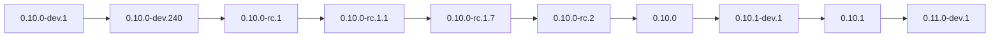
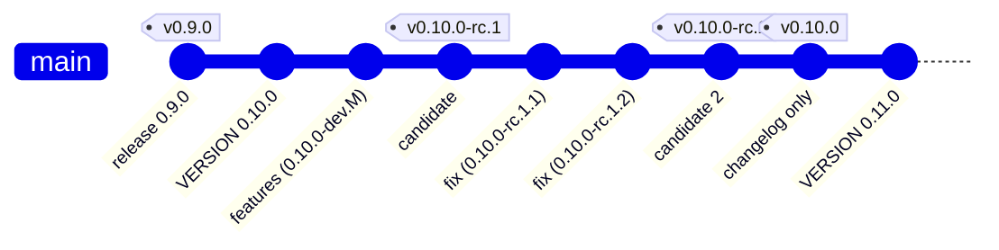
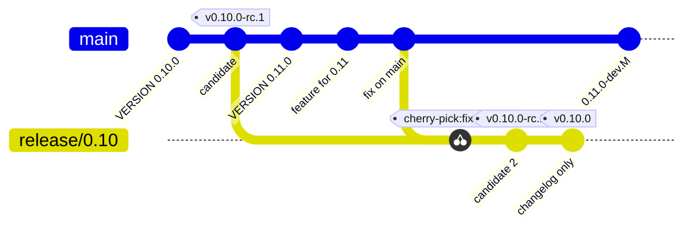
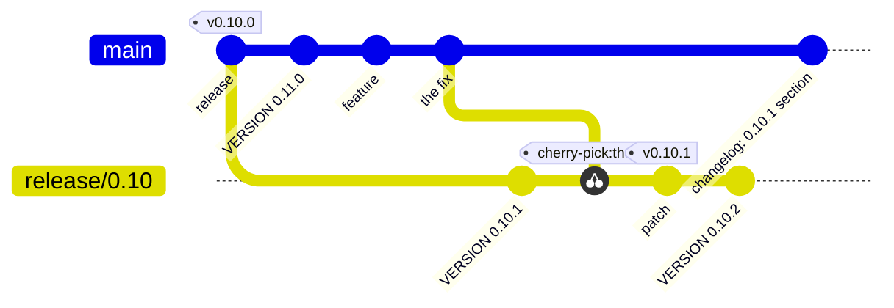
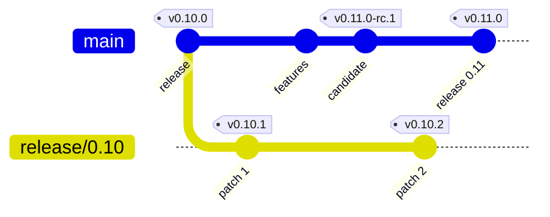

# ADR-0001: One versioning scheme for every QAROS repository

- **Status:** accepted
- **Date:** 2026-11-15
- **Applies to:** the QAROS product and SDK (this repository and the product repository that builds
  it), and every QAROS app and plugin repository: `qaros-blender`, `qaros-rerun`,
  `qaros-ros-rviz`, `qaros-ogre`, `qaros-qt`, `qaros-slicer`, `qaros-webapps`. Each repository has
  its own version number; all of them follow these rules.

## Context

- QAROS and its apps each publish releases. Each one ran its own small scheme.
- Builds made after a release candidate reported `X.Y.Z-dev.N`, which sorts *below* the
  candidate. Every version comparison (setup upgrades, update offers, minimum-version checks)
  then took a newer build for an older one.
- There was no way to ship a fix for the released version while the next minor was in
  development.

## Decision

### Numbers

- [Semantic Versioning 2.0](https://semver.org/spec/v2.0.0.html): `MAJOR.MINOR.PATCH`, with
  pre-release identifiers ordered by SemVer's precedence rules.
- `MINOR` is a feature release. It tries not to break users. When it must, the changelog lists
  the change under **Breaking**, with its migration step.
- `PATCH` only fixes. It never adds a feature, never breaks, and never changes a protocol.
- A version bump made only to test an update raises `MINOR`, never `PATCH`.

### The version file and tags

- Each branch has a `VERSION` file holding the **next planned** `X.Y.Z` of that branch. A human
  edits it, once per release.
- Releases are git tags on the release commit: `vX.Y.Z` for a release, `vX.Y.Z-rc.N` for a
  release candidate. A tag's `X.Y.Z` must equal `VERSION`; a build of a commit where they differ
  fails.
- A published tag never moves and is never deleted. A mistake gets the next number.

### What a build reports

The version is derived from git, never typed:

| The commit is | The build reports | Example |
|---|---|---|
| tagged `vX.Y.Z` | `X.Y.Z` | `0.10.0` |
| tagged `vX.Y.Z-rc.N` | `X.Y.Z-rc.N` | `0.10.0-rc.2` |
| after `vX.Y.Z-rc.N`, `M` commits later, `X.Y.Z` still unreleased | `X.Y.Z-rc.N.M+<sha>` | `0.10.0-rc.1.3+1a2b3c4d` |
| anything else, `M` commits after the last tag | `X.Y.Z-dev.M+<sha>` | `0.10.0-dev.14+1a2b3c4d` |

- "The last tag" is the nearest `v*` tag the commit descends from.
- Build metadata after `+` (the commit, a flavour such as `demo`) never takes part in ordering.
- One version line, in SemVer order:

- `dev` sorts before `rc` (alphabetical), so every development build precedes the first
  candidate. `rc.N.M` has more identifiers than `rc.N`, so it sorts after `rc.N` and before
  `rc.N+1`.
- Platforms that take only numbers (Windows file versions, Android `versionCode`) use
  `X.Y.Z.S`, where `S` rises across the builds of one `X.Y.Z`:
  - development builds: `0`;
  - `rc.N`, and every build after it until `rc.N+1`: `N`;
  - the release: `99`.

  Builds that share `S` are told apart only by the full SemVer string, except on Android.
- The Android `versionCode` must rise with every build, or a later build will not install over an
  earlier one. It is `major*1e8 + minor*1e6 + patch*1e4 + S*100 + min(commits, 99)`, where
  `commits` counts the commits since the last tag (`0` on a tag):

  | Build | versionCode |
  |---|---|
  | 12 commits after `v0.10.0`, `VERSION` 0.10.1 | 10010012 |
  | `v0.10.0-rc.4` | 10000400 |
  | 12 commits after `v0.10.0-rc.4` | 10000412 |
  | `v0.10.0` | 10009900 |

  `major` is at most 20 and `minor` and `patch` at most 99, which keeps the code under Android's
  limit of 2100000000. Past 99 commits after a tag, builds share a code until the next tag.
- Minimum-version checks (an app's `min_qaros_version`, for example) compare the `X.Y.Z` core. A
  development build or a candidate of `X.Y.Z` counts as `X.Y.Z`, so it can be tested with the
  apps that require it.

### Branches

| Branch | `VERSION` | Takes | Lives |
|---|---|---|---|
| `main` | the next minor, `X.(Y+1).0` | everything | always |
| `release/X.Y` | the next patch, `X.Y.(Z+1)` | fixes only | from when it is cut until `vX.(Y+1).0` is released |

- `release/X.Y` is cut the first time `main` must take something `X.Y` must not ship:
  - during the candidates, from the newest `vX.Y.0-rc.N` tag: `main` moves on to the next minor
    and the candidates continue on the branch;
  - after the release, from `vX.Y.0`, when the first patch is needed.

  Until then, candidates and the release are tagged on `main`, and no branch exists.
- A fix lands on `main` first, then is cherry-picked to `release/X.Y` (`git cherry-pick -x`).
  A fix for code that `main` no longer has lands only on the release branch, and its changelog
  entry says why.
- Only one older line is supported: `release/X.Y` gets patches until `vX.(Y+1).0` is released,
  then it is frozen. From then on, a fix needs the user to update to `X.(Y+1)`.
- Because of that rule, the newest final release is always the highest version. A GitHub release
  for a candidate is marked **pre-release**; a final release is marked **latest**.

### Changelogs

- Every change adds its entry under `Unreleased` in the same commit.
- A release moves `Unreleased` to `## [X.Y.Z] - <date>`.
- A patch released from `release/X.Y` also adds its `## [X.Y.Z]` section to `main`'s changelog,
  in version order, so the newest changelog lists every release.

## Situations and how to resolve them

### 1. A normal minor cycle

`VERSION` goes to `0.10.0` right after `v0.9.0`. Candidates and the release are tagged on `main`;
no branch is needed.

- Testers install `rc.1`. Fixes merged after it report `0.10.0-rc.1.M` and update an `rc.1`
  install, because they sort above it.
- When a batch of fixes is ready for testers, tag `rc.2`.
- The release commit changes only the changelogs. The released source is then the source testers
  verified.

### 2. A fix is merged while a candidate is out

- **What happens:** the build reports `0.10.0-rc.1.1+<sha>`. It is newer than `rc.1` and older
  than `rc.2`, so every update check orders it correctly.
- **Resolve:** nothing to do. Tag `rc.2` when the fixes should reach every tester. Do not move
  `rc.1`.

### 3. A feature for the next minor must merge while the candidates continue

- **What happens:** merging it on `main` would ship it in the next candidate of `0.10.0`.
- **Resolve:** cut `release/0.10` from the newest candidate tag. Set `main`'s `VERSION` to
  `0.11.0` and merge the feature there. The candidates continue on the branch, which gets fixes
  only.

- If the feature was already merged before anyone noticed, revert it on `main` before the next
  candidate and merge it again after the branch is cut. A candidate must never carry a feature
  the release will not have.

### 4. A bug in the released version while the next minor is in development

- **What happens:** `0.10.0` is out, `main` builds `0.11.0-dev.M`, and users need a fix now.
- **Resolve:**
  1. Fix on `main`.
  2. Cut `release/0.10` from `v0.10.0` and set its `VERSION` to `0.10.1`.
  3. Cherry-pick the fix. Tag `v0.10.1-rc.1` when it needs testing, then `v0.10.1`.
  4. Set the branch's `VERSION` to `0.10.2`.
  5. Add the `## [0.10.1]` section to `main`'s changelog.

- `0.10.1` is a final release and higher than every earlier final release, so it is the
  **latest** release. `0.11.0` candidates are pre-releases and never displace it.

### 5. The bug exists only on the older line

- **What happens:** `main` rewrote the code, so the fix does not apply there.
- **Resolve:** commit the fix only on `release/0.10`. Its changelog entry states that `0.11` is not
  affected and why.

### 6. A fix is wanted for a line that is no longer supported

- **What happens:** `0.11.0` is released, and someone asks for `0.10.3`.
- **Resolve:** `release/0.10` is frozen. Fix on `main` (and on `release/0.11` if it exists), and the
  user updates to `0.11.x`.

### 7. A tag that does not match `VERSION`

- **What happens:** `v0.10.1` was tagged on `main`, where `VERSION` is `0.11.0`. The build stops
  with "tag does not match VERSION".
- **Resolve:**
  - If the tag was never pushed, delete it locally and tag the right commit on `release/0.10`.
  - If it was pushed but no release was published from it, delete it on the remote too.
  - If a release was published, leave the tag. Publish the fix as the next number from the right
    branch, and mark the wrong release as withdrawn in its notes.

### 8. A candidate or release was tagged on the wrong commit

- **What happens:** `v0.10.0-rc.2` points at a commit without the intended fix.
- **Resolve:** never move the tag. Tag `v0.10.0-rc.3` on the right commit. For a final release, do
  the same with the next patch, `v0.10.1`.

### 9. A patch release and the next minor's candidates at the same time

- **What happens:** `release/0.10` releases `0.10.2` while `main` has tagged `v0.11.0-rc.1`.
- **Resolve:** nothing special.

  | Version | GitHub release | Gets |
  |---|---|---|
  | `0.10.2` | latest | users on the release line |
  | `0.11.0-rc.1` | pre-release | testers |

  Once `v0.11.0` is out, `release/0.10` is frozen (situation 6).

### 10. An app needs a QAROS that is still a candidate

- **What happens:** an app release requires `min_qaros_version` `0.10.0`, and a tester runs
  `0.10.0-rc.1.4`.
- **Resolve:** nothing to do. Minimum-version checks compare the `X.Y.Z` core, so the candidate
  counts as `0.10.0` and the app installs. Users of `0.9.x` are told the app needs `0.10.0`.

## Consequences

- Every build of a line sorts in the order it was made, so update offers, setup upgrades and
  version checks never step backwards.
- One older line gets fixes for as long as the next minor is in development, and no longer.
  Maintaining it costs a cherry-pick per fix.
- Repositories that publish with a different scheme today move to this one at their next release.
  Their tools that order releases must then use SemVer precedence.
