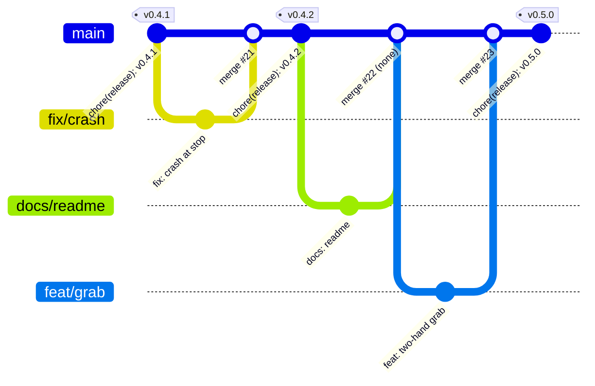
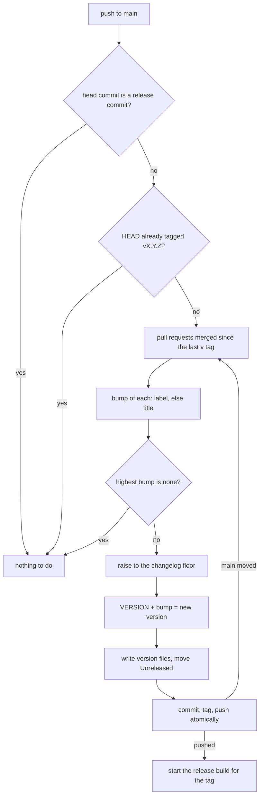

# ADR-0002: QAROS apps release on every merge that changes behaviour

- **Status:** accepted
- **Date:** 2026-11-16
- **Refines:** [ADR-0001](0001-one-versioning-scheme.md), for the app and plugin repositories only
- **Applies to:** `qaros-blender`, `qaros-rerun`, `qaros-ros-rviz`, `qaros-ogre`, `qaros-qt`,
  `qaros-slicer`. Not to this repository or the QAROS product, which keep ADR-0001 unchanged
  (candidates, `release/X.Y` branches), and not to `qaros-webapps`, which versions each adaptation
  on its own.

## Context

- The apps are small and change in small steps. Under ADR-0001 a release needs a person to
  move the changelog, tag, and then bump `VERSION` to the next planned version. Fixes waited on
  `main` for days because nobody made that release.
- "The next planned version" is a guess: whether the next release is a minor or a patch depends
  on what merges next.
- Every pull request already says what it is: its title is a Conventional Commit (`feat:`,
  `fix:`, `docs:` ...).

## Decision

### Every merge that changes behaviour is a release

When a pull request merges to `main`, CI decides its bump, and when the bump is not *none* it
releases at once:

1. writes the new version into `VERSION` and every file that carries it (`Cargo.toml`,
   `package.xml`, `bl_info`, `CMakeLists.txt` ...);
2. moves the changelog's `Unreleased` entries under `## [X.Y.Z] - <date>`;
3. commits that as `chore(release): vX.Y.Z` (author `github-actions[bot]`), tags the commit
   `vX.Y.Z`, and pushes both;
4. starts the repository's release build for the tag (or, for a repository without one,
   publishes a GitHub release with the changelog section as its notes).

A merge whose bump is *none* (documentation, CI, tests) releases nothing; its changes ship with
the next release.

### The bump

A label on the pull request wins; without one, the title decides.

| Label | Title (Conventional Commit) | Bump | From `0.4.1` | From `1.4.1` |
|---|---|---|---|---|
| `release:major` | | major | `1.0.0` | `2.0.0` |
| | `feat!: ...`, `fix(x)!: ...`, or `BREAKING` in the title | breaking: major, minor below 1.0.0 | `0.5.0` | `2.0.0` |
| `release:minor` | `feat: ...` | minor | `0.5.0` | `1.5.0` |
| `release:patch` | `fix: ...`, `perf: ...`, `revert: ...` | patch | `0.4.2` | `1.4.2` |
| `release:none` | `docs`, `ci`, `chore`, `test`, `refactor`, `style`, `build` | none | none | none |

- A check on every pull request (**Release bump**) fails when the title is not a Conventional
  Commit of a known type and no `release:*` label is set, or when two `release:*` labels are set.
  It shows the version that merging releases, and warns when a releasing pull request leaves the
  changelog unchanged.
- The release ships every `Unreleased` entry, so the changelog sets a floor: `Breaking` or
  `Removed` entries make it at least a breaking bump, `Features`, `Added`, `Enhancements`,
  `Changed` or `Deprecated` at least a minor, `Bug fixes`, `Fixed` or `Security` at least a
  patch. The floor applies only when the merge releases at all.
- `1.0.0` comes only from the `release:major` label: a breaking title below 1.0.0 is a minor.

### `VERSION` is the last release

ADR-0001 has `VERSION` hold the next planned version. In an app repository it holds **the version
of the last release on `main`**, and changes only in a release commit.

- The tag `vX.Y.Z` is on the release commit, whose `VERSION` is `X.Y.Z`; a tag whose `X.Y.Z`
  differs from `VERSION` still fails the build. A tag never moves.
- Before the first release `VERSION` is `0.0.0`.
- A build of any other commit reports the **next patch** as its development version, so it sorts
  after the release it builds on and before the next one, whatever that turns out to be:

| The commit is | `VERSION` | The build reports |
|---|---|---|
| the release commit, tagged `v0.5.0` | `0.5.0` | `0.5.0` |
| 3 commits after `v0.5.0` | `0.5.0` | `0.5.1-dev.3+1a2b3c4d` |
| pull request 12, built before merging | `0.5.0` | `0.5.1-pr.12` |
| the next release commit (a `feat`), tagged `v0.6.0` | `0.6.0` | `0.6.0` |

### No candidates, no release branches

- App repositories tag no `vX.Y.Z-rc.N`. A change is tried before it merges, from the pull
  request's build (`X.Y.(Z+1)-pr.N`), which every update check orders below the release it
  becomes.
- To merge without releasing (several pull requests that only make sense together), label them
  `release:none`; the next releasing merge ships them all, its bump raised by their changelog
  entries.
- Only the latest release is supported. A fix for an older version is the next release of `main`.

### Safe to run

- The release runs on every push to `main`, one run at a time per repository. It looks at every
  pull request merged since the last `v*` tag, so a run that GitHub skipped or cancelled is made
  up by the next one, which releases both merges in one version.
- If `main` moves while a run releases, the push is rejected (the commit and tag are pushed
  atomically) and the run starts again from the new `main`.
- A run on a commit that already has a release tag does nothing, and the release commit's own
  push skips the workflow, so it never loops.
- The run pushes with the workflow's token. When `main` is protected against it, the repository
  needs the secret `QAROS_RELEASE_TOKEN` (a GitHub App installation token or a fine-grained
  token with Contents read and write that may bypass the rules of `main`); without it the run
  fails and says so.

### Where it lives

- The logic is one script and one reusable workflow in this repository:
  `.github/app-release/app_release.py` and `.github/workflows/app-release.yml`.
- Each app repository has a caller workflow `.github/workflows/app-release.yml` and
  `.github/app-release.json`, which lists the files that carry the version, the changelog, and
  how the release build is started.

## Examples

### A fix, a documentation change and a feature

| Merge | Bump | `main` builds report | Release |
|---|---|---|---|
| #21 `fix: crash at stop` | patch | `0.4.2` | `v0.4.2` |
| #22 `docs: readme` | none | `0.4.3-dev.1+…` | none |
| #23 `feat: two-hand grab` | minor | `0.5.0` | `v0.5.0` (also ships #22) |

### Two merges close together

#24 (`fix`) and #25 (`feat`) merge within seconds. The run for #24 starts; the run for #25 waits
for it.

- If the run for #24 pushes first, it releases `v0.5.1`; the run for #25 then releases `v0.6.0`.
- If #25 lands before the run for #24 pushes, that push is rejected; the run starts again, sees
  both pull requests since `v0.5.0` and releases `v0.6.0`. The run for #25 then finds `main`
  released and does nothing.

### How a run decides

## Situations

1. **A pull request merged with a wrong title** (`Update stuff`): the check failed but it was
   merged anyway. It releases nothing; the run's summary says why. Merge a follow-up with the
   right `release:*` label, or the next releasing merge ships it.
2. **The release build failed** after the tag was pushed: fix the build on `main`. Rerun the
   release workflow for the tag (`workflow_dispatch` with the tag) if the fix was in CI only;
   otherwise the fix's own merge releases the next version. The failed tag stays.
3. **A released version is broken:** never move or delete its tag. Merge the fix; it releases the
   next patch.
4. **`VERSION` disagrees with the last tag** (someone edited it by hand): the run fails with
   "VERSION must hold the version of the last release". Set it back in a pull request labelled
   `release:none`.
5. **A breaking change below 1.0.0:** `feat!:` releases the next minor, with a `Breaking` changelog
   entry and its migration step, as ADR-0001 requires.

## Consequences

- Every behaviour change reaches users as soon as it merges, and the version says what kind of
  change it was.
- `main` has one bot commit per release. It changes only version files and the changelog.
- A pull request's title is part of the release: the check makes the author choose before
  merging.
- Testing before a release happens on pull request builds, since app repositories have no
  candidates.
