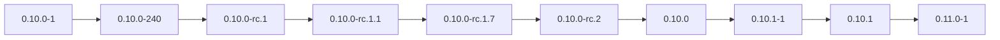

# ADR-0003: An untagged build is X.Y.Z-commits+sha

- **Status:** accepted
- **Date:** 2026-11-16
- **Supersedes:** the untagged row of [ADR-0001](0001-one-versioning-scheme.md)
  (`X.Y.Z-dev.M+<sha>`) and the same form in [ADR-0002](0002-app-release-on-merge.md)'s
  examples. Everything else in both stands.

## Context

- Builds that are neither a release nor a release candidate reach users: testers' setups, the
  players on their headsets, the About box. `dev` in the version reads as a developer build.
- Every program that compares QAROS versions uses SemVer precedence, in which build metadata
  after `+` does not count. A version made only of metadata (`0.10.1+34.1a2b3c4d`) would compare
  equal to the release `0.10.1` and above its candidates.

## Decision

| The commit is | The build reports | Example |
|---|---|---|
| anything else, `M` commits after the last tag | `X.Y.Z-M+<sha>` | `0.10.0-14+1a2b3c4d` |

- The pre-release is the bare commit count. SemVer sorts a numeric identifier below any
  alphanumeric one, so the build order is unchanged:

- Tagged releases, tagged candidates and builds after a candidate (`X.Y.Z-rc.N.M+<sha>`) are
  unchanged.

## Consequences

- No version a user sees says `dev`, and every SemVer comparison orders builds as before.
- A program that looked for `-dev` in a version recognises such a build by a pre-release that
  starts with a digit. Versions made before this change keep `-dev.M`; they sort below the
  candidates as well.

## Rejected

| Alternative | Why not |
|---|---|
| Build metadata only, `X.Y.Z+M.<sha>` | Compares equal to the release and above its candidates |
| Keep `X.Y.Z-dev.M` | The version users see says `dev` |
