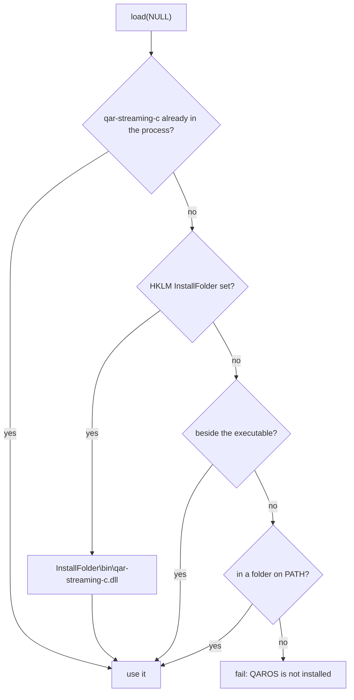

# Authoring a Language Binding

A QAROS binding is a thin layer over the C ABI of `qar-streaming-c`
([Language Bindings](/docs/developer-guide/language-bindings)). The C header (`qar_streaming.h`) and
the C# binding (`Quaternar.Qaros`) are the reference implementations. A new binding (Rust, Python,
…) follows the same rules, so an application behaves the same whichever language it is written in.

## Loading the runtime

The runtime is one shared library, `qar-streaming-c.dll` (Linux: `libqar-streaming-c.so`). A
binding loads it at run time and never links it. Distributed applications run against the QAROS
installed on the PC and never ship a copy of the runtime.

### The default lookup

Called with no path, the load takes the **first** match:

| Step | Where | Notes |
|---|---|---|
| 1 | A `qar-streaming-c` already loaded in the process | A host (a game engine, a plug-in host) or another binding loaded it first. Take it, and take a reference so that unloading stays balanced. |
| 2 | The installed QAROS: `<InstallFolder>\bin\qar-streaming-c.dll` | `InstallFolder` is the value under `HKLM\SOFTWARE\Quaternar\QAROS`. Read `HKLM` only, never `HKCU`, which every process of the user can write. **When QAROS is installed, only this copy is used:** if it is missing or fails to load, report that and stop. |
| 3 | Beside the running executable | The folder of the process's executable (`GetModuleFileNameW(NULL)`). A managed binding also checks the application's base directory, because `dotnet app.dll` runs from `dotnet.exe`. Covers an unpacked development ZIP and an app built into a QAROS tree. |
| 4 | Each folder on `PATH`, in order | Linux: the dynamic linker's own search (`LD_LIBRARY_PATH`, runpath, the ld.so cache). |

- **Never search the current directory.** A library planted there would be loaded.
- **Load every candidate from its absolute path.** Resolve its dependencies from the library's own
  folder and System32 only, never from the application's folder:
  `LoadLibraryExW(path, NULL, LOAD_LIBRARY_SEARCH_DLL_LOAD_DIR | LOAD_LIBRARY_SEARCH_SYSTEM32)`.
- **Do not change the process's search path.** No `SetDllDirectory`, no `PATH` edits: they change
  how every later library of the host process is found.
- **Nothing found:** fail with a result whose message says QAROS is not installed and where the
  library was looked for. Never let a missing library surface later as a crash or a loader
  exception.

### An explicit path

- The binding also accepts the path of the library **file**. Only that file is tried, with no
  fallback, using the same `LoadLibraryExW` flags.
- Explicit paths are for development builds of QAROS itself. A distributed application uses the
  default lookup.

### After loading

- Leave `QarRuntimeInit::runtime_binaries_folder_path` empty. The runtime then uses the folder it
  was loaded from, which is where it finds `qar-runtime-launcher` and its other processes.
- Expose the installed `bin` folder for diagnostics (C: `qar_installed_bin_folder`, C#:
  `InstalledRuntime.TryGetBinFolder`), and the path actually loaded (C#:
  `InstalledRuntime.LoadedLibraryPath`).

### Reference implementations

| Binding | Default lookup | Explicit path |
|---|---|---|
| C | `qar_library_load(NULL)` in `qar_streaming.h` | `qar_library_load(path)` |
| C# | `InstalledRuntime.Load()`, called by `Library.Init` | `InstalledRuntime.Load(path)` |

The [Vulkan cube example](https://github.com/Quaternar/qaros/tree/main/qar-streaming-c/examples/vulkan_cube/main.cpp)
shows the application side: it calls `qar_library_load(NULL)` and does no searching of its own.

## Binding the C ABI

- **Symbols:** resolve the exported `qar_impl_<name>` functions by name. Loading is all or nothing:
  if one symbol is missing, unload the library and fail, so a half-bound API is never observable.
- **Stability:** the ABI only grows. Functions are appended and never change their signature, and
  structs grow through their extension chain. A binding built against an older header keeps
  working with a newer runtime.
- **Init structs** start with a `{type, next}` header. Fill each one exactly as the header's
  `qar_<struct>_default()` does: the type tag and the default values.
- **Extensions** are chained through `header.next`. Keep a chain alive for the whole call that
  reads it.
- **Results** are returned by value (`QarResult`). Map them to the language's result type rather
  than throwing for expected failures, and keep the status code and message.
- **Strings and paths** are UTF-8 in both directions. Never use the platform's ANSI code page.
- **Handles:** each one has its `qar_<type>_handle_destroy`. Tie it to the language's lifetime
  mechanism (RAII, `IDisposable`, `Drop`).
- **Callbacks** run on library threads. Hand their data to the application's thread; never call
  back into a UI toolkit from them.

## Checklist for a new binding

- [ ] The default lookup follows steps 1–4 above, in that order. An installed QAROS is the only
  copy considered when it exists.
- [ ] The explicit path loads only that file.
- [ ] Candidates load from their absolute path, with dependencies from their own folder and
  System32. The current directory is never searched, and the process search path is never
  changed.
- [ ] A missing runtime is a result with a "QAROS is not installed" message, not a crash.
- [ ] `runtime_binaries_folder_path` is left empty by default.
- [ ] Every symbol resolves at load, or the load fails as a whole.
- [ ] Strings are UTF-8, results are values, handles are released, callbacks are marshalled.
