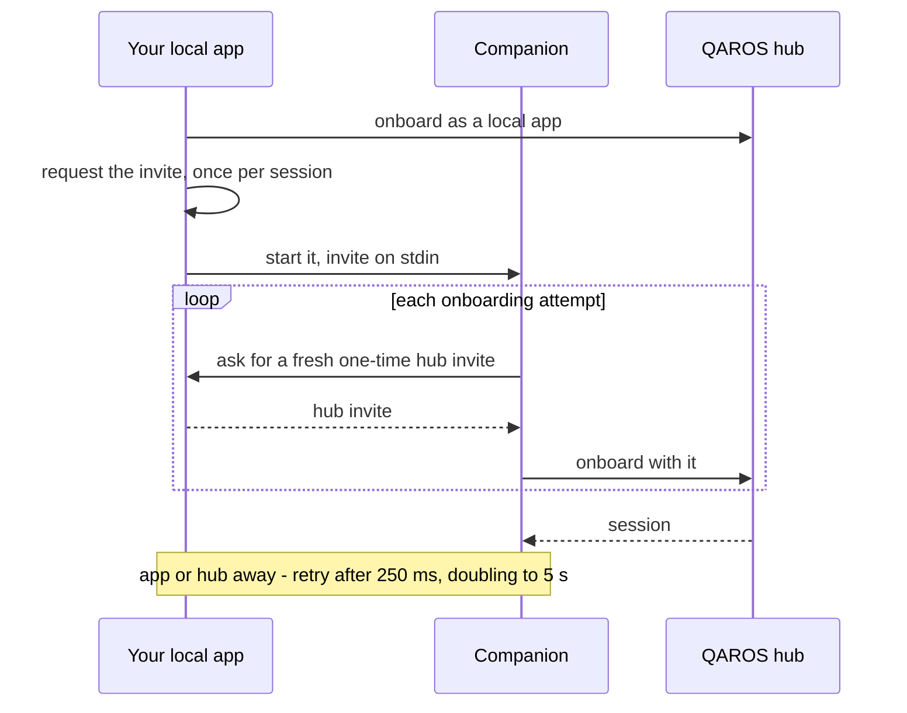

import CodeTabs, { Lang } from '@site/src/components/CodeTabs';
import LanguageSwitcher from '@site/src/components/LanguageSwitcher';

# Onboarding and Sessions

<LanguageSwitcher />

In QAROS you never "create" or "join" a session directly: **every session is obtained through onboarding**, in one of three ways. Which one fits your app is on [Choosing an Onboarding Mode](/docs/developer-guide/onboarding); this page is the API reference.

| # | Your app runs | Mode | The user does |
|---|---|---|---|
| 1 | on the PC where QAROS is installed | [local app](#local-app-on-the-qaros-pc-no-code) (`QarOnboardLocalAppExt`), with [app tags](#app-tags-telling-instances-apart) | clicks **Allow** once in QAROS |
| 2 | as a process your local app starts | [companion](#co-process-a-process-your-app-starts) (`QarOnboardInviteExt` with an invite from your app) | nothing |
| 3 | on another PC that runs QAROS | [remote app through a member hub](#remote-app-through-a-member-hub) (`QarOnboardRemoteAppGrantExt`) | nothing; the operator allows the granting app once |

- Nothing is persisted in any mode: the onboarding id stays zero and every start onboards again.
- After onboarding, [the session follows its hub](#when-the-hubs-session-changes) through a new session or a join to another hub; only a hub that no longer admits the app requires onboarding again.
- An app cannot obtain credentials for an arbitrary PC or a new device ([What apps cannot do](#what-apps-cannot-do)). The security behind these calls is described in [Security Model](/docs/operator-guide/security-model); the API hides it.

## Local app: on the QAROS PC, no code

Chain `QarOnboardLocalAppExt` as the only mode extension of `qar_runtime_onboard` (or `_async`). Windows only; elsewhere the call returns `QAR_STATUS_NOT_IMPLEMENTED`.

<CodeTabs>
<Lang value="c">

```c
static void on_progress(QarActionSeverity severity, float percent,
                        const char* message, void* state)
{
    printf("%s\n", message); /* "Waiting for approval in QAROS hub" */
}

QarOnboardInit init = qar_onboard_init_default();
QarOnboardLocalAppExt local = qar_onboard_local_app_ext_default();
init.presentation.display_name = "Vendor Capture";
init.header.next = &local.header;

QarOnboardingId unused = qar_onboarding_id_default(); /* stays zero */
QarSession* session = NULL;
QarResult r = qar_runtime_onboard(runtime, &init, on_progress, NULL,
                                  cancel, &unused, &session);
```

</Lang>
<Lang value="csharp">

```csharp
var who = new PeerPresentationOptions { DisplayName = "Vendor Capture" };
var onboard = runtime.Onboard(new OnboardOptions().WithPresentation(who).UseLocalApp());
if (onboard.IsSuccess)
{
    using Session session = onboard.Value.Session;
    // ...
}
```

</Lang>
<Lang value="rust">

{/* Generated by cargo xtask guide from examples/guide/onboarding-and-sessions.md of the Rust binding. Edit that file, not this tab. */}

`OnboardMethod::LocalApp` waits for the Allow in the hub, at most `approval_timeout` (`None`: the hub's default). Progress reports arrive on the channel while the call blocks.

```rust
let (progress, reports) = mpsc::channel::<Progress>();
let printer = std::thread::spawn(move || {
    for report in reports {
        println!("{}", report.message); // "Waiting for approval in QAROS hub"
    }
});

let presentation = PeerPresentation {
    display_name: Some("Vendor Capture".to_string()),
    ..PeerPresentation::default()
};
let joined = runtime.onboard(
    &OnboardMethod::LocalApp {
        approval_timeout: None,
        app_tag: None, // the default tag; see "App tags"
    },
    &presentation,
    &BlockingOptions {
        progress: Some(progress),
        cancel: Some(cancel),
    },
);
let _ = printer.join(); // the channel closes when the call returns

// Nothing to persist: every start onboards as a local app again.
let session = joined?.session;
```

</Lang>
</CodeTabs>

- **Every start calls onboard.** Nothing is written to disk and the onboarding id stays zero; `qar_runtime_rejoin` and `qar_runtime_forget` do not apply.
- **Load the installed runtime** (`qar_library_load(NULL)`). The hub refuses a runtime of another version or flavor, such as a private copy shipped with your app (`QAR_STATUS_ONBOARDING_FAILED`, with the reason in the message).
- **The only mode extension.** Any other mode extension next to it fails with `QAR_STATUS_ARGUMENT_NOT_SUPPORTED`. A `QarOnboardLocalAppTagExt` ([app tags](#app-tags-telling-instances-apart)) and a `QarGraphicsDeviceId` ([Choosing the GPU](#choosing-the-gpu)) or a `QarGraphicsDeviceDisabledExt` ([A session without a graphics device](#a-session-without-a-graphics-device)) may be chained.
- **Credentials live in memory only.** Each start gets a fresh key and a 30-minute certificate; the runtime renews it in the background.
- **The peer id survives a restart.** The hub remembers it per approval and [app tag](#app-tags-telling-instances-apart) and picks it; your app cannot choose it.
- Pass a `QarCancelToken` and cancel it when your user quits: the call can wait minutes for the approval.
- Compiled tutorial: [Local App Onboarding](/docs/developer-guide/tutorials/c/local-app-onboarding).

### App tags: telling instances apart

Several instances of one approved app (a left and a right view, one process per document) share one approval. Chain a `QarOnboardLocalAppTagExt` after `QarOnboardLocalAppExt` to give each instance its own tag, and with it its own peer id:

<CodeTabs>
<Lang value="c">

```c
QarOnboardLocalAppExt local = qar_onboard_local_app_ext_default();
QarOnboardLocalAppTagExt tag = qar_onboard_local_app_tag_ext_default();
tag.app_tag = "left.terraexplorer.skyline";
init.presentation.display_name = "TerraExplorer – left view"; /* any UTF-8 */
init.header.next = &local.header;
local.header.next = &tag.header;
```

</Lang>
<Lang value="csharp">

```csharp
var who = new PeerPresentationOptions { DisplayName = "TerraExplorer – left view" };
var onboard = runtime.Onboard(new OnboardOptions()
    .WithPresentation(who)
    .UseLocalApp(new OnboardLocalApp { Tag = "left.terraexplorer.skyline" }));
```

</Lang>
<Lang value="rust">

{/* Generated by cargo xtask guide from examples/guide/onboarding-and-sessions.md of the Rust binding. Edit that file, not this tab. */}

`app_tag` is chained after the mode extension. An invalid tag fails with `StatusCode::ARGUMENT_NOT_SUPPORTED`; an interior NUL fails with `Error::InvalidArgument` before the call.

```rust
let who = PeerPresentation {
    display_name: Some("TerraExplorer – left view".to_string()), // any UTF-8
    ..PeerPresentation::default()
};
let onboarded = runtime.onboard(
    &OnboardMethod::LocalApp {
        approval_timeout: None,
        app_tag: Some("left.terraexplorer.skyline"),
    },
    &who,
    &BlockingOptions::default(),
)?;
```

</Lang>
</CodeTabs>

- **An identity key, like the common name of an app volume.** Printable ASCII (0x20-0x7E), no space at either end, at most 256 bytes (`QAR_MAX_APP_TAG_LENGTH`), compared exactly. The prefix `member/` is reserved for the hub. Anything else fails with `QAR_STATUS_ARGUMENT_NOT_SUPPORTED` (C# `OnboardLocalApp.Tag` throws `ArgumentException`). Text for people, any UTF-8, goes in `display_name`.
- **Keep it constant across versions** of your app: a new tag is a new peer. A DNS-style name scoped by your app is recommended, such as `left.terraexplorer.skyline`.
- **No tag is the default tag**, remembered the same way. An app that runs one instance needs none.
- **Same tag, two live instances:** both run; the second gets a one-off peer id that is not remembered. Give instances that run together distinct tags.
- **Restart right after a crash:** a crashed app announces no leave, so the session shows its peer for a few more seconds. A start in that window gets a one-off peer id; the next start after the old peer is gone gets the remembered one back.
- The hub keeps at most **64 tags per approval**, dropping the least recently used first, and forgets a tag unused for **30 days**. Revoking the app's approval forgets all of them.
- A tag is not a secret and not a permission: it only selects among the peer ids of your app's own approval.
- Only with `QarOnboardLocalAppExt`; with any other mode it fails with `QAR_STATUS_ARGUMENT_NOT_SUPPORTED`. A runtime older than the tag skips the extension and joins with the default tag: check `qar_runtime_info` before relying on it.

### Several API instances in one process

A process that uses QAROS from more than one place (native code and a C# plug-in, two libraries) onboards as a local app in each. A second onboard with the same tag in the same process returns a **new handle to the same session**: one approval, one peer, one enrollment.

- One session per hub and tag in the process: the key is the hub the onboard enrolls with and the app tag.
- Each handle is released on its own with `qar_session_handle_destroy` (C# `Dispose`); the session ends when the last one is released.
- Onboards with different tags are different peers, each with a session of its own.
- An onboard while another one with the same tag is still waiting for its approval waits for it, at most the approval timeout plus 2 minutes, then fails with `QAR_STATUS_TIMEOUT`. If that first enrollment fails, the waiting onboard enrolls on its own.
- A session whose renewal the hub refused (for example after the operator revoked the app) stays shared until its last handle is released. Release every handle, then onboard again.
- No invite is involved and nothing is written to disk.
- The first onboard's presentation and `QarGraphicsDeviceId` (or `QarGraphicsDeviceDisabledExt`) win; a sharing onboard applies neither, reports one INFO progress message and returns the zero onboarding id.
- Compiled tutorial: [Several API Instances in One Process](/docs/developer-guide/tutorials/c/api-instances-in-one-process).

### The approval prompt

```text
app ──onboard──> QAROS identifies the process from Windows (path, file hash, signature, user)
                   │
       approved before and unchanged? ──yes──> session ✓ (no prompt)
                   │ no
       "Allow <app> to join QAROS?" in the Visualizer and as a tray window
                   │
       Allow ──> trust record saved, session ✓
       Deny / closed / no answer ──> error, nothing saved
```

- The prompt shows only what Windows says about your app: publisher, product, executable, path, signature. Your `display_name` appears separately, labelled "App says:".
- **Deny** is the default button. **Allow** is disabled for one second, then takes a mouse click or an accessibility Invoke (UI Automation); no key ever presses it. A program running as the same Windows user can Invoke it too. Closing the prompt counts as Deny.
- The prompt waits `approval_timeout_ms`; 0 means the hub default of **120 s**. The hub caps longer waits at 10 minutes.
- While it waits, the progress callback reports `Waiting for approval in QAROS hub`. The prompt opens in front of every window, your app's included, so the user sees it even with the Visualizer closed.
- A second start of the same app while the prompt is open waits for the same prompt.

### The trust record

**Allow** saves a trust record on the hub. Which rule it holds depends on whether your executable is code-signed:

| Your executable | Record matches | Rebuilt or updated in place | Moved or copied elsewhere |
|---|---|---|---|
| **Authenticode-signed** | signer, product name, original file name, install folder, path inside it | joins silently | refused (1808) |
| **unsigned** | exact path and file hash | asks again; the new approval replaces the old | refused (1808) |
| **invalid signature** | never approvable | | refused (1808) |

- Sign release builds of your app: users then approve it once, not after every update.
- During development every rebuild of an unsigned app asks again. That is expected.
- The operator lists and revokes records in the Visualizer: [Approved local apps](/docs/operator-guide/source-applications#approved-local-apps). A revoked app asks again on its next start.
- The approval is for the **process**. Approving a host executable (an editor, a game engine) admits everything it loads.

### Status codes and what to tell the user

| Status | Meaning | Tell the user | Retry |
|---|---|---|---|
| `QAR_STATUS_ONBOARDING_HUB_UNREACHABLE` (1802) | no hub answered on this machine. The join starts the hub when it does not run, so the hub could not be started or reached | "Could not start or reach QAROS on this machine. Start QAROS from the Start menu, then start this app again." | when the user says so |
| `QAR_STATUS_ONBOARDING_APPROVAL_DENIED` (1805) | the user clicked Deny or closed the prompt, or the approval was revoked | "QAROS did not allow this app." | only when the user asks |
| `QAR_STATUS_ONBOARDING_APPROVAL_TIMEOUT` (1806) | nobody answered in time | "Nobody answered the approval prompt in QAROS." | offer it |
| `QAR_STATUS_ONBOARDING_HUB_NOT_AUTHENTIC` (1807) | the program answering on this PC is not the installed QAROS | "The QAROS installation could not be verified. Reinstall QAROS or contact your administrator." | never silently |
| `QAR_STATUS_ONBOARDING_APP_IDENTITY_MISMATCH` (1808) | the app no longer matches its approval (moved, copied, re-signed, tampered) | "This app changed since it was approved. Revoke it in QAROS and start it again." | after the user revoked it |
| `QAR_STATUS_ONBOARDING_RE_PAIR_REQUIRED` (1809) | the hub no longer admits this app: its certificate expired, was revoked or is no longer renewed | "QAROS no longer admits this app. Start it again." | onboard again once |
| `QAR_STATUS_ONBOARDING_RENEWAL_POSSESSION_UNPROVEN` (1810) | the hub refused to renew the certificate because the renewal did not prove it holds the certificate's key | "This app could not renew its QAROS certificate. Update it to the current QAROS SDK." | no, update |
| `qar_library_load(NULL)` returns `false` | No runtime beside the executable, `QAR_INSTANCE` not set (or naming an instance with no runtime), QAROS not installed, and none on `PATH` | "QAROS is not installed on this PC." | no |

The bindings name the same codes. In C#: `StatusCode.OnboardingHubUnreachable`, `OnboardingApprovalDenied`, `OnboardingApprovalTimeout`, `OnboardingHubNotAuthentic`, `OnboardingAppIdentityMismatch`, `OnboardingRePairRequired`, `OnboardingRenewalPossessionUnproven`. In Rust: `StatusCode::ONBOARDING_HUB_UNREACHABLE` and the others, each the C name without its `QAR_STATUS_` prefix. The [Vulkan cube](https://github.com/Quaternar/qaros/tree/main/qar-streaming-c/examples/vulkan_cube/main.cpp) (`ExplainOnboardingFailure`) handles each of them.

### Started by QAROS

<a id="launched-by-qaros-qaros-api-apps"></a>

An operator can add your executable as a **QAROS API app** in [Source Applications](/docs/operator-guide/source-applications). QAROS then starts it, and it onboards as a local app exactly as above: same approval, no extra step; the hub gives it the peer id it planned.

| QAROS hands it | How |
|---|---|
| Arguments | command line, one per line the operator entered |
| The GPU of its target | `QAR_GPU_ADAPTER_ID`, read by the library ([Choosing the GPU](#choosing-the-gpu)); your app reads nothing |
| A stop request | stdin is a pipe QAROS closes on **Stop**; it kills the process about 1 s later |

- Prompt for nothing: nobody is at the console. On an approval timeout, exit with an error.
- Treat the end of stdin as a stop and cancel a pending onboard then.
- Create your own app volume and choose your targets ([Rendering Streams](/docs/developer-guide/rendering-streams#finding-rendering-targets)); QAROS does neither for an API app.
- An app that exits within 10 s of starting is restarted with backoff (2 s, doubling up to 60 s). The [`vulkan_cube` example](https://github.com/Quaternar/qaros/tree/main/qar-streaming-c/examples/vulkan_cube) runs the same whether a user or QAROS starts it.

## Co-process: a process your app starts

When your local app starts a **companion** in another process (a helper in another language, a sandboxed plug-in host), the companion joins with an invite your app requests from its session. The companion asks the user nothing and stores nothing.

1. Your app joins as a [local app](#local-app-on-the-qaros-pc-no-code).
2. Once per session, it calls `qar_session_request_onboarding_invite` (C# `Session.RequestOnboardingInvite`, Rust `Session::request_onboarding_invite`) with the companion's app tag, and serializes the invite.
3. It starts the companion and hands it the serialized invite over stdin or a pipe, never on the command line. Every later start of the companion gets the same bytes.
4. The companion deserializes it, creates its runtime with `QarRuntimeEphemeralStorageExt` and onboards with `QarOnboardInviteExt` (C# `UseInvite`), bounded by a cancel token.



<CodeTabs>
<Lang value="c">

```c
/* In your app (joined as a local app), once per session: */
QarRequestInviteInit req = qar_request_invite_init_default();
req.app_tag = "companion.terraexplorer.skyline"; /* required */
QarOnboardingInvite* invite = NULL;
QarResult r = qar_session_request_onboarding_invite(
    session, &req, NULL, NULL, NULL, &invite);
if (qar_result_is_error(r))
    return r; /* e.g. this session did not join as a local app */

size_t size = 0;
qar_onboarding_invite_serialized_size(invite, &size);
uint8_t* blob = malloc(size);
size_t written = 0;
qar_onboarding_invite_serialize(invite, blob, size, &written);
qar_onboarding_invite_handle_destroy(invite);
/* write `blob` to the stdin of every companion you start while the session lives;
 * when the session ends: */
memset(blob, 0, size);
free(blob);
```

```c
/* In the companion: */
QarRuntimeInit runtime_init = qar_runtime_init_default();
QarRuntimeEphemeralStorageExt ephemeral = qar_runtime_ephemeral_storage_ext_default();
runtime_init.header.next = &ephemeral.header; /* identity in memory only */
QarRuntime* runtime = NULL;
qar_runtime_create(&runtime_init, &runtime);

QarOnboardingInvite* invite = NULL;
qar_onboarding_invite_deserialize(blob, blob_size, &invite);
QarOnboardInit init = qar_onboard_init_default();
QarOnboardInviteExt invite_mode = qar_onboard_invite_ext_default();
init.presentation.display_name = "TerraExplorer companion";
invite_mode.invite = invite;
init.header.next = &invite_mode.header;

QarOnboardingId unused = qar_onboarding_id_default(); /* stays zero */
QarSession* session = NULL;
/* retries while the app or the hub is away: `cancel` bounds the wait */
qar_runtime_onboard(runtime, &init, NULL, NULL, cancel, &unused, &session);
qar_onboarding_invite_handle_destroy(invite); /* caller keeps ownership */
```

</Lang>
<Lang value="csharp">

```csharp
// In your app (joined as a local app), once per session:
using OnboardingInvite invite = session
    .RequestOnboardingInvite("companion.terraexplorer.skyline").ValueOrThrow();
byte[] blob = invite.Serialize().ValueOrThrow();
// write `blob` to the stdin of every companion you start; clear it when the session ends

// In the companion:
using var runtime = Runtime.Create(new RuntimeOptions { EphemeralStorage = true }).ValueOrThrow();
using var received = OnboardingInvite.Deserialize(blob).ValueOrThrow();
using var cts = new CancellationTokenSource(TimeSpan.FromMinutes(2)); // bounds the retries
var onboard = runtime.Onboard(new OnboardOptions().UseInvite(received), cancellationToken: cts.Token);
```

</Lang>
<Lang value="rust">

{/* Generated by cargo xtask guide from examples/guide/onboarding-and-sessions.md of the Rust binding. Edit that file, not this tab. */}

Request the invite once per session and hand the same bytes to every start of the companion. Its `onboard` retries while your app or the hub is away: bound it with `BlockingOptions::cancel`.

```rust
// In your app (joined as a local app), once per session:
let invite = session.request_onboarding_invite(
    "companion.terraexplorer.skyline",
    &BlockingOptions::default(),
)?;
let mut wire_bytes = invite.serialize()?;
drop(invite);
start_companion(&wire_bytes); // over its stdin; again on every later start of the companion
// when the session ends:
wire_bytes.fill(0);

// In the companion:
let runtime = library.create_runtime(&RuntimeConfig {
    ephemeral_storage: true, // identity in memory only
    ..RuntimeConfig::default()
})?;
let received = library.deserialize_invite(blob)?;
let who = PeerPresentation {
    display_name: Some("TerraExplorer companion".to_string()),
    ..PeerPresentation::default()
};
// Retries while the app or the hub is away (250 ms, doubling to 5 s): the token bounds it.
let cancel = library.create_cancel_token(Some(Duration::from_secs(120)))?;
let onboarded = runtime.onboard(
    &OnboardMethod::Invite(&received),
    &who,
    &BlockingOptions {
        progress: None,
        cancel: Some(&cancel),
    },
)?;
// the invite is destroyed when it drops
```

</Lang>
</CodeTabs>

| Rule | Consequence for your app |
|---|---|
| Only a session joined as a local app (or a process QAROS started) may request one | any other session gets `QAR_STATUS_ONBOARDING_INVITE_REFUSED` (C# `StatusCode.OnboardingInviteRefused`); final, nothing was minted |
| The invite names your app on this PC, not the hub | it reaches only this user on this PC: a named pipe on Windows, a Unix socket in `/run/user/<uid>/qaros` on Linux. Another PC or user cannot use it |
| It works for every start of the companion while your app's session lives, with no expiry of its own | request it once per session and reuse it; no timer, no refresh |
| Each onboarding attempt asks your app for a fresh one-time hub invite | keep your app's session alive while companions start |
| The companion retries every 250 ms, doubling to 5 s, while your app or the hub is away | make one onboard call and wait; bound it with a cancel token |
| It fails at once only for a forged invite, a denied approval, or your app's session gone | treat these as final |
| Bound to the peer id the hub remembers for your app's approval and this tag | the companion joins as the same peer on every start while no other live process holds it |
| 30-minute certificate under your app's approval, renewed only while your app is in the session | when your app leaves, the companion drops out within one certificate lifetime; revoking your app revokes both |

- **In-memory storage.** With `QarRuntimeEphemeralStorageExt` nothing is written to disk and the onboarding id is zero. A runtime older than the extension skips it and stores the identity on disk: check `qar_runtime_info` before relying on it.
- **Give the companion a tag of its own**, not one your app's instances use: a tag a live process holds gets a one-off peer id.
- **The tag is required.** A missing, empty or non-ASCII `app_tag`, or one starting with the reserved `member/`, fails with `QAR_STATUS_ARGUMENT_NOT_SUPPORTED`, as does a `QarRequestInviteInit` built from an older header ("app tag required"): rebuild against the current header.
- **The invite is a secret:** do not log it, pass it on a command line or store it on disk.
- A platform without this local endpoint gets the hub's invite instead: single use, valid for 60 s. There, request one per start.
- Compiled tutorial: [Co-Process Onboarding](/docs/developer-guide/tutorials/c/co-process-onboarding) starts itself as its companion and hands the invite over stdin.

## Remote app: through a member hub

An app on the primary hub's PC can bring **one** app on another PC into the session without an operator: it creates a member-hub invitation with a **remote-app grant**, sends it over its own channel, and the app on the other PC joins that PC's hub to the primary and onboards there as a local app.

1. On the primary's PC, an approved app with the right to bring in member hubs (granted by the operator) calls `qar_runtime_create_member_hub_invitation` with a `QarMemberHubInvitationAppGrantExt` naming the remote app's tag.
2. It serializes the invitation (`qar_member_hub_invitation_serialize`) and sends it over an encrypted, authenticated channel of its own.
3. On the other PC, the app deserializes it and calls `qar_runtime_join_hub_as_member`: the hub there joins the primary and restarts into its session.
4. The app onboards with `QarOnboardLocalAppExt` and a chained `QarOnboardRemoteAppGrantExt`. Every later start onboards as a plain local app.

<CodeTabs>
<Lang value="c">

```c
/* On the primary's PC: */
QarMemberHubInvitationInit init = qar_member_hub_invitation_init_default();
QarMemberHubInvitationAppGrantExt grant = qar_member_hub_invitation_app_grant_ext_default();
grant.app_tag = "client.my-simulation.vendor";
init.header.next = &grant.header;
QarMemberHubInvitation* invitation = NULL;
QarResult r = qar_runtime_create_member_hub_invitation(runtime, &init, NULL, &invitation);
/* serialize, send over your channel, clear and destroy */

/* On the other PC, first start: */
QarJoinHubAsMemberInit join = qar_join_hub_as_member_init_default();
join.invitation = received;
r = qar_runtime_join_hub_as_member(runtime, &join, NULL, NULL, NULL);

QarOnboardInit onboard = qar_onboard_init_default();
QarOnboardLocalAppExt local = qar_onboard_local_app_ext_default();
QarOnboardRemoteAppGrantExt redeem = qar_onboard_remote_app_grant_ext_default();
redeem.invitation = received;
onboard.header.next = &local.header;
local.header.next = &redeem.header;
r = qar_runtime_onboard(runtime, &onboard, NULL, NULL, NULL, &unused_id, &session);
```

</Lang>
<Lang value="csharp">

```csharp
// On the primary's PC:
var created = runtime.CreateMemberHubInvitation(
    new MemberHubInvitationOptions { AppTag = "client.my-simulation.vendor" });
// created.Value.Serialize(), send over your channel, clear the bytes, dispose

// On the other PC, first start:
using MemberHubInvitation received = MemberHubInvitation.Deserialize(bytes).Value;
var joined = runtime.JoinHubAsMember(new JoinHubAsMemberOptions(received));
var onboard = runtime.Onboard(new OnboardOptions()
    .UseLocalApp(new OnboardLocalApp { RemoteAppGrant = received }));
```

</Lang>
<Lang value="rust">

{/* Generated by cargo xtask guide from examples/guide/onboarding-and-sessions.md of the Rust binding. Edit that file, not this tab. */}

`MemberHubInvitationConfig::app_grant_tag` chains the grant; `OnboardExtensions::remote_app_grant` redeems it next to `OnboardMethod::LocalApp`.

```rust
// On the primary's PC:
let config = qaros::MemberHubInvitationConfig {
    app_grant_tag: Some("client.my-simulation.vendor".to_string()),
    ..qaros::MemberHubInvitationConfig::default()
};
let invitation = runtime.create_member_hub_invitation(&config, None)?;
let mut bytes = invitation.serialize()?;
send_over_your_channel(&bytes); // encrypted and authenticated; never log it
bytes.fill(0);
drop(invitation);

// On the other PC, first start:
let invitation = library.deserialize_member_hub_invitation(received)?;
runtime.join_hub_as_member(
    &invitation,
    &qaros::JoinHubAsMemberConfig::default(),
    &BlockingOptions::default(),
)?;
let onboarded = runtime.onboard_with(
    &OnboardMethod::LocalApp {
        approval_timeout: None,
        app_tag: None, // the grant's tag applies
    },
    &PeerPresentation::default(),
    &OnboardExtensions {
        remote_app_grant: Some(&invitation),
        ..OnboardExtensions::default()
    },
    &BlockingOptions::default(),
)?;
```

</Lang>
</CodeTabs>

| Rule | Consequence for your app |
|---|---|
| Only an app the primary approved with the right to bring in member hubs, with quota left, may create one | otherwise `QAR_STATUS_MEMBER_SPONSOR_NOT_ALLOWED` / `QAR_STATUS_MEMBER_SPONSOR_QUOTA_EXCEEDED`; ask the operator |
| The invitation is a signed bearer secret, valid 24 h and for one hub by default, revocable by the primary's operator | send it only over a channel you trust, never log it |
| The other PC must trust the primary (an administrator's allow-list, else the first primary it joined) | `QAR_STATUS_MEMBER_INVITATION_PRIMARY_NOT_ALLOWED` otherwise |
| Only a **member hub** redeems a grant: join first | a hub that is not a member ignores the grant, with no error of its own, and prompts its operator as for any local app (`QAR_STATUS_ONBOARDING_APPROVAL_DENIED` or `_TIMEOUT` when nobody allows it) |
| The **first executable** that redeems the grant is approved, recorded by publisher or file hash, with no prompt | a different executable is refused afterwards (`QAR_STATUS_ONBOARDING_APPROVAL_DENIED`), also with a later invitation of the same tag |
| The primary picks the remote app's peer id and remembers it under the grant's tag | the same peer on every start while no other live process holds it; no `QarOnboardLocalAppTagExt` needed |
| With a grant, the issuing app's own approval is not extended to the member hub | the grant admits exactly one app |
| Revoking the issuing app's approval, or the granted one, on the primary | revokes the remote app and forgets its peer id |

- The member PC needs QAROS installed. Windows only (`QAR_STATUS_NOT_IMPLEMENTED` elsewhere).
- Without a grant, an invitation joins the hub and extends the issuing app's own approval to it, as described under the member-hub functions in the [API reference](/api/qar-streaming-c/groups/qar-c-onboarding/).
- The compiled tutorial [Remote App on Another PC](/docs/developer-guide/tutorials/c/remote-app-onboarding) runs both sides.

## What apps cannot do

- **No pairing codes, no unbound invites.** No API mints a code, and `qar_session_request_onboarding_invite` mints only [companion invites](#co-process-a-process-your-app-starts), which name your app on this PC.
- **No credentials for a new device or another user.** A companion invite reaches only this user on this PC.
- **An app on another PC** joins only through a [remote-app grant](#remote-app-through-a-member-hub) from an approved app on the primary's PC, and only when its PC runs QAROS.

## Minimum SDK for certificate renewal

A hub renews a certificate only for an app or device whose renewal proves it holds that certificate's key. Every renewal sends a signature by the current key over the new request; a stolen certificate without its key renews nothing.

- **The runtime makes the proof.** The runtime library, and with it the C# binding and the Unity package, signs every renewal itself. An app on the hub's PC that loads the installed runtime (`qar_library_load(NULL)`) renews with the hub's own version.
- **An SDK that does not make the proof cannot renew.** The hub refuses its renewal (`QAR_STATUS_ONBOARDING_RENEWAL_POSSESSION_UNPROVEN`) and the app or device stops at its certificate's end. Onboarding again does not help until it is updated.
- **Update apps and devices before, or together with, the hub.** Device players, apps on other PCs and member hubs run the QAROS of their own device or PC: update them first, so none is left on an SDK the updated hub refuses.

## Choosing the GPU

Chain a `QarGraphicsDeviceId` into `QarOnboardInit` to create the session's GPU devices — and with them every render sender's frame textures — on a specific adapter. Windows takes the adapter LUID, other platforms its UUID. Absent, QAROS selects one: for an app [started by QAROS](#started-by-qaros), the GPU of its target (`QAR_GPU_ADAPTER_ID`); otherwise the library picks one. Only NVIDIA adapters are supported; an unsupported adapter fails with `QAR_STATUS_ARGUMENT_NOT_SUPPORTED`.

<CodeTabs>
<Lang value="c">

```c
QarGraphicsDeviceId adapter = qar_graphics_device_id_default();
adapter.id_type = QAR_GPU_DEVICE_ID_TYPE_LUID;
memcpy(&adapter.luid, my_adapter_luid, sizeof adapter.luid); /* e.g. VkPhysicalDeviceIDProperties::deviceLUID */

init.header.next = &local.header;    /* mode extension first */
local.header.next = &adapter.header; /* then the adapter     */
```

</Lang>
<Lang value="rust">

{/* Generated by cargo xtask guide from examples/guide/onboarding-and-sessions.md of the Rust binding. Edit that file, not this tab. */}

```rust
// e.g. VkPhysicalDeviceIDProperties::deviceLUID; other platforms GraphicsAdapter::Uuid
let adapter = GraphicsAdapter::Luid(my_adapter_luid);
// The adapter is chained after the mode extension, as in C.
let onboarded = runtime.onboard_on_adapter(
    &OnboardMethod::LocalApp {
        approval_timeout: None,
        app_tag: None,
    },
    who,
    Some(adapter),
    &BlockingOptions::default(),
)?;
```

</Lang>
</CodeTabs>

Render on the session's adapter, so frames need no cross-GPU copy. Whether you chained one or QAROS selected it, read the adapter in use after onboarding with `qar_session_get_graphics_device_id` (in C#, `Session.GetGraphicsDeviceId()`; in Rust, `Session::graphics_adapter`) and create your graphics device on it:

<CodeTabs>
<Lang value="c">

```c
QarGraphicsDeviceId gpu = qar_graphics_device_id_default();
bool present = false;
qar_session_get_graphics_device_id(session, &gpu, &present);
/* present: match gpu.luid (Windows) or gpu.uuid against VkPhysicalDeviceIDProperties */
```

</Lang>
<Lang value="rust">

{/* Generated by cargo xtask guide from examples/guide/onboarding-and-sessions.md of the Rust binding. Edit that file, not this tab. */}

```rust
if let Some(gpu) = session.graphics_adapter()? {
    // match gpu (Luid on Windows, Uuid elsewhere) against VkPhysicalDeviceIDProperties
    // with gpu.matches(device_luid, device_uuid)
    println!("render on adapter {gpu}");
}
```

</Lang>
</CodeTabs>

### A session without a graphics device

A process that never streams media — a companion that only drives app volumes, GUI panels or peers — chains a `QarGraphicsDeviceDisabledExt` after the mode extension (in C#, `OnboardOptions.WithoutGraphicsDevice()`; also on a rejoin). Its session creates no Vulkan or D3D11 device, enumerates no adapter and loads no transfer plugin, so it is ready sooner. Onboarding, peers, app volumes, GUI panels and storage work as usual.

- Every media streaming call on it — `qar_render_sender_create` and its async form, `qar_render_sender_subscribe_requests`, `qar_video_sender_create` — and `qar_session_get_graphics_device_id` fail with `QAR_STATUS_GRAPHICS_DEVICE_NOT_INITIALIZED` (610). Nothing is created.
- Chained together with a `QarGraphicsDeviceId`, the onboard fails with `QAR_STATUS_ARGUMENT_NOT_SUPPORTED`.
- A shared local-app session keeps the choice of the onboard that created it.

```c
QarGraphicsDeviceDisabledExt no_gpu = qar_graphics_device_disabled_ext_default();
invite_ext.header.next = &no_gpu.header; /* after the mode extension */
```

## Onboarding without blocking

`qar_runtime_onboard_async` returns at once and delivers the outcome to a result callback; progress reports go to the update callback with the same `user_state`. A GUI uses it to stay responsive while the approval prompt runs or a companion waits for its app.

<CodeTabs>
<Lang value="c">

```c
static void on_onboarded(QarResult status, const QarOnboardingId* id, QarSession* session, void* state)
{
    /* A library thread, exactly once. On success hand the session to your thread,
     * which owns it; *id is zero in all three modes. */
}

QarResult r = qar_runtime_onboard_async(runtime, &init, on_onboarded, on_progress, state, token);
/* An error here: the callback never fires. */
```

</Lang>
<Lang value="csharp">

```csharp
var onboard = await runtime.OnboardAsync(options, progress, cancellationToken);
```

</Lang>
<Lang value="rust">

{/* Generated by cargo xtask guide from examples/guide/onboarding-and-sessions.md of the Rust binding. Edit that file, not this tab. */}

`Runtime::start_onboard` returns a `PendingOnboard`; `poll` never blocks, `wait` does, `cancel_handle` cancels from any thread.

```rust
let (progress, reports) = mpsc::channel::<Progress>();
let mut pending = runtime.start_onboard(
    &OnboardMethod::LocalApp {
        approval_timeout: None,
        app_tag: None,
    },
    &PeerPresentation::default(),
    &OnboardExtensions::default(),
    Some(progress),
    None,            // or a timeout: the call then ends with StatusCode::TIMEOUT
    request_repaint, // runs on a library thread once the result is in
)?;

// In your UI loop, on your thread:
for report in reports.try_iter() {
    println!("{}", report.message);
}
if let Some(outcome) = pending.poll() {
    let onboarded = outcome?; // nothing to persist: the next start onboards again
    drop(onboarded);
}
// Dropping `pending` cancels the call; the runtime destroys a session it still delivers.
```

</Lang>
</CodeTabs>

| Rule | Consequence for your app |
|---|---|
| The result callback fires exactly once, on a library thread, also on cancellation | keep `user_state` valid until it has returned; no progress callback follows it |
| Cancelling or destroying the token, or destroying the runtime, ends the call | the callback reports `QAR_STATUS_TIMEOUT`; a cancel arriving as the call finishes may still deliver the session |
| `qar_runtime_handle_destroy` waits for the callbacks of the runtime's pending calls | never destroy the runtime from its own result callback |

## Getting devices into the session

Every app reaches the session by onboarding itself (this page): as a local app, as a [companion](#co-process-a-process-your-app-starts) of one, or as a [remote app](#remote-app-through-a-member-hub). Once a peer has joined, it shows in the [peer list](/docs/developer-guide/peers). Your application decides which targets it renders for and creates a sender for each; that sender is what makes the target ask for your content — see [Finding rendering targets](/docs/developer-guide/rendering-streams#finding-rendering-targets).

To bring an AR device in from your application, ask this machine's hub to start its target app with `qar_session_invite_target_app` (or `_async`). The connection string names a HoloLens and its address: `"hololens:<host>"` or a bare `"<host>"`. Android headsets (Meta Quest, METALENSE 2, Android XR) are never invited: `"headset:<host>"`, `"quest:<host>"` and `"android:<host>"` return `QAR_STATUS_HUB_TARGET_APP_DEVICE_NOT_INVITABLE` before the hub is asked (`_async` returns it directly and never calls its callback). Such a headset is paired once by the operator and joins the session by itself; find it with `qar_session_find_render_target`, which still takes those connection strings. The call returns once the device's peer has joined and gives you its peer id; `qar_session_kill_target_app` stops it again. Only the hub on your own machine answers, and only for a local app or an app the hub started. An app on another PC is refused. The invite is one-time (only an operator can mark a device for automatic re-invite), and a device another hub is serving is moved to this one.

## When the hub's session changes

A session follows its hub by itself. When the hub's operator starts a new session, or the hub joins another hub as its member, your `QarSession` moves into the new session in place:

| What | After the move |
|---|---|
| The session handle and every handle obtained from it, your subscriptions, your peer id | Kept: nothing to do |
| App volumes, GUI panels and rooms your app created, or took over with `get_or_create` | Kept: proposed again in the new session |
| Render and video senders | Kept: they renegotiate and frames pause for a few seconds. Create them with reconnects (`enable_auto_reconnects`, `enable_reconnects`), or recreate them after the move |
| Objects owned by other peers | Gone until their owners have moved too |
| The session id (`qar_session_get_id`) | The new one: whatever your app keyed by the old id belongs to the old session |

The session ends for good with `QAR_SESSION_LIFECYCLE_STATE_RE_PAIR_REQUIRED` (C# `SessionLifecycleState.RePairRequired`): the hub was reset to a new install, your app's approval was revoked, or the app missed too many rotations. Nothing is retried. Destroy the session, onboard again and recreate what your app owns.

Subscribe to the lifecycle to learn about each step. The first callback carries the current state; `qar_session_get_lifecycle_state` (C# `Session.GetLifecycleState()`) reads it without a subscription.

| State | Means | Do |
|---|---|---|
| `CONNECTED` | In the hub's current session | React when the session id differs from the last one you saw |
| `MIGRATING` | Moving into another session; still the old id | Nothing: frames resume after the move |
| `HUB_UNREACHABLE` | The hub has not answered for a while | Show it if you like; the session keeps trying |
| `RE_PAIR_REQUIRED` | The hub no longer admits this app | Destroy, onboard again, recreate |

- **Key on a change of the session id, not on one state.** A move reports `MIGRATING`, then `CONNECTED` with the new id, the previous id and a cause. A move whose new session answers late reports `HUB_UNREACHABLE` with the new id first, and a callback that falls behind sees only the newest state.
- **The cause is informational.** `QAR_SESSION_CHANGE_CAUSE_ROTATED` (the hub started a new session) and `QAR_SESSION_CHANGE_CAUSE_JOINED_PRIMARY` (the hub joined another hub) need the same handling, and a join may be reported as `ROTATED`.
- **Keep the callback short.** It runs on a library thread: copy the state and do any reinitialization on your app's own thread. Never destroy the session or the library from the callback.
- **Get or create what you own again.** On a new session id, and after onboarding again on `RE_PAIR_REQUIRED`, call `qar_app_volumes_get_or_create` and `qar_gui_panels_get_or_create` (C# `AppVolumes.GetOrCreate`, `GuiPanels.GetOrCreate`) again for every common name your app owns. The calls are idempotent: each returns the same id, takes the object over when it is there and re-creates it when it is missing. After a re-pair this is the only way your objects come back.
- **A restarted app takes its objects over.** An object your app's previous run created is still in the session under its common name. `get_or_create` returns it and from then on your session carries it into the next session like one it created; until you call it, nobody does.

<CodeTabs>
<Lang value="c">

```c
static void on_lifecycle(const QarSessionLifecycleInfo* info, void* user_state)
{
    /* Library thread: copy and return. info->reason is valid only now. */
    post_to_app_thread(user_state, info->state, &info->session_id);
}

QarCancelToken* token = NULL; /* owns the subscription */
QarResult r = qar_cancel_token_create(&token);
if(qar_result_is_success(r))
    r = qar_session_subscribe_lifecycle(session, on_lifecycle, app, token);
if(qar_result_is_error(r))
    return fail(r); /* without it the app never learns of RE_PAIR_REQUIRED */

/* On the app's thread, for each posted state: */
if(memcmp(posted_id.data, last_id.data, sizeof last_id.data) != 0)
{
    last_id = posted_id; /* re-read whatever you keyed by the session id */
    get_or_create_owned_objects(session); /* qar_app_volumes_get_or_create, ... per common name */
}
if(posted_state == QAR_SESSION_LIFECYCLE_STATE_RE_PAIR_REQUIRED)
{
    qar_cancel_token_handle_destroy(token); /* ends the subscription */
    qar_session_handle_destroy(session);
    /* onboard again, then get_or_create_owned_objects() and recreate your senders */
}
```

</Lang>
<Lang value="csharp">

```csharp
SessionId lastId = session.GetId().ValueOrThrow();
using IDisposable lifecycle = session.SubscribeLifecycle((sender, e) =>
{
    // Library thread: hand the snapshot to the app's own thread.
    appQueue.Post(() =>
    {
        if (e.SessionId != lastId)
        {
            lastId = e.SessionId; // re-read whatever you keyed by the session id
            GetOrCreateOwnedObjects(session); // AppVolumes.GetOrCreate, ... per common name
        }
        if (e.State == SessionLifecycleState.RePairRequired)
            Reinitialize(); // dispose the session, onboard again, GetOrCreateOwnedObjects
    });
}).ValueOrThrow();
```

</Lang>
<Lang value="rust">

{/* Generated by cargo xtask guide from examples/guide/onboarding-and-sessions.md of the Rust binding. Edit that file, not this tab. */}

`Session::subscribe_lifecycle` delivers the current state first, then every change, on a library thread; `Session::lifecycle` reads the current one. Dropping the returned `Subscription` ends it.

```rust
let (posted, states) = mpsc::channel::<SessionLifecycle>();
// Library thread: hand the snapshot to the app's thread and return.
let lifecycle = session.subscribe_lifecycle(move |state| {
    let _ = posted.send(state);
})?; // without it the app never learns of RePairRequired

// On the app's thread, for each posted state:
let mut last_id: SessionId = session.id()?;
for state in states.try_iter() {
    if state.session_id != last_id {
        last_id = state.session_id; // re-read whatever you keyed by the session id
        get_or_create_owned_objects(session); // app volumes, panels, ... per common name
    }
    if state.state == SessionLifecycleState::RePairRequired {
        // drop `lifecycle` and the session, onboard again, then get_or_create_owned_objects()
        // and recreate your senders
    }
}
```

</Lang>
</CodeTabs>

The C# `Session.LifecycleChanged` event delivers the same states while a subscription from `Session.SubscribeLifecycle()` is alive. Compiled tutorial: [Session Lifecycle](/docs/developer-guide/tutorials/c/session-lifecycle).

## Teardown

<a id="teardown-destroy-vs-forget"></a>

| Language | Call | Effect |
|---|---|---|
| C | `qar_session_handle_destroy(session)` | ends this handle; the session ends with the last handle of the process |
| C# | `Session.Dispose()` | the same |
| Rust | `drop(session)` | the same |

- Nothing persisted, nothing to erase: the onboarding id is zero in all three modes, so `qar_runtime_forget` does not apply.
- The hub keeps the approval and the remembered peer id; the next start onboards again and gets the same peer.
- Destroy sessions before the runtime, and the runtime before the library. Cancel pending onboards first and wait for their result callbacks.
- When your app's session ends, its companions stop renewing and drop out within one certificate lifetime.

## Compiled tutorials

One per mode, plus the session topics:

- [Local App Onboarding](/docs/developer-guide/tutorials/c/local-app-onboarding) (`local_app_onboarding.c`): a local app with an app tag.
- [Several API Instances in One Process](/docs/developer-guide/tutorials/c/api-instances-in-one-process) (`api_instances_in_one_process.c`): two local-app onboards with one tag share a session.
- [Co-Process Onboarding](/docs/developer-guide/tutorials/c/co-process-onboarding) (`co_process_onboarding.c`): a local app hands an invite to a companion it starts; the companion joins with in-memory storage.
- [Remote App on Another PC](/docs/developer-guide/tutorials/c/remote-app-onboarding) (`remote_app_onboarding.c`): a remote-app grant through a member hub.
- [Session Lifecycle](/docs/developer-guide/tutorials/c/session-lifecycle) (`session_lifecycle.c`): a local app follows its session through a move and onboards again on `RE_PAIR_REQUIRED`.
- [Dynamic Loading](/docs/developer-guide/tutorials/c/dynamic-loading): the DLL bootstrap the examples use.
- In Rust: [Local App Onboarding](/docs/developer-guide/tutorials/rust/local-app-onboarding), [Remote App on Another PC](/docs/developer-guide/tutorials/rust/remote-app-onboarding) and [Dynamic Loading](/docs/developer-guide/tutorials/rust/dynamic-loading).
