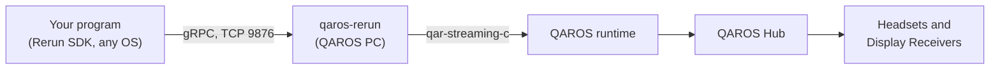
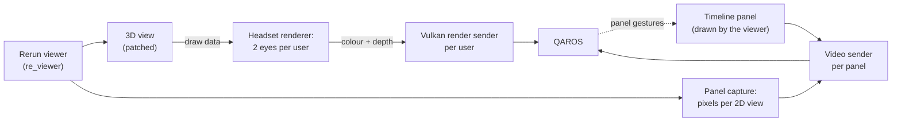
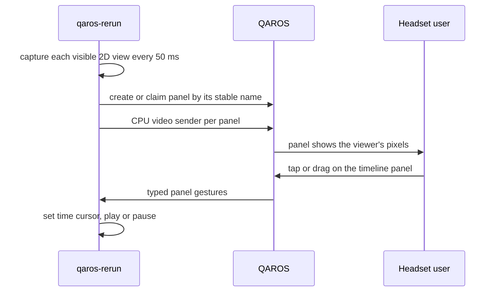
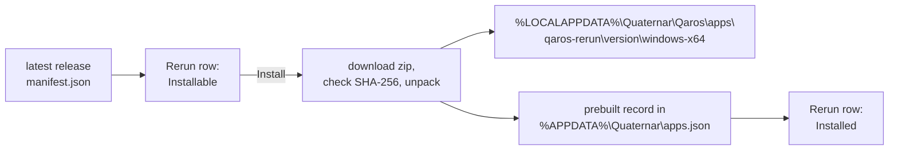

# The Rerun Viewer (qaros-rerun)

`qaros-rerun` is the [Rerun](https://rerun.io) 0.40.0 viewer with a second output to QAROS. This page is for people who log to it from their own programs, start it with their own options, build it, or change it. To set it up and stream an example, follow the user tutorial [Rerun](../user-guide/supported-apps/rerun.md).


| | Version |
|---|---|
| `qaros-rerun` | 0.1.1 |
| Rerun viewer and SDK | 0.40.0 (other SDK versions untested) |
| QAROS | 0.9.0 or newer; panels from 0.9.0-dev.3177; installed from the Visualizer from 0.10.0 |
| OS | the viewer: Windows x64 on the QAROS PC, with a Vulkan GPU driver. Your logging program: any OS |

Source, releases and the viewer's own design notes: [github.com/Quaternar/qaros-rerun](https://github.com/Quaternar/qaros-rerun).

## What runs where



| Machine | Runs | Connections |
|---|---|---|
| Any (Windows, Linux, macOS) | Your program with the Rerun SDK 0.40.0 | to the viewer: gRPC, TCP 9876 |
| Windows, the QAROS PC | the QAROS Hub, the Visualizer, `qaros-rerun` | `qaros-rerun` to the Hub through the installed `qar-streaming-c.dll` |
| Headset | the QAROS player app | to the Hub |

## How it streams



- **The 3D view.** A small patch to Rerun's 3D view hands its draw data to a headset renderer. It draws the first 3D view twice per headset frame, once per eye, with the eye poses and fields of view QAROS hands out for that frame, and sends colour and depth. Empty pixels are transparent, so only your data appears in the room.
- **One stream per user.** Each running target app (a headset's player, a Display Receiver, the Visualizer) is a user with its own render sender. Up to `--max-users` (default 2) at a time; the next waits for a free slot. A target that does not answer is retried about once a minute.
- **The Vulkan path** (default on Windows) renders each eye straight into the images of that user's Vulkan render sender. `--qaros-graphics cpu` reads each eye back and copies it into a CPU render sender instead.
- **The render thread.** The eyes are drawn on a thread of their own from the last finished scene with fresh head poses, so head motion stays smooth while a large scene updates slowly. `--inline-render` draws them inside the viewer frame.
- **Not streamed:** Rerun's labels and overlays drawn after the 3D render. Data outside the app volume is cut by the mixer.

## How it joins QAROS

| Started | Options | Joins |
|---|---|---|
| By the Visualizer's **Rerun** row | `--sink qaros --launched-by-qaros --local-app --window --panels` | as an app QAROS launched; ends when QAROS closes its stdin (**Stop**) |
| By a QAROS API app preset (**+** > **Open QAROS supported app** with `qaros-rerun.exe`) | none until you add them: the Visualizer saves a plain preset, and without `--sink qaros` the viewer never joins | type the five options of the row above as six argument lines (Developer mode) |
| By hand on the QAROS PC | `--sink qaros --local-app --panels` | as a local app of the Hub on this PC |
| With a pairing code | `--sink qaros --pairing-code <CODE> --panels` | with the Hub's current code; rejoins later with the onboarding id kept in `qaros-rerun.onboarding-id.txt` in the working directory |

- **First start of an executable:** the Hub asks a person at the PC to approve it: **Sources** > **Waiting for approval** > **Approve**. The viewer waits up to 2 minutes for the answer. Later starts of the same executable join without asking; each copy of `qaros-rerun.exe` in another folder is asked about once ([Approved local apps](../operator-guide/source-applications.md#approved-local-apps)).
- **Signed-in desktop only.** A viewer started outside the user's desktop session (over SSH, as a service) is refused with `ONBOARDING_HUB_NOT_AUTHENTIC`.
- **Without `--sink qaros`** the viewer never joins: its default sink writes PNGs of simulated users (see [Run without QAROS](#run-without-qaros)).
- **Started by the Visualizer** only once a target exists: until a headset player or a Display Receiver runs, the row's card under **Running** reads **Waiting for a target**.
- **`--launched-by-qaros`** runs headless at 1280x720 unless `--window` or `--headless WxH` is given. The **Rerun** row passes `--window`, so the user has a desktop window to pick an example in.
- **The QAROS library:** `--qaros-library PATH`, else `QAROS_DLL`, else the binding's default lookup: a runtime already loaded, one beside the executable, `QAROS_RUNTIME_DIR`, the installed QAROS (`HKLM\SOFTWARE\Quaternar\QAROS`), then `PATH`. With QAROS installed, nothing needs setting. A started app also gets its hub's `QAR_INSTANCE` from the launcher.

The viewer's log then shows, in order: `qaros: runtime ...`, `qaros: connected; app volume "rerun" ready, looking for target peers`, one `qaros: target <peer> (<name>) found by the peer list` per target, and `qaros: rendering for user-1 (...)` once a stream runs.

Stop: **Stop** in the Visualizer, Ctrl+C in the console, or closing the window. The viewer leaves in order (senders, panels, app volume, session); a second Ctrl+C ends it at once.

## Log your own data

The viewer listens for Rerun SDK connections on gRPC port 9876 (`--port`) on every network interface. Log to it as to any running Rerun viewer, with the SDK of the viewer's version:

```python
# pip install rerun-sdk==0.40.0
import rerun as rr

rr.init("my_app")
rr.connect_grpc("rerun+http://127.0.0.1:9876/proxy")
rr.log("world/points", rr.Points3D([[0, 0, 0], [0.5, 0, 0.5]]))
```

```rust
// rerun = "=0.40.0"
let recording = rerun::RecordingStreamBuilder::new("my_app")
    .connect_grpc_opts("rerun+http://127.0.0.1:9876/proxy")?;
```

- **From another PC:** use the QAROS PC's LAN address and allow TCP 9876 for `qaros-rerun.exe` in its firewall (elevated PowerShell):

  ```powershell
  New-NetFirewallRule -DisplayName "qaros-rerun" -Direction Inbound -Action Allow -Protocol TCP -LocalPort 9876 -Program "<folder>\qaros-rerun.exe"
  ```

  The port has no authentication: anyone who reaches it can log into the viewer. Use it on a trusted network only.
- **Quick test:** `log-test-scene.exe 600`, in the viewer's folder, logs a 1 m orange cube, a ring of light-blue points, axes, an image and a time series. `log-test-scene [steps] [url] [heavy entities]`.
- **A `.rrd` recording:** the viewer takes no file arguments. Open it with **File > Open** in the window, or replay it through the SDK under its application id (`rerun rrd print recording.rrd` shows it in `store_id`), sending the blueprint before and after the data:

  ```python
  import rerun as rr
  import rerun.blueprint as rrb

  blueprint = rrb.Blueprint(rrb.Spatial3DView(origin="/world"))
  recording = rr.RecordingStream("robot_survey")
  recording.connect_grpc("rerun+http://127.0.0.1:9876/proxy")
  recording.send_blueprint(blueprint, make_active=True, make_default=True)
  recording.log_file_from_path("recording.rrd")
  recording.flush()
  recording.send_blueprint(blueprint, make_active=True, make_default=True)
  recording.flush()
  ```

- **Choose what streams with a blueprint:** one 3D view becomes the scene, each other visible view a panel. With several 3D views on screen only the first drawn streams, and the log does not say which: send a blueprint with a single 3D view.
- Recordings with many small chunks load slowly: `rerun rrd optimize in.rrd -o out.rrd`.

## Placement in the room

- **The app volume** is named `rerun` (`--volume-name`), labelled *Rerun* (`--display-name`), 1.5 m on each side (`--volume-size W,L,H`), centred at `--origin` (default `0,0.5,-1.6`: 1.6 m in front of the room origin, 0.5 m up; OpenXR axes, metres). Two viewers at once need two volume names.
- **Auto-fit.** Each recording is fitted once its scene bounds settle (half a second for a file, up to 3 s for a stream): centred, with its largest extent at 0.7 of the volume's smallest side. A recording opened later gets its own fit. The log names each: `headset: recording ... placed with auto-fit to the scene bounds: center [...], data scale ...`.
- **By hand.** `--center X,Y,Z` (Rerun units) is placed at `--origin`, `--scale S` is room metres per Rerun unit. They place the first recording with content; `--auto-fit off` places every recording with them. `RUST_LOG=qaros_rerun=debug` logs the scene bounds each frame to compute them from. `--yaw` turns the data about the room's up axis.
- **Coordinates.** Right-handed view coordinates (for example `RFU`, Z up) are rotated onto the room's Y-up axes. Left-handed ones are not streamed (`not streaming this view: left-handed (...)`); `--up CODE` overrides what the view declares.
- **Kept across runs.** At Stop the viewer hides its volume instead of closing it, and the next run under the same volume name takes it over with its pose and the user's zoom. A volume QAROS creates afresh starts where it was last moved, kept in `qaros-rerun.volume-placements.json`, as long as `--origin` and `--yaw` are unchanged. `--reset-placement` starts at the flags' place at zoom 1.
- **Gestures:** a one-hand grab moves the volume, a two-hand spread scales it (the app scale is the user's zoom, starting at 1).

## Panels and the timeline

`--panels` (with `--sink qaros`) streams the 2D views and a timeline as [GUI panels](./gui-panels.mdx).



- **What becomes a panel.** Each view visible in the viewer's layout, other than the one streamed 3D view: images, depth, plots, text, maps. A view in a hidden tab does not stream. A view gets its panel once it has been published for 3 s.
- **How a panel is built.** The viewer reads its whole UI back from the GPU every `--panel-interval-ms` (default 50 ms, about 17 frames a second), crops each view, and copies it into a CPU video sender of its own; the panel shows that stream (a stream panel). Panels are view-only: they show images of the views and take no input.
- **The timeline panel** is drawn by the viewer: a track and a **Play** button. A finger on it comes back as typed panel gestures (tap, drag with its start and end), which the viewer turns into time commands. It follows the desktop time cursor a few times a second, and the desktop follows it; whoever moves time last wins.
- **Placement.** A panel is 0.45 m wide and as tall as its view's aspect needs, created within reach of the first headset near the app volume (any viewer near it once no headset has streamed for 60 s), tilted to face the eyes. Standing (default): the timeline straight ahead at about elbow height (0.90 m ahead, 0.50 m below the eyes), the views 0.95 m away beside it, alternately right and left. `--panel-posture sitting`: the views 0.8 m from the head, right of the gaze, just below the eyes, clear of a desk.
- **Names and reuse.** Panels have stable names, `<view>.stream.<volume>.rerun` and `timeline.panel-stream.<volume>.rerun`. At Stop the viewer hides them (`--panels-at-stop keep` leaves them showing); the next run reattaches to them with new streams, where they were left. `--reset-panels` closes and recreates them at the default place, `--move-far-panels` brings back one whose centre is farther than 1.5 m from the eyes. Closing the panels in the Hub Display has the same effect as `--reset-panels` for the next run.
- **Panels of other apps** are left alone. Up to `qaros-rerun` 0.1.0, a served panel of another app (a web app's controls panel) stopped the viewer's panel listing: no panel opened and the log said `cannot list panels (... unknown content type ...)`. 0.1.1 lists past it.
- **Cost.** Each capture reads the whole viewer UI back from the GPU. A longer `--panel-interval-ms` leaves the headset stream more GPU time. Don't minimise the desktop window: that stops its rendering and freezes the panels. Cover it instead, or run `--headless WxH` (a larger size gives sharper panels).

## Command-line options

`qaros-rerun --help` prints a summary, `--version` the version. An unknown option or a bad value prints the error and exits with code 2.

**QAROS**

| Option | Default | Does |
|---|---|---|
| `--sink image\|qaros\|off` | `image` | PNGs of simulated users, QAROS render streams, or a plain viewer |
| `--local-app` | off | Join the Hub on this PC as a local app, with no code or invite |
| `--pairing-code CODE` | none | Join with the Hub's current pairing code on the first start |
| `--onboarding-id-file PATH` | `qaros-rerun.onboarding-id.txt` | Where the onboarding id is kept; the viewer's other state files go next to it |
| `--launched-by-qaros` | off | Join as an app QAROS launched and stop when stdin closes; headless at 1280x720 unless `--window` or `--headless` |
| `--qaros-library PATH` | `QAROS_DLL`, else the default lookup | The `qar-streaming-c` library |
| `--qaros-graphics cpu\|vulkan` | `vulkan` on Windows | How frames reach QAROS |
| `--max-users N` | 2 | Users rendered at once |
| `--volume-name NAME` | `rerun` | The app volume; viewers running at once need different names |
| `--display-name NAME` | `Rerun` | The volume's label; the viewer's peer is "NAME viewer" |
| `--volume-size W,L,H` | `1.5,1.5,1.5` for a new volume | App volume size in metres |

**Panels**

| Option | Default | Does |
|---|---|---|
| `--panels` | off | 2D views and a timeline as GUI panels; needs `--sink qaros` |
| `--panel-interval-ms MS` | 50 | Capture interval |
| `--panel-posture standing\|sitting` | `standing` | Where new panels open |
| `--panels-at-stop hide\|keep` | `hide` | What the panels become at Stop; they are never closed |
| `--reset-panels` | off | Recreate this viewer's panels at the default place |
| `--move-far-panels` | off | Bring back a reattached panel farther than 1.5 m from the eyes |

**Placement and depth**

| Option | Default | Does |
|---|---|---|
| `--origin X,Y,Z` | `0,0.5,-1.6` | Room position of the volume's centre (metres, Y up, -Z forward) |
| `--center X,Y,Z` | auto-fit | Point of the first recording placed at `--origin` (Rerun units) |
| `--scale S` | auto-fit | Room metres per Rerun unit for the first recording |
| `--auto-fit on\|off` | `on` | Fit each later recording to its bounds |
| `--yaw DEGREES` | 0 | Turn the data about the room's up axis |
| `--reset-placement` | off | Start at `--origin` and `--yaw`, zoom 1, and forget the kept place |
| `--up CODE` | the view's own | Override the view coordinates, for example `RFU` |
| `--near METERS`, `--far METERS` | 0.05, 20 | Near and finite far plane |
| `--depth reverse-infinite\|forward\|reverse\|linear` | `reverse-infinite` | Depth encoding; `linear` on the CPU path only |

**Viewer**

| Option | Default | Does |
|---|---|---|
| `--port PORT` | 9876 | gRPC port the SDKs connect to |
| `--window` | off | Open the desktop window also with `--launched-by-qaros` |
| `--headless WxH` | off | No window; the UI renders off screen at WxH |
| `--inline-render` | off | Draw the eyes in the viewer frame instead of on their own thread |
| `--graphics-backend vulkan\|metal\|dx12\|gl` | Rerun's choice | wgpu backend; the Vulkan path needs `vulkan` |
| `--vulkan-device SELECTOR` | the session's GPU | `default`, `discrete`, `name:TEXT`, `uuid:HEX`, `luid:HEX`, `index:N` |

**When frames look wrong**, change one at a time: `--color-format rgba` (red and blue swapped), `--pose-space room` (offset or wrong scale), `--depth forward` then `reverse` (content swims as the head moves), `--qaros-graphics cpu` (black or garbage on the Vulkan path), `--frame-stamp` (draws user, frame and eye into each image).

**Environment:** `QAROS_DLL`, `QAROS_RUNTIME_DIR`, `QAROS_STORAGE_DIR`, `RUST_LOG` (for example `info,qaros_rerun=debug,qaros_sink=debug`), `QAROS_RERUN_PERF_LOG` (a CSV of frame and call timings).

The full list, including the image sink's options: the viewer's [integration guide](https://github.com/Quaternar/qaros-rerun/blob/main/docs/integration-guide.md#reference).

## Build it yourself

Needs Windows, a Vulkan GPU driver, Visual Studio 2022 Build Tools with **Desktop development with C++**, Git and [rustup](https://rustup.rs) (the repository pins its Rust version, fetched on the first `cargo` call).

```powershell
git clone https://github.com/Quaternar/qaros-rerun
cd qaros-rerun
cargo build --release -p qaros-rerun
.\target\release\qaros-rerun.exe --sink qaros --local-app --panels
```

- The first build compiles Rerun and fetches the QAROS Rust binding from [github.com/Quaternar/qaros](https://github.com/Quaternar/qaros), pinned by revision: it needs network access and takes several minutes (about 25 on a laptop); a rebuild after a small change takes seconds.
- Tests run against a stub runtime, with no Hub or headset: `cargo test --workspace`.
- **Let the Visualizer launch your build:** `.\scripts\register-qaros-app.ps1` writes a `local` record to `%APPDATA%\Quaternar\apps.json`. The **Rerun** row then launches your build with the row's options; a local record wins over a downloaded one. `-Unregister` removes it.

### Run without QAROS

The default sink writes PNGs with scripted head motion, so you can check the viewer before QAROS is involved, on any OS:

```powershell
$viewer = Start-Process .\target\release\qaros-rerun.exe -PassThru -NoNewWindow -ArgumentList "--headless 1600x1000 --out out\headset --frames 240 --write-every 30 --quit-when-done"
Start-Sleep 5
.\target\release\log-test-scene.exe 300
$viewer.WaitForExit()
```

`out\headset\user-1` then holds both eyes' colour, depth and the poses of every 30th frame.

## How the Visualizer installs it



- Each release of `qaros-rerun` has `qaros-rerun-<version>-windows-x64.zip` (and a Linux zip) and a `manifest.json` with each zip's SHA-256, size, executable, version and `min_qaros_version`.
- The row reads the latest release's manifest. **Installable**: a package for this platform runs with this QAROS. **Installed**: QAROS downloaded it. **Needs update**: a newer compatible release exists. **Detected**: a registered build of your own. A release that needs a newer QAROS leaves the row **Not available** until QAROS is updated.
- The zips do not carry the QAROS runtime; the viewer loads the installed one. They need the Microsoft Visual C++ 2015-2022 Redistributable (x64), which the QAROS setup installs from 0.10.0.
- Release packages, the manifest fields and versioning: [releases](https://github.com/Quaternar/qaros-rerun/blob/main/docs/releases.md).

## Limits

- One 3D view streams; a recording with no 3D view streams panels and the timeline only.
- Rerun's labels and overlays in the 3D view do not stream; in panels they do (they are the view's pixels).
- Up to `--max-users` users rendered at once (2 by default).
- The SDK port has no authentication.
- Panels are view-only, apart from the timeline.
- A minimised desktop window freezes the panels.
- Large point clouds slow the scene update: shorter time windows in the blueprint, or `rerun rrd optimize`.
- On METALENSE 2 the two-hand spread barely scales the scene.

QAROS behaviour the viewer works around, with its status: [known issues](https://github.com/Quaternar/qaros-rerun/blob/main/docs/known-issues.md).

## Troubleshooting

| Symptom | Cause | Fix |
|---|---|---|
| The viewer waits at start | The Hub asks to allow this executable | **Sources** > **Waiting for approval** > **Approve** |
| `ONBOARDING_HUB_NOT_AUTHENTIC` | Started outside the signed-in desktop session | Start it in the desktop session |
| `no usable onboarding id ...` | First start with neither `--local-app` nor a code, or another working directory | Add `--local-app`, or `--pairing-code` |
| Starts, but nothing in QAROS | No `--sink qaros`: the default sink writes PNGs | Start with `--sink qaros --local-app` |
| Connected, no `target ... found` line | No running target app | Open a Display Receiver, or start the player app on a headset |
| No panels | No `--panels`; views in a hidden tab; QAROS older than 0.9.0-dev.3177; `qaros-rerun` 0.1.0 beside another app's served panel | Add `--panels`, show the views, update QAROS or `qaros-rerun` |
| `QAROS handed back app volume "rerun" closed` | Another viewer holds that volume, or it was closed in the Hub | Start with another `--volume-name` |
| Nothing in the headset, the log streams | Data outside the volume, no 3D view, left-handed coordinates | Check the `placed with` log line; `--center`, `--scale`, `--up`; `--reset-placement` |
| An SDK on another PC cannot connect | Firewall, or the wrong address | Allow TCP 9876 for `qaros-rerun.exe`; use the QAROS PC's LAN address |
| The library does not load, or lists missing functions | An older or no runtime found | Point `QAROS_DLL` or `--qaros-library` at a current `qar-streaming-c.dll` |
