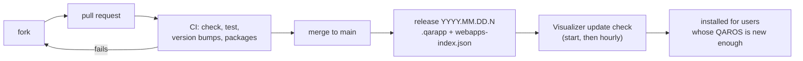

# Contribute an Adaptation

The adaptations QAROS offers every user live in the public repository
[Quaternar/qaros-webapps](https://github.com/Quaternar/qaros-webapps). A merged change reaches users
through the Visualizer's automatic updates, without a QAROS release.



## What belongs there

- Adaptations useful to a broad audience, which the Visualizer shows in Basic (user) mode:
  `Channel` `public`.
- Developer and debugging samples do not: keep them in your own repository and share the
  `.qarapp` ([quick start](quick-start.md#4-package)).
- Shared code is a kit library referenced by `"Library": "<name>@<major>"`; never copy one into the
  repository. A library fix goes to the kit, in
  [Quaternar/qaros](https://github.com/Quaternar/qaros/tree/main/adaptation-kit/lib).

## Layout

```
adaptations/<name>/
  profile.json        Id, Name, DisplayName, Version, StartAddress, AddressPattern, PageRegion, Scripts, ...
  scripts/*.js        the adaptation's own scripts (Scripts[].File)
  panels/             optional served panel pages
  test/*.test.mjs     optional Node tests, never packaged
```

- Everything in the folder except `test/` is packaged: keep only adaptation files there.
- Never write `Files` or `Signature` into `profile.json`: the build writes them.
- `Id` is permanent and reverse-DNS; the repository's adaptations use `com.quaternar.<name>`. A
  different Id is a different adaptation and a new folder.
- `release.json` `minQarosVersion` is the oldest QAROS whose kit has every library the adaptations
  name. Raise it in the same pull request when your adaptation needs a newer library or major.

## Versions

Each adaptation has its own semantic version, `Version` in its `profile.json`.

| Change to the folder (outside `test/`) | Below 1.0 | From 1.0 |
|---|---|---|
| Breaking (a newer QAROS needed, other addresses matched) | MINOR | MAJOR |
| Feature | MINOR | MINOR |
| Fix | PATCH | PATCH |
| Only `test/` | none | none |

- Bump in the **same commit** as the change. A version is never reused or lowered: QAROS installs
  only a newer version than the one it has.
- `scripts/check_versions.py` compares every folder with the previous release and refuses a
  changed folder without a bump, a changed `Id`, or a `profile.json` holding `Files` or
  `Signature`.

## Changelog

- `CHANGELOG.md` follows Keep a Changelog; entries go under `## [Unreleased]`.
- Grouped per adaptation (`### <adaptation id>`), then by category in this order, only those used:
  `Breaking`, `Features`, `Enhancements`, `Bug fixes`, `Deprecated`, `Removed`, `Security`.

```markdown
### com.quaternar.threejs-examples

#### Bug fixes

- Thin lines in the map examples keep their depth in the glasses (0.2.1).
```

- One line per change a user notices (what the site looks like in the glasses, scale, addresses
  matched, a fixed bug, a new or removed adaptation), in the same commit as the change and bump.
- Say what changed for the user, not how, and end with the new version in parentheses. Link the
  public issue or pull request with its full URL when there is one.
- No entry for tooling, tests or CI. A `Breaking` entry says what to do.

## Fork, check, pull request

1. Fork [Quaternar/qaros-webapps](https://github.com/Quaternar/qaros-webapps) and clone your fork.
2. Get the kit where the scripts look for it (or pass `--kit <dir>` / set `QAROS_ADAPTATION_KIT`):

   ```
   git clone https://github.com/Quaternar/qaros .qaros
   ```

   Check against the kit of `minQarosVersion` (tag `v<minQarosVersion>`) when that tag exists;
   `python -I scripts/ci.py kit-ref` says which ref CI uses.
3. Add or change `adaptations/<name>/`, bump `Version`, add the changelog line.
4. Run what CI runs (Python 3.10+, Node.js 20+, git):

   ```
   python -I scripts/ci.py check --kit .qaros/adaptation-kit
   python -I scripts/build_packages.py --out out --kit .qaros/adaptation-kit
   ```

   `ci.py check` runs the tooling tests, `qaros-adaptation check` and `test` on every adaptation,
   and the version check. `build_packages.py` builds and verifies the unsigned packages.
5. Test the package from `out/` in your Visualizer (**Import app package**) with one and several
   users.
6. Open a pull request. Commit subjects follow Conventional Commits (`feat:`, `fix:`, `docs:`),
   bodies are short bullet points. The repository is public: no keys (`*.pem` is ignored), no links
   to private documents.

## Release and signing

- Every merge to `main` that changes an adaptation publishes a release tagged `YYYY.MM.DD.N` (UTC
  date, N from 1 per day), made by CI only: one `<id>-<version>.qarapp` per adaptation and
  `webapps-index.json`.
- Contributors never sign. When signing is configured, CI signs every package and the index with
  the QAROS release key; until then releases are unsigned and say so in their notes.

## How it reaches users

- Each QAROS setup ships the newest release at the time it was built.
- The Visualizer reads the release index at start and every hour while online. It installs, for
  the current user, a newer version of an adaptation already on the PC when that version runs with
  the user's QAROS (`minQarosVersion`), after checking its SHA-256.
- A new adaptation shows as **Installable** on its tile; a running web app keeps its version until
  its next start (**Update ready**). Users can turn automatic updates off in Settings
  ([Web apps QAROS provides](../../operator-guide/source-applications.md#web-apps-qaros-provides)).
- An adaptation a later release removes stays installed but is never picked by address; users
  remove it with **Uninstall web app adaptation...**.
