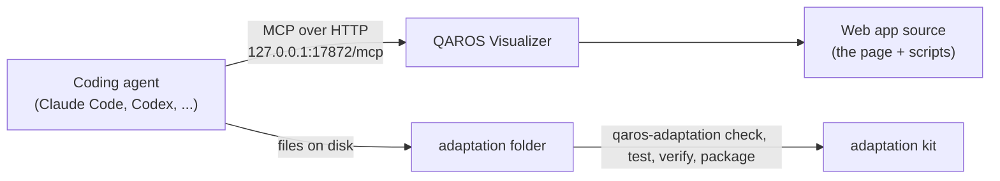
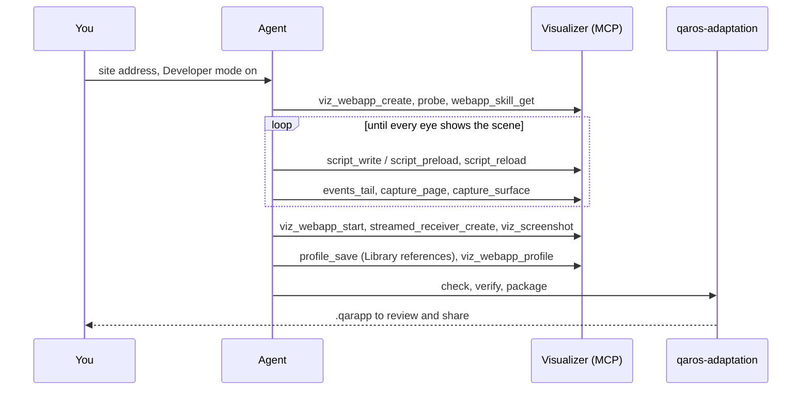

# Develop with AI Agents

The Visualizer runs a local **MCP** (Model Context Protocol) server, and ships **authoring
skills** that tell an agent how to adapt a site.

- A connected coding agent does what you would do by hand: open the page, probe its renderer, write
  and reload scripts, stream to test receivers, take screenshots, save a profile.



## 1. Enable the MCP endpoint

| Setting | Where | Default |
|---|---|---|
| **Enable MCP endpoint** | Visualizer, Settings > General | on |
| UI mode | Visualizer, Settings: **Developer** (or Debug) | Basic |
| Port | Settings, or the environment variable `QAR_MCP_SERVER_PORT` set before starting QAROS (wins over Settings; `off` turns the server off) | `17872` |

- The web app authoring tools and skills answer only in **Developer** mode or higher. Only you can
  switch the mode: no tool can.
- The endpoint is `http://127.0.0.1:<port>/mcp`. It listens on the loopback address only and has no
  authentication: any program of the signed-in Windows user can call it while it is enabled. Turn
  it off when you do not use it.
- A second Visualizer on the same PC needs its own port; a busy port turns the server off and the
  log says so.

## 2. Connect your agent

Both clients below talk to an MCP server over HTTP.

**Claude Code** (command line):

```
claude mcp add --transport http qaros-visualizer http://127.0.0.1:17872/mcp
```

or in a project's `.mcp.json`:

```json
{
  "mcpServers": {
    "qaros-visualizer": { "type": "http", "url": "http://127.0.0.1:17872/mcp" }
  }
}
```

**Codex** (`~/.codex/config.toml`, a Codex version with HTTP MCP servers):

```toml
[mcp_servers.qaros-visualizer]
url = "http://127.0.0.1:17872/mcp"
```

- Use the port your Visualizer listens on.
- Browser-based MCP clients served from another origin are refused: the server answers only
  requests addressed to the loopback host.
- Ask the agent to call `webapp_skill_list`: a list of skills means the connection works; a
  refusal naming Developer mode means the Visualizer is still in Basic mode.

## 3. Give it the authoring skills

The skills ship with QAROS in `<install>/bin/assets/skills/<skill>/SKILL.md`:

| Skill | For |
|---|---|
| `webapp-authoring` | always first: the tools, the authoring loop, the render-frame protocol, several users, depth and alpha, profiles |
| `webapp-threejs` | three.js pages (`WebGLRenderer` and `WebGPURenderer`) |
| `webapp-webgl` | raw WebGL and engines without dedicated support |
| `webapp-webgpu` | WebGPU pages, including those with their own render loop |
| `webapp-other` | pages that are not a 3D canvas |
| `gui-panel-authoring` | flat panels beside the streamed scene |

- **Over MCP** (simplest): tell the agent to call `webapp_skill_get` with the web app source's
  `instance_id`. The Visualizer probes the page and returns `webapp-authoring` plus the platform
  skill that fits. `webapp_skill_get {name}` returns one skill by name.
- **As files:** copy the skill folders into your agent's skills folder (Claude Code:
  `.claude/skills/`), or name them in your agent's instructions file (`AGENTS.md`).
- The Visualizer serves a skill or library only while it matches the hash of the installed file:
  an edited copy in the install is refused. Change your own copy instead.

## 4. The tools an adaptation needs

| Task | Tools |
|---|---|
| Open a site as a web app source | `viz_webapp_create {address}`, `viz_webapp_list` |
| Find the renderer | `probe`, `devtools_send` (`Runtime.evaluate`, reading sources) |
| Read a kit library | `webapp_library_get {name: "threejs-render-frame@1"}` |
| Edit and reload scripts | `script_write`, `script_preload`, `profile_preload`, then `script_reload` |
| Save the profile | `profile_save`, `profile_finalize`; select it with `viz_webapp_profile` |
| Reload or rebuild | `script_reload` (same browser), `navigate` or `viz_webapp_reload` (rebuilds the browser) |
| Start streaming and add test users | `viz_webapp_probe`, `viz_webapp_start`, `streamed_receiver_create`, `streamed_receiver_camera` |
| See the result | `capture_page` (the page region), `capture_surface` (the whole atlas), `viz_screenshot` |
| Logs and statistics | `events_tail` (page errors, console, DevTools events), `viz_webapp_list` (phase, frame counters, last error), `viz_stream_info` |
| Derive from an existing adaptation | `adaptation_list`, `adaptation_derive {id, new_id, name}` |
| Keep it as a tile | `viz_webapp_register {instance_id, name}` |
| Export or import a package | `adaptation_export`, `adaptation_import` |

`tools/list` names every tool, each with its tier and a description of every parameter.

## 5. An example session



1. You: switch the Visualizer to Developer mode and give the agent the address, for example
   `https://example.com/viewer/`.
2. Agent: `viz_webapp_create {address}`, waits for the page to draw, `probe`, then
   `webapp_skill_get {instance_id}`.
3. Agent: starts from a kit template, or from an existing adaptation with `adaptation_derive`, and
   writes the smallest site-specific script it needs (a scene choice, a camera buffer).
4. Agent: stages the scripts, `script_reload`, reads `events_tail`, compares `capture_page` and
   `capture_surface`, and repeats until the page is unchanged and every eye shows the scene.
5. Agent: starts the source, adds two or four streamed receivers at different positions, checks
   them with `viz_screenshot`.
6. Agent: saves the profile with `Library` references (`profile_save`), selects it
   (`viz_webapp_profile`) and checks once more.
7. On disk, with the saved folder:

   ```
   qaros-adaptation check my-viewer
   qaros-adaptation verify my-viewer --address "https://example.com/viewer/"
   qaros-adaptation package my-viewer --out dist
   ```

   `verify` measures depth, thin-line and alpha coverage on the running source through the same
   MCP endpoint ([quick start](quick-start.md#5-verify)).
8. You: read every script before you share the package.

## Safety

- **Local only.** The endpoint binds to `127.0.0.1`. Do not forward or expose its port.
- **What an agent can do:** everything the Visualizer's own panels can do in the current UI mode,
  plus, in Developer mode, run any code in the web app's page (`devtools_send`, page scripts).
  It cannot change the UI mode, the MCP setting, the hub connection, pairing or onboarding codes.
- **The page is your browser profile.** Every web app shares one browser profile: cookies and
  logins included. Log in yourself on the **Page** panel; do not let an agent type credentials or
  send page content, cookies or screenshots anywhere else.
- **Adaptation scripts are trusted code.** `preDocument` scripts run before the page and outside
  its content security policy. Review every script an agent wrote before you package, share or
  register it, and run `qaros-adaptation check`.
- **Sign what you share.** Package with `--sign` so recipients can tell your adaptation from a
  modified copy; an unsigned package or one from a publisher the hub does not trust asks before it
  installs.
