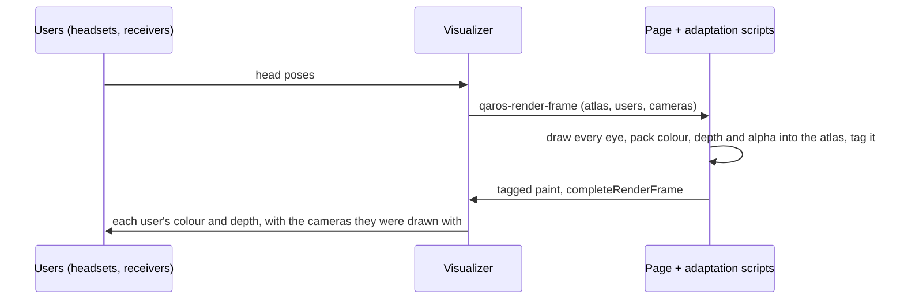
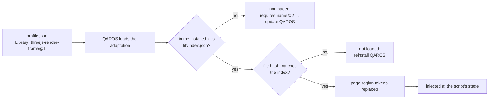

# Web App Adaptations

A **web app** streams an existing website to every user of a session, unchanged. Its
**adaptation** is the set of scripts that renders each user's eyes from the page's own scene.

- The Visualizer loads the page in a built-in browser and injects the adaptation.
- Operators launch web apps from Source Applications
  ([Web apps](../../operator-guide/source-applications.md#web-apps)); this guide is for writing an
  adaptation.


## The adaptation kit

Everything to write one ships with QAROS in `<install>/share/qaros/adaptation-kit/`, and is
published in the public [`qaros` repository](https://github.com/Quaternar/qaros/tree/main/adaptation-kit):

| Folder | What |
|---|---|
| `lib/` | The [libraries](library-reference.md): capture, render-frame and packing code shared by every adaptation. `lib/index.json` lists each with its version, stage and SHA-256 |
| `templates/` | Starter adaptations: `threejs`, `webgl`, `webgpu`, `webgpu-redirect`. Each has a `profile.json`, its own scripts, a README and a test |
| `examples/` | Reference apps (three.js, WebGL, WebGPU), the three.js reference page with served panels, and one runnable example per [recipe](recipes.md) |
| `tools/` | `qaros-adaptation.py`, the [command line tool](quick-start.md), and `verify-depth.py` |

- The kit is versioned with QAROS: an install resolves libraries from its own kit.

## How a page is streamed



- **One page for everyone.** One DOM, one scene and one page input (the operator's page preview)
  serve all users. Users get the rendered 3D views, never the page's HTML.
- **Every eye is a real camera.** Each user's eyes are drawn with their own pose and projection,
  never a crop of another view. Screen-space and temporal effects (bloom, SSAO, TAA, outlines)
  cannot run per eye and are left out of the users' views.
- **The atlas.** All eyes of all users share one image. The top-left **page region** keeps the
  page's own view for the preview; each eye gets a colour rectangle and a depth rectangle at half
  resolution (and an alpha rectangle with `TransportAlpha`). See
  [atlas packing](recipes.md#1-atlas-packing).
- **Depth is required.** Headsets reproject the last frame to the newest head pose and mix
  sources by depth: colour without correct depth swims or is dropped.

## Scripts and stages

An adaptation is an ordered list of scripts, each run at one stage:

| Stage | Runs | Used for |
|---|---|---|
| `preDocument` | before any of the page's own scripts, in every new document, not subject to the page's content security policy | capturing the page's renderer or rendering context before the page creates it |
| `afterLoad` | after the page has loaded | the render-frame handler, packers, site-specific code |

- Scripts run in declared order within a stage. A library comes after every library it
  [needs](library-reference.md).
- A script names a **kit library** or a **file** of the adaptation, never both:

```json
"Scripts": [
  { "Name": "capture-renderer", "Stage": "preDocument", "Library": "threejs-capture@1" },
  { "Name": "scene-selection", "Stage": "preDocument", "File": "scripts/scene-selection.js" },
  { "Name": "render-frame-core", "Stage": "afterLoad", "Library": "render-frame-core@1" }
]
```

### Libraries by name and major version



- `Library` names `<name>@<major>`. QAROS injects its installed kit's file when the page loads, so
  a library fix in a QAROS update reaches every adaptation that uses it.
- A **minor** version (a fix, a new optional option) keeps the major: every adaptation picks it
  up. A **breaking** change is a new major; the old major keeps shipping.
- An adaptation that names a major this QAROS does not have does not load, with
  "requires `name@2`, this QAROS provides @1: update QAROS" ([troubleshooting](troubleshooting.md)).
- The kit files are part of the signed QAROS install: they are not in your package, and a library
  QAROS injects does not change your adaptation's signature check.
- To freeze an exact version, bundle a copy instead (`qaros-adaptation pin`, see
  [quick start](quick-start.md#pin-a-library)).
- The earlier form `"Library": "name.js"` still loads and means `name@1`.

## The profile

The fields an author sets in `profile.json`:

| Field | Meaning |
|---|---|
| `Id`, `Name`, `DisplayName`, `Version` | Package identity: a reverse-DNS `Id` you own (`com.example.viewer`), the profile name, what users see, a semantic version |
| `AddressPattern` | Glob over the page address (`*` any run, `?` one character). The most specific matching adaptation wins |
| `StartAddress` | The address the tile opens after an import. Default: `AddressPattern` when it has no wildcard |
| `Engine` | `three.js`, `webgl`, `webgpu` or empty. `three.js` keeps the page untouched and streams from a separate surface |
| `PageRegion` | `Width` x `Height` in pixels kept for the page's own view: at least 1024 x 1024, or 0 x 0 for none |
| `AppScale` | Room metres per scene unit |
| `AppScaleByAddress` | `[{ "AddressPattern": ..., "AppScale": ... }]`: the first match wins over `AppScale`. For one adaptation covering pages authored in different units. A page that navigates to an address with another scale rescales its volume while it streams |
| `RenderScale` | (0, 1]: each eye's resolution as a fraction of the user's. Lower is cheaper; see [thin lines](recipes.md#2-thin-lines-msaa-and-renderscale) |
| `ContinuousRendering` | Draw every user on each animation tick from the newest cameras. See [render rate](recipes.md#6-continuous-rendering-and-renderrate) |
| `RenderRate` | Frames per second the page renders at most, 1 to 120. **Default 30** |
| `Antialias` | Samples per pixel of the users' eye views: 2, 4, 8 or 16. Absent: no multisampling. For lines thinner than a pixel, grids and point clouds; see [thin lines](recipes.md#2-thin-lines-msaa-and-renderscale) |
| `TransportAlpha` | Stream coverage alpha, for content meant to float in the room |
| `Channel` | `public` (default), `developer` or `debug`. Developer and debug adaptations show only in the Visualizer's Developer mode |
| `CommonName` | Base name of the app volume and served panels (lowercase DNS labels). Default: derived from `StartAddress` |
| `Panels` | Folder of served panel pages, default `panels` |
| `Scripts` | The ordered scripts, above |

- `Files` and `Signature` are written by `qaros-adaptation package`: never by hand.
- Fields a QAROS version does not know are kept when it rewrites a profile.


## Where to go next

| Page | For |
|---|---|
| [Quick start](quick-start.md) | `init`, `check`, `test`, `package`, `verify`, `pin` |
| [Develop with AI agents](develop-with-ai-agents.md) | Connect a coding agent to the Visualizer's MCP endpoint, the authoring skills, an example session |
| [Library reference](library-reference.md) | What each library needs, provides and guarantees |
| [Recipes](recipes.md) | Atlas packing, thin lines, depth conventions, iframes, UI confinement, render rate, WebGPU redirect, common mistakes |
| [Troubleshooting](troubleshooting.md) | Load errors, leftover adaptations, blank or dashed views |
| [Contribute an adaptation](contribute-an-adaptation.md) | Publish an adaptation for every QAROS user through `Quaternar/qaros-webapps` |
