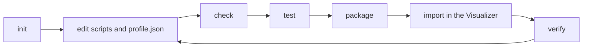

# Quick Start

`qaros-adaptation` is a Python 3 tool (standard library only) in the kit's `tools/` folder. Node.js
is needed only for `test`.

| From | Run |
|---|---|
| An install | `python -I "<install>/share/qaros/adaptation-kit/tools/qaros-adaptation.py" <command> ...` |
| The `qaros` repository | `python -I adaptation-kit/tools/qaros-adaptation.py <command> ...` |

- The kit is the folder the tool is in. `--kit <dir>` (before or after the command) or the
  `QAROS_ADAPTATION_KIT` environment variable picks another, for instance the kit of the oldest
  QAROS you support.
- Below, `qaros-adaptation` stands for the full command.



## 1. Create

```
qaros-adaptation init threejs my-viewer --address "https://example.com/viewer/*"
```

| Template | For | Yours to write |
|---|---|---|
| `threejs` | a three.js page, `WebGLRenderer` or `WebGPURenderer` | `scripts/scene-selection.js`, only when the default scene or renderer choice is wrong |
| `webgl` | a raw WebGL2 page (no engine) | `scripts/render-frame.js`: draw the page's scene with a given camera |
| `webgpu` | a raw WebGPU page that exposes its device and draw function | `scripts/app-bridge.js`: the page's device, camera and draw entry point |
| `webgpu-redirect` | a WebGPU page with its own render loop that exposes nothing | `scripts/site-camera.js`: the page's camera buffer and its layout |

- `init` asks in a terminal for what is missing: `--name`, `--address`, `--engine`,
  `--display-name`, `--id`. Give the adaptation a reverse-DNS `--id` you own.
- The new folder holds `profile.json`, `scripts/`, `test/` and a README naming each script.

## 2. Check

```
qaros-adaptation check my-viewer
```

- **Errors:** `profile.json` against the schema, every `Library` present in the kit, each library
  after the libraries it needs, every script file present; a source folder carrying `Files` or `Signature` that no longer match is refused (`package` writes them).
- **Warnings:** the known pitfalls listed in [common mistakes](recipes.md#8-common-mistakes).
  `--ignore <code>` skips one; `--strict` fails on warnings too.

## 3. Test

```
qaros-adaptation test my-viewer
```

Runs the adaptation's `test/*.test.mjs` and the kit's own tests of every library it uses, with
`node --test`. `--no-kit-tests` runs only yours.

## 4. Package

```
qaros-adaptation package my-viewer --out dist
qaros-adaptation package my-viewer --out dist --sign key.pem --signer "Example Ltd"
```

- Writes `<id>-<version>.qarapp`: the folder, a manifest of every file's SHA-256, and with
  `--sign` an ECDSA P-256 signature. The package is verified the way QAROS imports it.
- `Library` references stay references. `__PAGE_REGION_WIDTH__` / `__PAGE_REGION_HEIGHT__` in your
  own scripts are replaced from `PageRegion`.
- `--unpacked` writes the folder instead; `--version` sets `Version`.
- Import it in the Visualizer: Source Applications, **+**, **Import app package**
  ([Importing a web app package](../../operator-guide/source-applications.md#importing-a-web-app-package)).
  An unsigned package or one from a publisher the hub does not trust asks first.

## 5. Verify

With the adaptation running as a web app source, in a Visualizer in Developer mode with its MCP
endpoint enabled:

```
qaros-adaptation verify my-viewer --address "https://example.com/viewer/"
```

- Reads the streamed atlas and reports depth coverage of the coloured pixels, the thin-line check,
  alpha coverage and the depth pack.
- `--instance <id>` picks a source; `--host` / `--port` the Visualizer's MCP endpoint.

## Pin a library

```
qaros-adaptation pin my-viewer threejs-render-frame@1
```

Replaces the `Library` reference with a copy at `scripts/threejs-render-frame@1.js` and names it as
the script's `File`. The copy's header shows its exact version. A pinned copy no longer receives
fixes from QAROS updates: pin only to hold a version you have verified, and re-pin after testing a
newer one.

## Before you share it

- `AddressPattern` matches the site's pages and nothing more.
- `check` and `test` pass against the kit of the oldest QAROS you support (`--kit`).
- `RenderRate`, `RenderScale` and `AppScale` are set on purpose ([recipes](recipes.md)).
- Tested with one, two and four users, and the page still works in the preview while streaming.
- `Version` raised for every change you hand out: importing the same version changes nothing, and an
  older one asks first.
