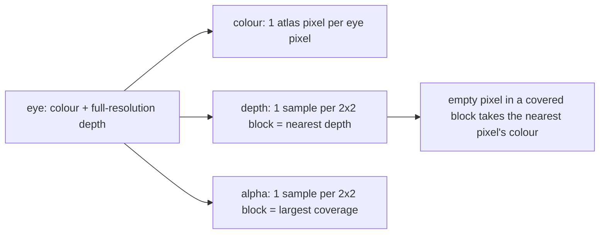
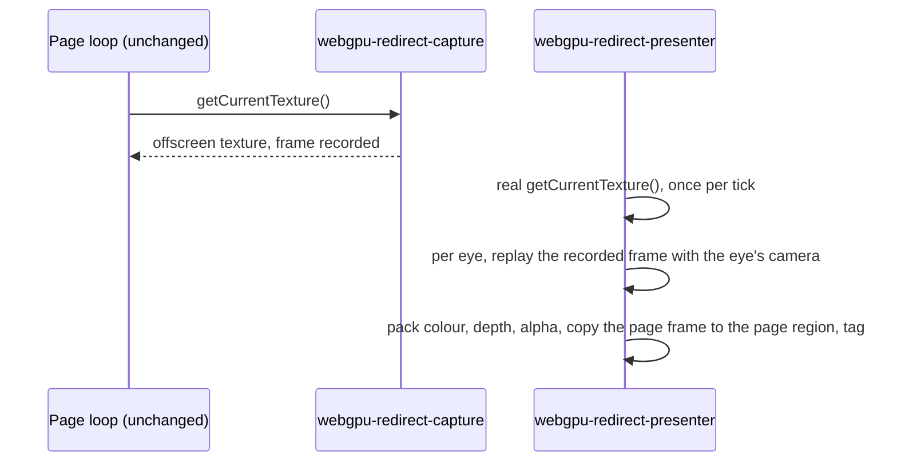

# Recipes

- Each recipe has a runnable example in the kit's
  [`examples/recipes/`](https://github.com/Quaternar/qaros/tree/main/adaptation-kit/examples/recipes):
  a page (`index.html`), its adaptation (`profile.json`) and a README.
- To run one: serve the folder over http, package or save the adaptation, open the page as a web app.

## 1. Atlas packing

Example: [`01-atlas-packing`](https://github.com/Quaternar/qaros/tree/main/adaptation-kit/examples/recipes/01-atlas-packing)
(1-px lines and a box; `?webgpu` draws the same scene with `WebGPURenderer`).

- Depth and alpha travel at half resolution: one sample stands for a 2x2 block of eye pixels.
- **Keep the nearest depth of the block.** A packer that keeps one fixed texel misses a 1-px line
  in about half its blocks. That colour then reaches the headset without depth and is dropped, so
  the line shows dashed.
- **Keep the largest coverage of the block.** A mean dims a 1-px line to a quarter or a half.
- **Fill empty pixels at edges.** A background pixel in a block that holds geometry takes the
  colour of the block's nearest pixel; otherwise the clear colour shows as a fringe at the
  geometry's depth.
- Render depth at full resolution and reduce it. Rendering it directly at half resolution samples
  one point per block and loses thin features the same way.
- The kit's packers (`webgl-atlas-pack@1`, `threejs-webgpu-render-frame@1`,
  `webgpu-redirect-presenter@1`) do all of this; use them instead of writing a packer.

## 2. Thin lines, MSAA and RenderScale

Example: [`02-thin-lines-render-scale`](https://github.com/Quaternar/qaros/tree/main/adaptation-kit/examples/recipes/02-thin-lines-render-scale).

- Users' eye views render without multisampling: the page's `antialias: true` applies to its own
  canvas only.
- `RenderScale` sets each eye's resolution as a fraction of the user's. At 0.5 a line one page
  pixel wide still rasterizes (lines are at least one pixel wide) but every pixel of it is a full
  eye pixel, twice as wide in the headset.
- Depth stays correct at any scale: each depth sample keeps the nearest depth of its block.

| Content | `RenderScale` |
|---|---|
| Lines, CAD, maps, charts, text in the scene | 1.0 |
| Shaded scenes where cost matters more than edges | 0.5 to 0.75 |

## 3. Depth conventions

Example: [`03-depth-conventions`](https://github.com/Quaternar/qaros/tree/main/adaptation-kit/examples/recipes/03-depth-conventions)
(`scripts/depth-convention.js` reports a mismatch).

- Pack **device depth**: the raw post-projection value, non-linear. Never linear or metric depth:
  QAROS knows each camera's near and far planes and reconstructs metres itself.
- Each request names the convention per camera (`depthConvention`), derived from its near/far
  pair:

| Convention | When | Nearest depth is |
|---|---|---|
| `regular` | near < far: standard Z, cleared to 1 | the smallest |
| `inverted` | near > far: reversed Z, cleared to 0 | the largest |
| `infiniteFar` | the far plane is at infinity | as the Z direction says |

- Use the request's near and far exactly. The kit's libraries render `regular` depth.
- A page that uses reversed Z or a logarithmic depth buffer for its own view is fine: the users'
  eyes use their own cameras. A hand-written handler must pack what the request asks for.
- WebGL (clip z -1..1) and WebGPU (clip z 0..1) differ in clip space, not in window depth: both
  pack the same 0..1 value.

## 4. iframes and multi-frame pages

Example: [`04-iframes`](https://github.com/Quaternar/qaros/tree/main/adaptation-kit/examples/recipes/04-iframes)
(a gallery whose 3D view is `frame.html` in an iframe, like the threejs.org examples).

- QAROS streams the renderer of the **top-level** page. A gallery that shows its 3D content in an
  iframe has no renderer at top level, so the source never starts.
- Open the framed page at top level from an afterLoad script (`location.replace(frame.src)`, so
  Back does not return to a page that redirects again), and let `AddressPattern` match both pages
  so the same scripts adapt the framed one.
- Same-origin child frames share the top-level page's capture state; cross-origin frames are not
  reachable.
- `check` warns (`iframe`) when the pattern names an index or gallery page and no script of yours
  handles frames.

## 5. UI confinement

Example: [`05-ui-confinement`](https://github.com/Quaternar/qaros/tree/main/adaptation-kit/examples/recipes/05-ui-confinement).

- The page region keeps the page's own view and interface for the operator's preview; users get
  only the 3D scene.
- `ui-confinement@1` sizes an `#app-ui` container to the page region. It works for pages that
  collect their whole interface under that container (`position: fixed`, full viewport,
  `overflow: hidden`, children `position: absolute`).
- A third-party site keeps its own layout without it: the render-frame libraries draw the users'
  views without the page's HTML anyway. With `Engine: "webgl"` or `"webgpu"` the page itself is the
  atlas, so a fixed-position panel (dat.gui, lil-gui) outside the page region lands on a user's
  view: move it into the region.

## 6. Continuous rendering and RenderRate

Example: [`06-render-rate`](https://github.com/Quaternar/qaros/tree/main/adaptation-kit/examples/recipes/06-render-rate)
(set `RenderRate` to 15, 30 or 60 to compare).

| Pacing | Profile | Behaviour |
|---|---|---|
| Continuous | `ContinuousRendering: true` | Draws every user on Chromium's animation tick from the newest cameras, without waiting for a paint to be read back. The kit's handlers use it |
| On demand | `ContinuousRendering: false` | Each request draws once. Simpler, about a third of the frame rate |

- `RenderRate` (1 to 120 frames per second) caps the page's rendering. **A profile without it
  renders at 30.** QAROS paints, throttles cameras and paces the libraries' loop at that rate.
- A lower rate delays scene changes (animation, interaction), not head motion: headsets reproject
  the newest frame to the current head pose.

| `RenderRate` | For |
|---|---|
| 15 | slowly changing content (dashboards, maps, documents), heavy scenes, battery-powered hosts |
| 30 (default) | most scenes |
| 60 | smooth animation and fast motion (games, the kit's reference apps) |

- A hand-written loop follows the same rule with `render-frame-core@1`
  `isRenderDue(detail, timestamp, lastDraw)`, or uses `createRenderFrameLoop`.

## 7. WebGPU redirect presenter

Example: [`07-webgpu-redirect-presenter`](https://github.com/Quaternar/qaros/tree/main/adaptation-kit/examples/recipes/07-webgpu-redirect-presenter);
template: `webgpu-redirect`.

- A WebGPU page with its own loop calls `getCurrentTexture()` every frame. A second caller on the
  same canvas defeats what the first drew, so an adaptation cannot draw beside such a page.
- The capture makes the adaptation the only real caller and records the page's frame; the presenter
  replays it once per eye into per-eye copies of the page's targets.
- Your script supplies only the camera: pairs of (page camera buffer, eye buffer) holding each
  eye's view-projection (`scripts/site.js` in the example, `scripts/site-camera.js` in the template).
  Find the buffer with `[...__qarAdaptationState.buffersByLabel.keys()]` and its layout in the
  page's WGSL.
- Needs `ContinuousRendering: true`. Compute passes run once per page frame, so every user sees the
  same simulation.

## 8. Common mistakes

`qaros-adaptation check` warns about each of these; `--ignore <code>` skips one.

| Code | Mistake | Fix |
|---|---|---|
| `depth-single-texel` | A packer of yours writes 24-bit depth but keeps one texel of each 2x2 block | Take the nearest depth of the block (min; max for reversed Z), or use a kit packer ([1](#1-atlas-packing)) |
| `alpha-mean` | A packer of yours averages alpha over the block | Take the largest coverage of the block ([1](#1-atlas-packing)) |
| `iframe` | `AddressPattern` names an index or gallery page and no script of yours handles frames | Open the framed page at top level, or narrow the pattern ([4](#4-iframes-and-multi-frame-pages)) |
| `page-region-token` | `__PAGE_REGION_WIDTH__` / `__PAGE_REGION_HEIGHT__` left in a script of yours | `package` replaces them; a folder loaded as it is keeps them. Read `window.__qarAdaptationPageRegion` or the request's `pageRegion` instead |

The lints read your own scripts only: kit libraries are tested by the kit. Also check by hand:

- Every eye uses its own camera from the request; never the page camera or one camera for both eyes.
- No per-user change to the shared scene inside the eye loop, and page animation steps once per tick.
- Screen-space and temporal effects are off in the users' views; you know which effects users miss.
- Every write to the atlas is opaque, and depth saturates at the far plane.
- A change meant to be seen in the headset changes 3D content (a material, a transform), not
  `scene.background`, which users never see.
- `RenderRate`, `RenderScale` and `AppScale` are set on purpose ([2](#2-thin-lines-msaa-and-renderscale), [6](#6-continuous-rendering-and-renderrate)).
