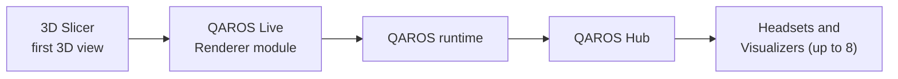
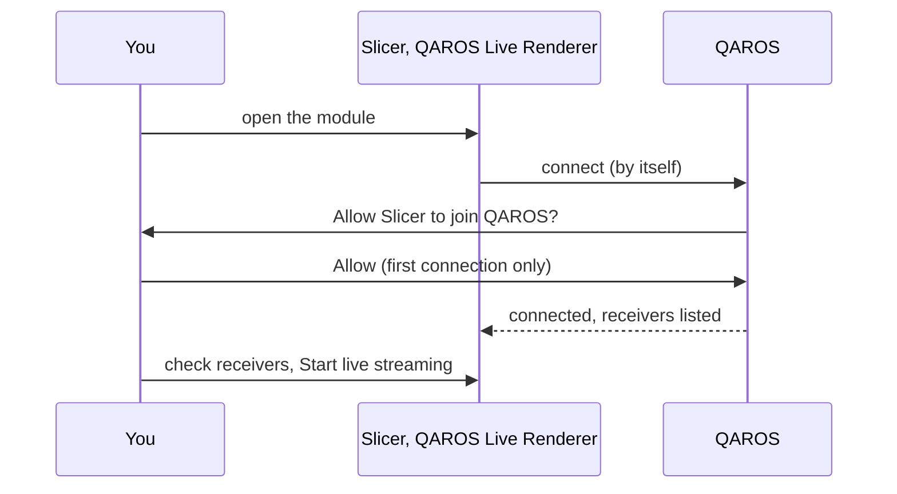

# 3D Slicer

## What you get

Your CT or MR volume rendering in the room, live, in stereo with depth. Each visible volume gets its own movable workspace; visible slice views open as view-only panels.

| | Version |
|---|---|
| **QAROS Live Renderer** module | Live plugin r8.8 |
| 3D Slicer | 5.12.4 (built and checked with it) |
| QAROS | Must match the package exactly. The prebuilt package needs QAROS 0.9.0-dev.3184. For QAROS 0.10.0, build from source. |
| OS | Windows x64 |

## Install

The Visualizer does not list or install 3D Slicer yet: install the module by hand.

1. Close Slicer (Windows locks the module's DLL while it runs).
2. Clone or pull [github.com/Quaternar/qaros-slicer](https://github.com/Quaternar/qaros-slicer). There is no Extensions Manager package.
3. Run `UPDATE-LIVE-PLUGIN.cmd` in it. It finds QAROS (or takes `-SdkRoot '<path>'`), checks that QAROS matches and backs up the previous module.
4. First time only: **Edit > Application Settings > Modules > Additional module paths** > add `<repository>\package\windows-start\plugins\slicer`. Restart Slicer.
5. Open **QAROS > QAROS Live Renderer**; it shows **Live plugin r8.8**.

- A pull alone updates nothing: run `UPDATE-LIVE-PLUGIN.cmd` again and restart Slicer.
- Building for another QAROS version: see the repository's README.

## Connect to QAROS

- **Detection:** none yet. No Slicer tile in **Sources**, so no greyed-out row, **Locate...** or presets. Start Slicer as usual.
- **Connect:** the module connects when you open it (or press **Connect to QAROS**).
- **Allow it once:** click **Allow** within two minutes; otherwise connect again ([Approved local apps](../../operator-guide/source-applications.md#approved-local-apps)).
- **Pick receivers:** under **Stream to**, check connected headsets or Visualizers (up to eight). **Start live streaming** stays disabled until one is checked.
- **Several Slicer versions:** not supported; the module is built for one Slicer and one QAROS version.

## First session

1. **Load a scan.** In **Volume Rendering** use **VTK GPU** ray casting with **Composite** blending; the volume shows in Slicer's first 3D view.
2. **Optional, before Start:**

   | Setting | Default |
   |---|---|
   | **Model size (at Start)** | **1x (1:1)**: 1 mm in Slicer = 1 mm in the room |
   | **Center model in workspace at Start** | On |
   | **Show image-only slice panels** | On |
   | **Render resolution** | 100% |

3. **Start.** Check receivers, click **Start live streaming**.
4. **What you see:** a workspace box per volume, sized to the visible scene, and the slice views as panels below it. The **Workspace** row shows its size in cm.
5. **Turn, move or scale** the model by moving its workspace with the usual app volume gestures ([Moving and scaling app volumes](../working-in-a-session.md#moving-and-scaling-app-volumes)).
   - Rotating Slicer's camera changes only the desktop view.
   - Move slice planes in Slicer; the panels follow.
6. **Stop.** **Stop live streaming** stays connected; **Disconnect** also leaves QAROS.

## Tips and limits

- Size, scale and workspace dimensions are fixed at **Start**: stop and start again to change them.
- Only **VTK GPU** with **Composite** blending. Refused: multi-volume fusion, MIP, transparent surfaces mixed with a volume.
- Slice panels: view-only, at most 768 px.
- Each extra receiver costs rendering time. Fastest: **Render resolution** 50%.
- Removing the 3D view or closing the scene stops the stream.
- One workspace for the whole scene: turn off **Separate QAROS workspace for each volume**.

## Troubleshooting

| Problem | Fix |
|---|---|
| Module not in the **QAROS** menu | Add the whole plugin folder under **Additional module paths**, restart Slicer. |
| SDK or DLL mismatch error | Use a complete QAROS of the version the package needs and the DLL from the same package. Don't mix files. |
| **Start live streaming** stays disabled | Connect to QAROS and check at least one connected receiver. |
| Started, but no image | A receiver is connected and checked under **Stream to**; Slicer is allowed in QAROS. |
| Logs for support | The module's **Log folder** row; `COLLECT-LOGS.cmd` zips logs and crash reports. |
