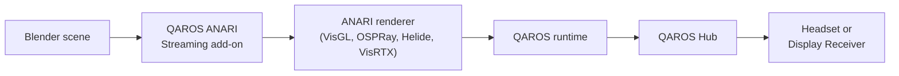

# Blender

Your open Blender scene, live in the room: edits in Blender show up within a moment, and a **Blender** panel beside the app volume edits the selected object from the headset. This page walks through it with a turbofan engine: import it into Blender and stream it with the **QAROS** tab. About 15 minutes.

You will:

- set up Blender with the QAROS add-on, one of three ways;
- import the turbine from a GLB file and place it;
- stream it and view it in a headset or a Display Receiver;
- edit the selected part live, and leave a part out of the stream;
- see the stream follow Blender's viewport shading, and choose the renderer.

The screenshots show add-on **0.5.0** in Blender 4.5 LTS.

## Before you start

| | Needed |
|---|---|
| **QAROS ANARI Streaming** add-on | 0.5.0 (step 3 installs it) |
| QAROS | installed and running on this PC, with the **ANARI device** component (default from 0.10.0). 0.9.0 or newer for the add-on; the Visualizer installs it from 0.10.0 |
| Blender | **4.5 LTS or newer**, on the same PC (Windows). Older versions are not supported |
| GPU | OpenGL 4.3 for the VisGL renderer (any recent NVIDIA, AMD or Intel GPU). OSPRay and Helide run on the CPU; VisRTX needs an NVIDIA RTX GPU and is optional |
| Viewer | a Display Receiver in the Visualizer, or a headset paired with this QAROS ([Before You Start](./start-qaros-and-add-a-receiver.md)) |

The picture in the headset is not Blender's viewport: an ANARI renderer inside Blender draws it ([Step 9](#step-9-shading-and-renderer)).

## The model

**[Download turbofan.glb](https://github.com/Quaternar/qaros-blender/raw/v0.5.0/demo/assets/turbofan.glb)** (11 MB, glTF binary).

- Work: "Turbine | Turbofan Engine | Jet Engine" by [blenderbirb](https://sketchfab.com/blenderbirb).
- Licence: [CC BY 4.0](https://creativecommons.org/licenses/by/4.0/). Credit the author when you show or share it.
- Source: [Sketchfab](https://sketchfab.com/3d-models/turbine-turbofan-engine-jet-engine-74c6aceed86b4a41aaad3b93afc3e262). The download above is the unchanged model.
- Contents: 19 meshes, about 236,000 triangles, 6 materials with constant colours and no textures. Everything in it streams.

## Step 1: Start QAROS and add a receiver

Follow [Before You Start: Start QAROS and Add a Receiver](./start-qaros-and-add-a-receiver.md): start QAROS, open the Visualizer, and add a **Display Receiver** (**+ Add receiver** at the bottom of the **Stream Graph**), or start the player app on your paired headset. Without one, Blender streams to nobody and you see nothing.

## Step 2: Install Blender

- Download an LTS release from [blender.org/download/lts](https://www.blender.org/download/lts/): **[Blender 4.5 LTS](https://www.blender.org/download/lts/4-5/)** is the oldest version the add-on supports.
- Newer Blender releases work too (checked with 5.2). Get them from [blender.org/download](https://www.blender.org/download/).
- Installer, zip or Steam: all work. Install it on the QAROS PC.

## Step 3: Set up Blender with QAROS

Three ways, in this order. Start with the first; if it does not find your Blender, take the second; the third always works.

| Way | You do | QAROS does |
|---|---|---|
| [1. Found by the Visualizer](#way-1-found-by-the-visualizer) | press **Install QAROS add-on**, then **Launch** | finds Blender, installs and enables the add-on, starts Blender streaming |
| [2. Added in Sources](#way-2-add-blender-in-sources) | point QAROS at `blender.exe` once | the same as way 1, for a Blender it did not find |
| [3. By hand](#way-3-by-hand) | install the add-on in Blender, start QAROS, press **Start Streaming** | nothing until you press it |

### Way 1: Found by the Visualizer

The Visualizer finds every Blender on the PC and installs the add-on into it. It looks in `Program Files`, your user's `Programs` folder, the Windows list of installed programs, and Steam.

1. Start **QAROS** from the Start menu. The Visualizer opens.
2. Click **Sources** on the left rail. Type `Blender` in the search field.
   - One row per Blender version, for example **Blender 5.2**.
   - **Detected:** QAROS found it. **Installable** / **Installed** / **Needs update:** the add-on's state in that Blender.

   

3. Click the row of your Blender. The **Detected app** dialog opens.
4. Under **QAROS add-on**, click **Install QAROS add-on** (or **Update QAROS add-on**).
   - QAROS downloads the latest add-on, checks it, copies it into that Blender's add-ons folder and enables it.
   - Nothing else in Blender changes.

   

5. The section then shows **Installed** and the version.

   

6. Click **Launch**. Blender starts and streams its scene by itself.
   - First time only: QAROS asks whether Blender may join. In **Sources**, under **Waiting for approval**, click **Approve** within 120 s ([Approved local apps](../../operator-guide/source-applications.md#approved-local-apps)).
   - **Running** shows Blender as **Connected**. **Stop** quits that Blender (it saves `quit.blend` first: **File > Recover > Last Session**).

   

No row for your Blender, or a greyed-out **Blender** row? Take way 2.

### Way 2: Add Blender in Sources

Point QAROS at the Blender it did not find. It then gets its own row, as in way 1.

1. In **Sources**, click **+** beside the search field. **Add source app** opens.

   

2. Click **Open QAROS supported app**.
3. **Executable:** click **Browse** and pick `blender.exe` in your Blender folder, for example `C:\Program Files\Blender Foundation\Blender 4.5\blender.exe` or the folder you unzipped a blender.org download into. Leave **Name** empty.

   

4. Click **Add app**. Your Blender gets its own row, for example **Blender 4.5**.
5. Continue with step 3 of way 1: click the row, **Install QAROS add-on**, **Launch**.

**Locate...** does the same from the Blender row: press it on the greyed-out **Blender** row (or **Locate another folder...** in a Blender row's **...** menu) and pick the folder with `blender.exe` ([Locating an app QAROS did not find](../../operator-guide/source-applications.md#locating-an-app-qaros-did-not-find)).

**Why not a plain app?** A Blender row installs the add-on into that Blender for you, keeps it up to date, and starts Blender with the add-on loaded and streaming by itself. A plain app entry that only names `blender.exe` starts Blender without any of that: the **QAROS** tab is missing unless you enabled the add-on yourself, and nothing streams until you press **Start Streaming**.

:::note
Way 2 needs QAROS 0.10.0 or newer. An older QAROS adds a plain app from **Open QAROS supported app**, which starts Blender without the add-on: remove it (its **...** menu) and use **Locate...**.
:::

### Way 3: By hand

Always works, also when QAROS cannot reach the internet. Use it to troubleshoot.

1. **[Download the QAROS Blender add-on](https://github.com/Quaternar/qaros-blender/releases/download/v0.5.0/qaros_blender_anari-0.5.0.zip)** (`qaros_blender_anari-0.5.0.zip`).
2. In Blender: **Edit > Preferences > Add-ons**, then **Install from Disk** (in the menu at the top right), and pick the zip.
3. Enable **QAROS ANARI Streaming**. Leave **ANARI folder** in its preferences empty.
4. Start **QAROS** from the Start menu (or run `qaros.exe` in the QAROS `bin` folder).
5. In Blender's 3D Viewport, press `N` and click the **QAROS** tab, then **Start Streaming** ([Step 7](#step-7-stream-it)).

The Visualizer leaves a hand-installed add-on alone: its row says so. To let QAROS manage it again, remove your copy from Blender and use way 1.

### Several Blender versions

- Each Blender version QAROS finds gets its own row, for example **Blender 4.5** and **Blender 5.2** side by side.
- Add another folder with **Locate another folder...** in a Blender row's **...** menu.
- Or **Duplicate as new preset** in the row's **...** menu and set its **Executable**.
- To start Blender from a preset without streaming at once, set `QAR_BLENDER_AUTO_START=0` in that preset; **Start Streaming** in the **QAROS** tab then starts it.

## The QAROS tab

The add-on puts a **QAROS** tab in the sidebar of the 3D Viewport. Open it with `N`, or **View > Sidebar**, then click **QAROS** on the sidebar's edge. It is built like Blender's own tabs: panels you can fold, and a tooltip on every button.

| Stopped | Streaming | Lower down |
|---|---|---|
|  |  |  |

| Panel | What it shows or does |
|---|---|
| **QAROS** | the status: **Off**, **Joining QAROS**, **Streaming to N users**, or why it stopped (the icon in the header says the same). **Start Streaming**, or **Stop** with a restart button beside it. The **App volume** name: empty is **Blender** (**Blender 2** for a second Blender); change it only while stopped |
| **Active Object** | the object Blender's selection makes active, with its eye (**Stream to QAROS**), what the stream does with it, and its material ([Step 6](#step-6-select-a-part-and-set-its-look)) |
| **View** | the stream's shading, following the viewport by default, and **Fit Scene to Volume** ([Step 9](#step-9-shading-and-renderer)) |
| **Renderer** | the renderer that draws the stream, what it can show of your materials, **Frame Rate**, **Resolution** and the VisRTX materials |
| **Streams To** | **All devices**, or a checkbox per headset or receiver; a dot marks one that receives the stream now |
| **Headset** | what hand gestures in the app volume do: **Navigation** or **Object selection**; whether the controls panel beside the app volume is open |
| **Diagnostics** (folded) | objects and triangles streamed, objects outside the volume, and every material approximation or object left out; a warning sign in its header when there is one |

## Step 4: Import the turbine

1. In Blender's default scene, select the **Cube** and press `X` > **Delete**.
2. **File > Import > glTF 2.0 (.glb/.gltf)**.
3. Pick `turbofan.glb`, click **Import glTF 2.0**. The default options are fine.

   

4. The engine appears at the world origin, about 4 m long, along the X axis.

The import makes one empty, **Sketchfab_model**, with the engine parts as its children (**Object_2**, **Object_3**, ...).

## Step 5: Scale and place it

The world origin sits at the centre of the app volume. One Blender unit is 0.25 m in the room by default, so the 4 m engine is 1 m long there.

- **Move it:** select **Sketchfab_model** in the Outliner, press `G`, or type **Location** in the sidebar's **Item** tab. Keep it near the origin.
- **Scale it:** press `S`, or set **Scale** on **Sketchfab_model**. All parts follow.
- **Turn it:** press `R`, for example `R` `Z` `90` to face it along Y.
- Skip exact sizing: **Fit Scene to Volume** (step 7) fits whatever you have.

Objects hidden in the viewport (eye icon in the Outliner) are not streamed.

## Step 6: Select a part and set its look

The stream follows Blender's selection and the selected object's own settings.

1. Click a part in the viewport or the Outliner, for example the yellow rings (**Object_5**).
2. **Active Object** in the QAROS tab shows it:
   - **Streamed, outlined in the headset**: it is in the stream, and the headset marks the selection;
   - its material, with the values the stream uses.

   

3. **Object Properties** (orange square): **Location**, **Rotation**, **Scale** stream as you change them. **Transform** in **Active Object** has the same values.
4. **Material Properties** (red sphere): edit the **Principled BSDF**.

   

   - Streamed: **Base Color**, **Metallic**, **Roughness**, **Alpha**, **Emission Color** and **Strength**. In **Solid** shading, the material's **Viewport Display > Color**.
   - Use constant values. An input linked to a texture or node streams the material's viewport colour.
   - The turbine's materials are shared by several parts: a change recolours all of them.

**Leave a part out of the stream:** click the eye beside the object's name in **Active Object**. The part stays in Blender and leaves the headset at once; the line below reads **Left out of the stream**. Click the eye again to bring it back. The choice is saved with the `.blend` file.

| In Blender | In the headset |
|---|---|
|  |  |

## Step 7: Stream it

If you launched Blender from the Visualizer (ways 1 and 2), it already streams: skip to point 6.

1. Make sure QAROS is running (Start menu > **QAROS**).
2. Open the **QAROS** tab (`N`).
3. Optional: type an **App volume** name, for example `Turbine`.
4. Click **Start Streaming**.
5. First time only: click **Approve** under **Waiting for approval** in the Visualizer's **Sources** within 120 s.
6. The status reads **Streaming to 1 user** once a device watches.
7. Click **Fit Scene to Volume** (in **View**) to fill the app volume with the engine.

To pick devices, untick **All devices** under **Streams To** and tick the ones you want. The change applies at once.

## Step 8: View it in the headset

1. Put on the paired headset, or open a Display Receiver. The engine sits in its app volume, with a **Blender** panel beside it.
2. Walk around it and look through the open casing.
3. Interact. **Headset** in the QAROS tab (or the panel's **Tools** tab) chooses what hand gestures do:

   | Do | **Navigation** (default) | **Object selection** |
   |---|---|---|
   | Double tap a part | selects it in Blender too | selects it in Blender too |
   | One-hand drag | moves your view; Blender's scene stays unchanged | moves the selected part, when the drag starts on it, in Blender too |
   | Two hands apart or together | zooms the view | scales the selected part |

   | On the panel | Does |
   |---|---|
   | **Object** tab | edits the selected part's location, rotation, scale |
   | **Material** tab | edits base colour, roughness, metallic |
   | **Frame** tab | sets the current frame, plays the animation |
   | **Panels** tab | Blender's Transform, Relations and Visibility panels |
   | **Undo** / **Redo** | steps back through edits |

4. Edit in Blender at the same time: every change shows in the room within a moment.

## Step 9: Shading and renderer

The headset picture does not come from Blender's viewport: a renderer inside Blender draws it. It follows the viewport's shading, though.

**Viewport shading** (the four spheres at the top right of the viewport, or `Z`): the stream switches with it within a moment.

| Wireframe | Material Preview |
|---|---|
|  |  |

| Shading | The stream shows |
|---|---|
| **Wireframe** | the edges of every mesh, faces empty |
| **Solid** | matte surfaces in each material's **Viewport Display > Color** |
| **Material Preview** | the materials (step 6), lit like the viewport: the scene's lamps and World only with its **Scene Lights** / **Scene World** options |
| **Rendered** | the materials with the scene's lamps and World |

- **View** in the QAROS tab can fix one shading for the stream instead: its first button (a chain link, **Follow Viewport**) follows the viewport, the others keep one shading whatever the viewport shows. The line below names the shading in use.
- A change rebuilds the scene in the new shading, which takes a moment on a large scene.
- Metal reflects only lamps, not Material Preview's studio light: add a lamp or two for highlights.

**The renderer** is the drop-down in the **Renderer** panel:

| Renderer | Runs on | Look | Use it for |
|---|---|---|---|
| **Automatic** (default) | the first that starts: VisGL, VisRTX, OSPRay, Helide | as that renderer | most PCs |
| **VisGL** | GPU, OpenGL 4.3 | lit, shadows, metallic, roughness, emission; no selection outline | headsets: fastest |
| **VisRTX** | NVIDIA RTX GPU | ray traced; grain in a moving view, or smooth with **VisRTX** materials **Matte** | comparing with a ray tracer |
| **OSPRay** | CPU | flat shading, hard shadows; colour only | PCs without a usable GPU |
| **Helide** | CPU | simple reference shading | checking a result |

- Choose one while streaming: the stream restarts on it at once, in the same app volume. Stopped, it applies at the next **Start Streaming**.
- The line below the drop-down says which renderer runs and what it can show of your materials.
- The selected part is outlined in orange in the headset on VisRTX, OSPRay and Helide. VisGL draws no outline.

## Step 10: Stop

- **Stop** in the QAROS tab. The app volume closes; Blender stays open.
- Or **Stop** on Blender's card under **Running** in the Visualizer: that quits Blender.
- **File > Save** keeps the scene, its **App volume** name, its **Streams To** choice and every part's eye.

## Limits

- **Materials:** only constant **Principled BSDF** values stream (base colour, metallic, roughness, alpha, emission). Not textures, vertex colours, normal maps, glass, coat, sheen or subsurface.
- **Lights:** a sun stays a sun; point, spot and area lamps become point lights. The World or HDRI streams only in **Rendered** shading or with Material Preview's **Scene World** option.
- **Not streamed:** Gaussian splats, point clouds, meshes without faces, objects hidden in the viewport, and objects completely outside the app volume.
- **One app volume per Blender.** A second Blender streams into *Blender 2*.
- **Scale:** Blender's world origin sits at the volume centre, Z up is up, and 1 Blender unit is 0.25 m by default.
- A change of the add-on's **ANARI folder** preference needs a Blender restart. Leave it empty: the add-on then uses the ANARI device QAROS installed.
- A Blender you started yourself is never closed by QAROS; **Stop** in the Visualizer quits only a Blender it launched.

## If something is off
| Problem | Fix |
|---|---|
| No **QAROS** tab in Blender | Blender started without the add-on. Start it from its Blender row in **Sources** (way 1 or 2), or install and enable the add-on by hand (way 3). |
| Status stays at **Joining QAROS** | Approve Blender in the Visualizer's **Sources** under **Waiting for approval**; the request expires after 120 s. |
| No **Install QAROS add-on** on the row | The add-on was installed by hand: update it by hand, or remove it from Blender and let QAROS install it. |
| Your Blender has no row | Way 2: **+** > **Open QAROS supported app**, or **Locate...**. |
| Nothing in the headset | Check **Streams To**, and that the headset is paired. |
| A part is missing in the headset | Its eye in **Active Object** is closed, or it is hidden in the viewport, or outside the volume (**Diagnostics**). |
| Engine tiny, huge or cut off | **Fit Scene to Volume**. |
| Slow, all CPU cores busy | The renderer is OSPRay or Helide: choose **VisGL** in **Renderer**. |
| A colour change does nothing | Edit the **Principled BSDF** that feeds **Material Output** with a constant value; in **Solid** shading, edit **Viewport Display > Color**. |
| No renderer loads | Install QAROS with the **ANARI device** component; leave the add-on's **ANARI folder** preference empty. |
| A second headset shows nothing | Check **Streams To**, and the **Users** limit in the **QAROS** tab (2 by default). |
| The row says *Installed by hand, not by QAROS* | Remove your copy from Blender to let QAROS manage it, or keep updating it yourself (way 3). |

More, for every add-on setting: the [QAROS Blender add-on user guide](https://github.com/Quaternar/qaros-blender/blob/main/docs/user-guide.md).
