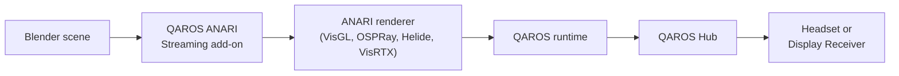
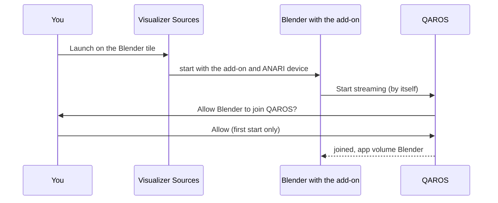

# Blender

## What you get

Your open Blender scene, live in the room: edits in Blender show up within a moment. A **Blender** panel beside the app volume edits the active object from the headset.

*Turbofan model by [blenderbirb](https://sketchfab.com/blenderbirb), [CC BY 4.0](https://creativecommons.org/licenses/by/4.0/); the [demo](https://github.com/Quaternar/qaros-blender/tree/main/demo) of the add-on.*

<!-- Screenshot needed: a Blender scene streamed to a Display Receiver with the Blender panel, captured on the released add-on (0.4.1). -->

| | Version |
|---|---|
| **QAROS ANARI Streaming** add-on | 0.4.1 |
| Blender | 4.5 LTS or newer |
| QAROS | 0.9.0 or newer, with the **ANARI device** component (default from 0.10.0). Install from the Visualizer: 0.10.0. |
| OS | Windows |

- The picture is not Blender's viewport: an ANARI renderer inside Blender draws it.
- VisGL needs an OpenGL 4.3 GPU; OSPRay and Helide run on the CPU; VisRTX needs an NVIDIA RTX GPU and is optional.

## Install

- **Blender** 4.5 or newer from [blender.org](https://www.blender.org/download/) (installer, zip or Steam).
- **The add-on, from the Visualizer (recommended):** open the **Blender 4.5** tile (your version), press **Install QAROS add-on** (later **Update QAROS add-on**).
  - QAROS downloads the [latest release](https://github.com/Quaternar/qaros-blender/releases/latest), checks its SHA-256, copies it into that Blender version's add-ons folder and enables it.
  - No other add-on or setting changes. Blender started any other way has the add-on too.
- **By hand:** download `qaros_blender_anari-<version>.zip` from the [releases](https://github.com/Quaternar/qaros-blender/releases/latest).
  1. In Blender: **Edit > Preferences > Add-ons > Install from Disk**, pick the zip.
  2. Enable **QAROS ANARI Streaming**.
  3. QAROS leaves a hand-installed add-on alone: the tile shows **Detected**.
- Leave the add-on's **ANARI folder** preference empty: it then uses the ANARI device QAROS installed.

## Connect to QAROS

- **Detection:** one tile per Blender version, for example **Blender 4.5**. QAROS looks in `Program Files`, your user's `Programs` folder, the Windows uninstall list and Steam.
- **Not found:** a greyed-out **Blender** row with **Locate...**.
  1. Press **Locate...** (or **Add Blender folder...** in the Apps heading).
  2. Pick the folder with `blender.exe` (an unzipped blender.org download works).
  3. Every **Refresh** searches it from then on. See [Locating an app QAROS did not find](../../operator-guide/source-applications.md#locating-an-app-qaros-did-not-find).
- **Start it:** click the tile, press **Launch**. Blender starts streaming by itself.
- **Start it from Blender instead:** 3D View > `N` > **QAROS** tab > **Start streaming**. **Stop streaming** keeps Blender open.
- **Allow it once:** click **Allow** within 120 s ([Approved local apps](../../operator-guide/source-applications.md#approved-local-apps)).
- **Stop** in the Visualizer quits that Blender without a save prompt. It saves `quit.blend` first: **File > Recover > Last Session** brings your work back. A Blender you started yourself is never closed by QAROS.
- **Several Blender versions:**
  - each version found gets its own tile;
  - add another with **Locate another folder...** in the row's **...** menu;
  - or **Duplicate as new preset** and set its **Executable**, for example Blender 4.5 and 5.2 side by side;
  - to launch without streaming, set `QAR_BLENDER_AUTO_START=0` in a preset.

<!-- Screenshot needed: Blender's QAROS sidebar tab (Start streaming, Streams to), from the add-on's own docs or a live capture. -->

## First session

1. **Open a target:** a paired headset or a Display Receiver.
2. **What you see:**
   - an app volume *Blender* (*Blender 2* for a second Blender);
   - Blender's world origin at the volume centre, Z-up is up;
   - 1 Blender unit = 0.25 m by default (a 4 m scene fills a 1 m volume);
   - objects fully outside the volume are not streamed. **Fit scene to volume** on the **QAROS** tab fixes that.
3. **Gestures:**

   | Gesture | Does |
   |---|---|
   | Click an object | Selects it, makes it active |
   | One-hand drag that grabs the selected object | Moves that object in Blender |
   | One-hand drag anywhere else | Moves the view |
   | Click empty space | Clears the selection |
   | Two-hand scale or rotate | Scales or rotates the view |

   Moving the view never changes the `.blend` file or the undo history.
4. **The Blender panel** edits the active object, with undo and redo:

   | Tab | Edits |
   |---|---|
   | **Object** | Location, rotation, scale |
   | **Material** | Base colour, roughness, metallic |
   | **Frame** | Current frame, play |
   | **Panels** | Blender's Transform, Relations, Visibility |

5. **Streams to** on the **QAROS** tab: **All devices**, or single headsets and receivers.

## Tips and limits

- Materials: only constant **Principled BSDF** values stream (base colour, metallic, roughness, alpha, emission). Not textures, vertex colours, normal maps, glass, coat, sheen or subsurface.
- Lights: a sun stays a sun; point, spot and area lamps become point lights. The World/HDRI is not streamed.
- Not streamed: Gaussian splats, point clouds, meshes without faces.
- One app volume per Blender. **Backend** and **ANARI folder** changes need a Blender restart.
- Fastest backend: **VisGL**.

## Troubleshooting

| Problem | Fix |
|---|---|
| Nothing after **Start streaming** | Click **Allow** in the QAROS prompt; it expires after 120 s. |
| No backend loads | Install QAROS with the ANARI device component; leave **ANARI folder** empty. |
| Slow, all CPU cores busy | Choose the **VisGL** backend. |
| Part of the scene missing, or tiny or huge | **Fit scene to volume**, or a new **App volume** name to reset its scale. |
| A headset shows nothing | Check **Streams to** and the **Users** limit (default 2). |
| Tile says *Installed by hand, not by QAROS* | Remove your copy from Blender to let QAROS manage it, or keep updating it yourself. |

Full add-on guide: [qaros-blender user guide](https://github.com/Quaternar/qaros-blender/blob/main/docs/user-guide.md).
