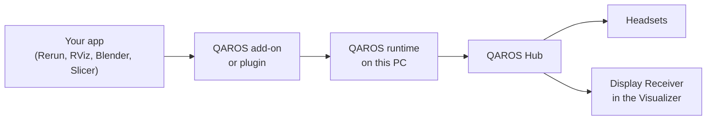

# Supported Apps

A **supported app** is a desktop application you already use, extended with a QAROS add-on or plugin. QAROS streams its 3D view into an app volume that everyone in the session sees.

| App | What streams | Added by | Visualizer installs it |
|---|---|---|---|
| [Rerun](./rerun.md) | Rerun's 3D view, 2D views as panels, a timeline | the `qaros-rerun` viewer | Yes, **Rerun** tile |
| [RViz (ROS 2)](./rviz.md) | The RViz2 scene, RViz panels, AR tools, video, picks | the `qar_rviz_streaming` plugin | Yes, **ROS 2 Rviz** tile |
| [Blender](./blender.md) | The open Blender scene, a controls panel | the **QAROS ANARI Streaming** add-on | Yes, **Blender** tile |
| [3D Slicer](./3d-slicer.md) | Slicer's volume rendering, slice views as panels | the **QAROS Live Renderer** module | No, by hand |

## How it works

## Start any of them

1. **Install QAROS** on the PC that runs the app (the Hub PC).
2. **Start QAROS and add a receiver** first: [Before You Start: Start QAROS and Add a Receiver](./start-qaros-and-add-a-receiver.md). A fresh Visualizer has no receiver, so an app streams to nobody until you add one or start a paired headset.
3. **Open Sources.** In the Visualizer, open **Sources** (the **Source Applications** panel). Rerun, RViz and Blender each have a tile there.
4. **Install the plugin.** Open the tile and press **Install**: QAROS downloads the app's QAROS add-on or plugin for you.
5. **Launch.** Press **Launch** on the tile.
6. **Allow it once.** The first start asks *"Allow &lt;app&gt; to join QAROS?"*: click **Allow** (see [Approved local apps](../../operator-guide/source-applications.md#approved-local-apps)).
7. **See it** on a paired headset ([Pair a Headset](../../operator-guide/visualizer-tutorials/pair-a-headset.md)) or a Display Receiver ([Stream to a 3D Monitor](../../operator-guide/visualizer-tutorials/stream-to-a-3d-monitor.md)).
8. **Move it.** Grab the app volume to move or rotate it, pinch with two hands to scale it ([Moving and scaling app volumes](../working-in-a-session.md#moving-and-scaling-app-volumes)).

- The Visualizer installs and updates add-ons and plugins from QAROS **0.10.0**. With an older QAROS, install them by hand as each page says.
- Tiles, **Locate...**, presets, the **+** dialog and UI modes: [Source Applications](../../operator-guide/source-applications.md).
- Step by step with Blender: [Blender](./blender.md), with a turbofan engine.
- Step by step with Rerun: [Rerun](./rerun.md), from a PC without Rerun to an example recording in the headset. Logging your own data, every option and building the viewer: [The Rerun Viewer](../../developer-guide/rerun-viewer.md) in the Developer Guide.
- To stream an app of your own: [Developer Guide](/docs/developer-guide/getting-started).
