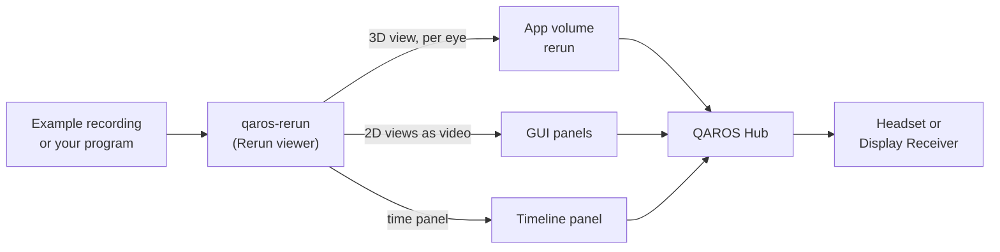

# Tutorial: Stream a Rerun Example

Start the Rerun viewer from the Visualizer, open one of Rerun's example recordings, and see it in the room: the 3D view in its app volume, the images, plots and text as panels beside it, and a timeline you can scrub with a finger. About 10 minutes, no code.


You will:

- install the QAROS Rerun viewer (`qaros-rerun`) from the Visualizer, or by hand;
- start it from the **Rerun** tile;
- pick an example recording in Rerun's welcome screen;
- see what streams and control the timeline;
- view it in a headset or a Display Receiver.

The screenshots show `qaros-rerun` **0.1.0**, which is Rerun **0.40.0**. For the viewer in general, every option and logging your own data, see [Rerun](./rerun.md).

## Before you start

| | Needed |
|---|---|
| QAROS | installed and running on this PC (Windows x64) |
| GPU | a Vulkan driver (any recent NVIDIA, AMD or Intel GPU) |
| Internet | for the download and the example recordings, which Rerun loads from its website |
| Viewer | a headset paired with this QAROS ([Pair a Headset](../../operator-guide/visualizer-tutorials/pair-a-headset.md)), or a Display Receiver ([Stream to a 3D Monitor](../../operator-guide/visualizer-tutorials/stream-to-a-3d-monitor.md)) |

## What the Rerun source is

[Rerun](https://rerun.io) records and shows multimodal data: point clouds, meshes, camera images, depth, plots, text and logs, on a timeline. `qaros-rerun` is the Rerun viewer with a second output to QAROS.



- The viewer runs on the QAROS PC. Its desktop window stays a normal Rerun viewer.
- QAROS starts it as a **source**: a QAROS API app that joins QAROS by itself.
- Everything you open in it streams: an example, a `.rrd` file, or data your own program logs.

## Step 1: Install the viewer

### From the Visualizer (recommended)

1. Start **QAROS** from the Start menu. The Visualizer opens.
2. Click **Sources** on the left rail. Find the **Rerun** row.

   

3. Click the row. The **Detected app** dialog opens.
4. Under **Download**, press **Install** (or **Update**). QAROS downloads the [latest viewer](https://github.com/Quaternar/qaros-rerun/releases/latest), checks it and unpacks it for your Windows user. No administrator rights.
5. When it shows **Installed** with its version, you are done.

   

The Visualizer installs it from QAROS **0.10.0**.

### By hand

- **QAROS viewer:** [Download the viewer](https://github.com/Quaternar/qaros-rerun/releases/latest) (`qaros-rerun-<version>-windows-x64.zip`) and unzip it anywhere. It uses the installed QAROS.
- **Rerun itself** (only for your own programs, not for this tutorial): [download the SDK and the stock viewer of Rerun 0.40.0](https://github.com/rerun-io/rerun/releases/tag/0.40.0), or [another version](https://github.com/rerun-io/rerun/releases). For Python: `pip install rerun-sdk==0.40.0`. Use the SDK of the viewer's version.
- **C++ runtime:** the Microsoft Visual C++ 2015-2022 Redistributable (x64). The QAROS 0.10.0 setup installs it; otherwise `winget install Microsoft.VCRedist.2015+.x64`.

## Step 2: Start the Rerun source

1. In the **Detected app** dialog of the **Rerun** row, press **Launch**.
2. **First start only:** QAROS asks *"Allow qaros-rerun to join QAROS?"*. Check the path and click **Allow** within 2 minutes ([Approved local apps](../../operator-guide/source-applications.md#approved-local-apps)). Later starts join without asking.
3. The Rerun viewer window opens with its welcome screen. In the Visualizer, the row shows **1 on** and the **Running** list a *Connected* row.

The tile starts the viewer as:

```
qaros-rerun.exe --sink qaros --launched-by-qaros --local-app --window --panels
```

| Argument | Does |
|---|---|
| `--sink qaros` | streams to QAROS |
| `--launched-by-qaros`, `--local-app` | joins as an app QAROS started; stops when you press **Stop** |
| `--window` | opens the desktop window, where you pick the example |
| `--panels` | streams the 2D views and the timeline as panels |

:::note
A QAROS whose Rerun tile does not pass `--panels` yet streams the 3D view only. Add it yourself: the row's **...** menu, **Duplicate as new preset**, then in **Developer** UI mode add `--panels` as a new line under **Arguments** and press **Save** ([Source Applications](../../operator-guide/source-applications.md#presets)).
:::

## Step 3: Pick an example

1. In the Rerun window, scroll the welcome screen to **Example recordings**.

   

2. Click an example. This tutorial uses **ARKit scenes**: a room scanned with a phone, with the camera image, depth and labelled boxes. Rerun downloads it (30 MB) and starts playing it.
3. The viewer now shows the example's layout: the **3D** view, the **BGR** image (with **Depth** as a second tab), the **Readme**, and the time panel at the bottom.

Each card names its kind: **3D** examples fill the app volume, **2D** examples open panels, examples with both do both. More examples follow below the first row. An example with no 3D view streams panels and the timeline only; one with no 2D view streams the scene and the timeline.

## Step 4: See what streams

| In the Rerun window | In the room |
|---|---|
| The **3D** view | The scene in the app volume *Rerun*, 1.5 m on each side, in stereo for each headset, fitted to about 0.7 of the volume |
| Each other visible view (image, depth, plot, text, map) | A panel of its own, 0.45 m wide, beside the scene |
| The time panel | The **timeline panel**: a track and a **Play** button, in front of you |

- Each panel's title starts with the view's name: `bgr.stream...`, `readme.stream...`, `timeline.panel-stream...`.
- A view becomes a panel about 3 s after it shows up in the layout. A view in a hidden tab (here **Depth**) does not stream: click its tab to stream it instead.
- Panels are video of the viewer's own pixels, updated about 17 times a second.
- Rerun's own labels and selection overlays in the 3D view do not stream; in the image panels they do, since those are the view's pixels.


## Step 5: Control the timeline

| Do | Where | Result |
|---|---|---|
| Drag along the track | Timeline panel, with a finger | Pauses and moves the time cursor; the 3D view and every panel follow |
| Tap **Play** | Timeline panel | Plays on from there; examples loop |
| Drag the time cursor, press play or pause | Rerun window, time panel | The timeline panel follows a few times a second |
| Change speed or the timeline | Rerun window, time panel | Applies to the stream too |

The desktop and the headsets share one time: whoever moves it last wins.

## Step 6: View it in the headset

1. Start the QAROS player app on a paired headset ([Pair a Headset](../../operator-guide/visualizer-tutorials/pair-a-headset.md)). A headset that joins later gets the stream within about a minute.
2. Look for the app volume *Rerun*, 0.5 m above and 1.6 m in front of the room origin.
3. The panels open within reach of the first headset near the scene: the timeline straight ahead at elbow height, the views to the sides.
4. Gestures:
   - one-hand grab moves the scene, a two-hand spread scales it;
   - drag a panel by its edge to move it;
   - a finger on the timeline track scrubs, a tap on **Play** plays.
5. QAROS keeps the scene's place and every panel's place for the next start.

Without a headset, add a **Display Receiver** in the Visualizer ([Stream to a 3D Monitor](../../operator-guide/visualizer-tutorials/stream-to-a-3d-monitor.md)): it shows the same scene and panels. Its panels open in front of it once no headset has streamed for 60 s.

## Tips

- **Your own data** goes to the same viewer: log to `rerun+http://127.0.0.1:9876/proxy` from any Rerun SDK 0.40.0 ([Rerun](./rerun.md#first-session)).
- **A `.rrd` file:** **File** > **Open** in the Rerun window, or drag the file onto it.
- **Panels from your own layout:** send a blueprint with one 3D view and the 2D views you want as panels.
- **Sitting at a desk:** add `--panel-posture sitting` in a preset, so the panels clear the desk.
- **Panels too far away** (left by another headset): add `--move-far-panels`, or close the panels in the Hub Display for fresh placement.
- **Several examples at once:** **+** in **Sources** of the Rerun window. Each recording is fitted to the volume by itself.
- Don't minimise the Rerun window while it streams: cover it instead.

## Troubleshooting

| Problem | Fix |
|---|---|
| The viewer window does not open, the row shows *Waiting for approval* | Click **Allow** in the QAROS prompt (tray window, or **Sources** > **Waiting for approval**). |
| The welcome screen shows no examples | They load from Rerun's website: check the PC's internet connection or proxy. |
| Only the 3D view streams, no panels | The tile must pass `--panels` (Step 2 note). With `qaros-rerun` 0.1.0, another app's served panel (a web app's controls panel) stops the listing: the viewer logs `cannot list panels (... unknown content type ...)`. Update `qaros-rerun`, or close that panel. |
| A view does not stream | It is in a hidden tab, or the view is a 3D view: only one 3D view becomes the scene. |
| Nothing in the headset | The player app runs and is joined; the volume *Rerun* is in front of the room origin. Start with `--reset-placement` if the scene was moved away. |
| `QAROS handed back app volume "rerun" closed` | Another viewer has that volume: give one `--volume-name` another name. |
| Slow with large point clouds | Shorter time windows in the blueprint; compact recordings with `rerun rrd optimize`. |

More: the [Rerun](./rerun.md) page.
