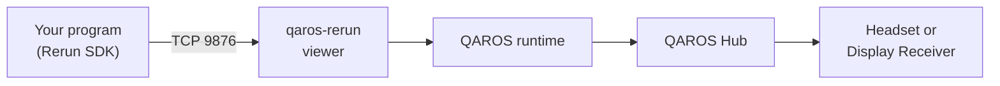
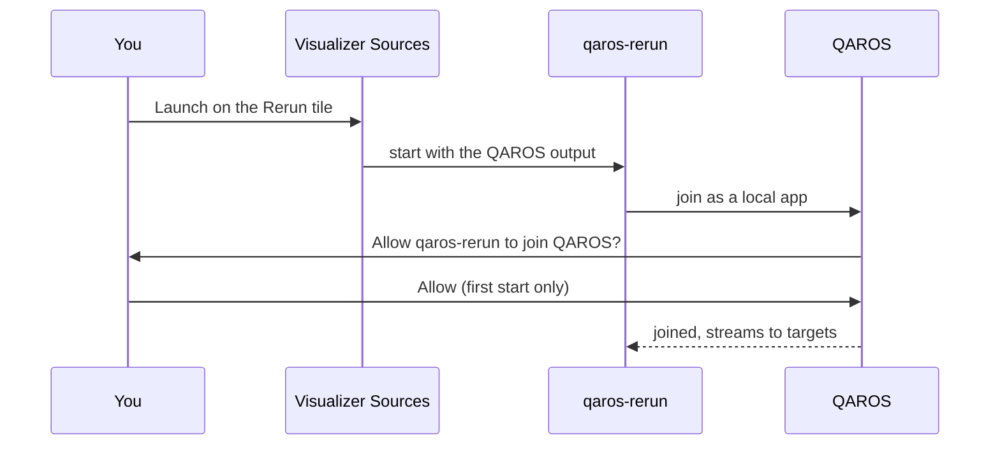

# Rerun

## What you get

Your Rerun data in the room, in stereo for each headset, with 2D views as panels and a timeline. Any Rerun SDK (Python, Rust, C++) logs to it unchanged.


| | Version |
|---|---|
| `qaros-rerun` | 0.1.0 |
| Rerun viewer and SDK | 0.40.0 (other SDK versions untested) |
| QAROS | 0.9.0 or newer. Panels: 0.9.0-dev.3177 or newer. Install from the Visualizer: 0.10.0. |
| OS | Windows x64 on the Hub PC, Vulkan GPU driver. Your logging program: any OS. |



## Install

- **From the Visualizer (recommended):** open the **Rerun** tile in **Sources**, press **Install** (later **Update**).
  - QAROS downloads the latest [qaros-rerun release](https://github.com/Quaternar/qaros-rerun/releases/latest) and checks its SHA-256.
  - It unpacks it for your Windows user, without administrator rights.
- **By hand:** download `qaros-rerun-<version>-windows-x64.zip` from the [releases](https://github.com/Quaternar/qaros-rerun/releases/latest) and unzip it anywhere. It uses the installed QAROS.
- **Your program:** the Rerun SDK at the same version, for example `pip install rerun-sdk==0.40.0`.
- **C++ runtime:** the Microsoft Visual C++ 2015-2022 Redistributable (x64). QAROS 0.10.0 installs it; otherwise `winget install Microsoft.VCRedist.2015+.x64`.

## Connect to QAROS



- **Detection:** QAROS does not search the PC for Rerun. The tile reads:

  | State | Means |
  |---|---|
  | **Installable** | A release for your QAROS exists. Press **Install**. |
  | **Installed** | QAROS installed it. |
  | **Needs update** | A newer release runs with your QAROS. Press **Update**. |
  | **Detected** | A viewer you built yourself and registered. |

- There is no greyed-out row or **Locate...** for Rerun: install it from the tile.
- **Start it:** click the **Rerun** tile, press **Launch**. The viewer opens a desktop window too.
- **Allow it once:** click **Allow** within 2 minutes ([Approved local apps](../../operator-guide/source-applications.md#approved-local-apps)).
- **Start it yourself instead** (Hub PC, signed-in desktop session, not over SSH):

  ```
  qaros-rerun.exe --sink qaros --local-app --panels
  ```

- **Several versions or settings:** the tile's **...** menu, **Duplicate as new preset**, then set **Executable** or arguments (arguments show in the Developer UI mode). Two viewers at once need different `--volume-name` values.


<!-- Screenshot needed: Rerun tile editor in Sources with Install / Launch (QAROS running). -->

## First session

1. Open a target: the player app on a paired headset, or a Display Receiver. A headset that joins later gets the stream within about a minute.
2. Log data. Quick test: `log-test-scene.exe 600` from the release folder shows an orange cube in a ring of light-blue points. From Python:

   ```python
   import rerun as rr
   rr.init("my_app")
   rr.connect_grpc("rerun+http://127.0.0.1:9876/proxy")
   ```

3. What you see:

   | In the room | From Rerun |
   |---|---|
   | App volume *rerun* (1.5 m), content fitted to about 0.7 of it | The 3D view |
   | View-only panels (needs `--panels`) | Each visible 2D view |
   | Timeline panel: drag the track to scrub, tap **Play** | The time bar, synced both ways |

4. Gestures: one-hand grab moves the scene, two-hand spread scales it. The placement is kept for the next run.

- **Replay a `.rrd`:** send it through the SDK (`log_file_from_path("recording.rrd")`) or use **File > Open** in the desktop viewer.

## Tips and limits

- Send a blueprint with one 3D view: it becomes the scene, other visible views become panels.
- Not streamed: Rerun's labels and overlays. Data outside the volume is cut.
- Up to two users rendered at once (`--max-users`); a third waits for a slot.
- Don't minimize the desktop window: it freezes the 2D panels. Cover it instead.
- Port 9876 has no authentication. Log from another PC only on a trusted network, with TCP 9876 allowed in the Hub PC's firewall.
- METALENSE 2: the two-hand spread barely scales the scene (known issue).
- Large point clouds: shorter time windows, or `rerun rrd optimize in.rrd -o out.rrd`.

## Troubleshooting

| Problem | Fix |
|---|---|
| The viewer waits at start | Click **Allow** in the QAROS prompt (tray window, or **Sources** > **Waiting for approval**). |
| Nothing in the headset | Check the headset player is running and joined, or open the Visualizer. Start with `--reset-placement` if the scene was moved away. |
| No panels | Start with `--panels`; keep the views visible (not in a hidden tab); QAROS 0.9.0-dev.3177 or newer. |
| `QAROS handed back app volume "rerun" closed` | Another viewer has that volume: use a different `--volume-name`. |
| SDK on another PC cannot connect | Allow TCP 9876 in the Hub PC's firewall, use its LAN address. |

More: [quick start](https://github.com/Quaternar/qaros-rerun/blob/main/docs/quick-start.md) and [known issues](https://github.com/Quaternar/qaros-rerun/blob/main/docs/known-issues.md).
