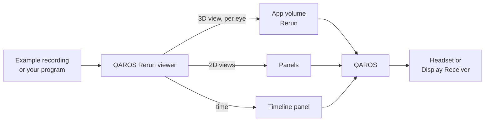

# Rerun

Stream [Rerun](https://rerun.io) into the room: the 3D view in its app volume, the images, plots and text as panels beside it, and a timeline you can scrub with a finger. This tutorial starts on a PC with no Rerun at all and opens one of Rerun's example recordings. About 10 minutes, no code.


You will:

- set up the QAROS Rerun viewer, one of three ways;
- pick an example recording in Rerun's welcome screen;
- see what streams, and control the timeline;
- view it in a headset or a Display Receiver.

The screenshots show the QAROS Rerun viewer **0.1.1**, which is Rerun **0.40.0**. To log your own data, script the viewer or build it yourself, see the developer page [The Rerun Viewer](../../developer-guide/rerun-viewer.md).

## Before you start

| | Needed |
|---|---|
| QAROS | installed and running on this PC (Windows x64), 0.10.0 or newer for way 1 |
| GPU | a Vulkan driver (any recent NVIDIA, AMD or Intel GPU) |
| Internet | for the download and for the example recordings, which Rerun loads from its website |
| Viewer | a Display Receiver in the Visualizer, or a headset paired with this QAROS ([Before You Start](./start-qaros-and-add-a-receiver.md)) |

You need nothing from Rerun itself: the QAROS Rerun viewer is a complete Rerun viewer.

## What the Rerun source is

[Rerun](https://rerun.io) records and shows multimodal data: point clouds, meshes, camera images, depth, plots, text and logs, on a timeline. The **QAROS Rerun viewer** (`qaros-rerun.exe`) is the Rerun viewer with a second output to QAROS.



- The viewer runs on the QAROS PC. Its desktop window stays a normal Rerun viewer.
- Everything you open in it streams: an example, a `.rrd` file, or data your own program logs.

## Step 1: Start QAROS and add a receiver

Follow [Before You Start: Start QAROS and Add a Receiver](./start-qaros-and-add-a-receiver.md): start QAROS, open the Visualizer, and add a **Display Receiver** (**+ Add receiver** at the bottom of the **Stream Graph**), or start the player app on your paired headset.

Do this first. The Visualizer starts a source only once something can show it; until then its card under **Running** reads **Waiting for a target**.

## Step 2: Set up the Rerun viewer

Three ways, in this order. Start with the first; if your QAROS does not offer it, take the second; the third always works.

| Way | You do | QAROS does |
|---|---|---|
| [1. From the Visualizer](#way-1-from-the-visualizer) | press **Install**, then **Launch** | downloads the viewer, starts it streaming with its panels and timeline |
| [2. Added in Sources](#way-2-add-it-in-sources) | download the viewer, add `qaros-rerun.exe` in **Sources**, type its options once | starts it streaming |
| [3. By hand](#way-3-by-hand) | download the viewer, run it from a terminal | nothing; the viewer joins QAROS by itself |

### Way 1: From the Visualizer

1. Start **QAROS** from the Start menu. The Visualizer opens.
2. Click **Sources** on the left rail. Type `Rerun` in the search field.
   - The **Rerun** row shows **Installable**: QAROS knows the viewer but has not downloaded it yet.

   

3. Click the row. The **Detected app** dialog opens.
4. Under **Download**, click **Install** (**Update** when a newer viewer is out).

   

   - QAROS downloads the latest viewer (about 80 MB), checks it and unpacks it for your Windows user. No administrator rights.
   - It goes to `%LOCALAPPDATA%\Quaternar\Qaros\apps\qaros-rerun\<version>\windows-x64\`.
5. **Download** then shows **Installed** and the version. Close the dialog and click the row again: **Executable** now names the viewer and **Launch** is blue.

   

6. Click **Launch**.
7. **First start only:** QAROS asks whether the viewer may join. In **Sources**, under **Waiting for approval**, check that the path is the viewer's and click **Approve** within 2 minutes ([Approved local apps](../../operator-guide/source-applications.md#approved-local-apps)). Later starts join without asking.

   

8. The Rerun window opens with its welcome screen. Under **Running**, the **Rerun** card shows **Connected**.

   

The **Rerun** row starts the viewer with its 2D views and timeline turned on, so everything in Step 4 streams.

No **Rerun** row in **Sources**, or it says **Not available**? Your QAROS is older than 0.10.0 or cannot reach the internet. Take way 2 or way 3.

### Way 2: Add it in Sources

Point QAROS at a viewer you downloaded. It gets a row of its own, which you set up once.

1. **[Download the viewer](https://github.com/Quaternar/qaros-rerun/releases/latest)**: `qaros-rerun-<version>-windows-x64.zip`. Unzip it into a folder of your own, for example `Documents\qaros-rerun`.
2. In **Sources**, click **+** beside the search field. **Add source app** opens.

   

3. Click **Open QAROS supported app**.
4. **Executable:** click **Browse** and pick `qaros-rerun.exe` in the folder you unzipped. **Name** fills in as `qaros-rerun`; change it if you like.

   

5. Click **Add app**. A **qaros-rerun** row appears, marked **API** only. It is a plain app, not the **Rerun** row of way 1: it does not know the viewer's options yet.

   :::warning
   Launched as it is, the viewer opens its window but never joins QAROS: its card stays at **Joining the hub**, then **Not joined**, and it writes pictures into an `out` folder beside `qaros-rerun.exe`. Click **Stop**, and give it its options first.

   
   :::

6. Switch the Visualizer to **Developer** mode: **Settings** (bottom of the left rail) > **General** > **Interface Mode** > **Developer**. Only this mode shows an app's arguments.

   

7. Click the **qaros-rerun** row. Under **Arguments**, type these six lines, one per line, exactly as the **Rerun** row of way 1 passes them:

   ```
   --sink
   qaros
   --launched-by-qaros
   --local-app
   --window
   --panels
   ```

   

8. Click **Save**, then **Launch**.
9. **First start of this copy:** click **Approve** under **Waiting for approval**, as in way 1. QAROS asks once for each `qaros-rerun.exe` on the PC.
10. The card under **Running** shows **Connected**. Switch back to **Basic** mode if you like: the row keeps its arguments.

    

What the six lines do: `--sink qaros` streams to QAROS (without it the viewer only writes pictures); `--launched-by-qaros` and `--local-app` join this PC's QAROS as an app QAROS started, so **Stop** ends it; `--window` opens the desktop window, where you pick the example; `--panels` streams the 2D views and the timeline.

### Way 3: By hand

Always works, also when QAROS cannot reach the internet or is older than 0.10.0. Use it to troubleshoot.

1. **[Download the viewer](https://github.com/Quaternar/qaros-rerun/releases/latest)** (`qaros-rerun-<version>-windows-x64.zip`) and unzip it.
2. Start **QAROS** from the Start menu (or run `qaros.exe` in the QAROS `bin` folder) and open a Display Receiver or your headset's player app (Step 1).
3. Open a terminal in the folder you unzipped (in Explorer, right-click inside the folder > **Open in Terminal**) and run:

   ```powershell
   .\qaros-rerun.exe --sink qaros --local-app --panels
   ```

   - `--sink qaros` streams to QAROS; `--local-app` joins the QAROS running on this PC; `--panels` streams the 2D views and the timeline.
   - Run it in your own Windows session, not over a remote shell.
4. **First start of this copy:** click **Approve** under **Waiting for approval** in **Sources**.
5. The Rerun window opens. The terminal shows the viewer's log; `qaros: rendering for user-1 (Display Receiver 1, ...)` means it streams.

   

6. **Quick test without an example:** in a second terminal in the same folder, run `.\log-test-scene.exe 600`. An orange cube in a ring of light-blue points, a colour image and a sine plot appear in the viewer and stream.

   | In the Rerun window | In a Display Receiver |
   |---|---|
   |  |  |

7. Stop it with Ctrl+C in the terminal, or close the Rerun window. A viewer started by hand is not listed under **Running** in **Sources**.

Started this way, the viewer opens its window by itself (`--window` is only needed when QAROS starts it). `.\qaros-rerun.exe --help` lists every option.

## Step 3: Pick an example

1. In the Rerun window, scroll the welcome screen down to **Example recordings**.

   

2. Click an example. This tutorial uses **ARKit scenes**: a room scanned with a phone, with the camera image, depth and labelled boxes. Rerun downloads it (31 MB) and starts playing it.
3. The viewer now shows the example's layout: the **3D** view, the **BGR** image (with **Depth** as a second tab), the **Readme**, and the time panel at the bottom.

   

- Each card names its kind: **3D** examples fill the app volume, **2D** examples open panels, examples with both do both.
- An example with no 3D view streams panels and the timeline only; one with no 2D view streams the scene and the timeline.
- Examples with a video (such as **Detect and track objects**) need FFmpeg on the PC to play their video; Rerun says so in the view. The other views still stream.

## Step 4: See what streams

| In the Rerun window | In the room |
|---|---|
| The **3D** view | The scene in the app volume *Rerun*, 1.5 m on each side, in stereo for each headset, fitted to about 0.7 of the volume |
| Each other visible view (image, depth, plot, text, map) | A panel of its own, 0.45 m wide, beside the scene |
| The time panel | The **timeline panel**: a track and a **Play** button, in front of you |

- Each panel's title starts with the view's name: `bgr.stream...`, `readme.stream...`, `timeline.panel-stream...`.
- A view becomes a panel about 3 s after it shows up in the layout. A view in a hidden tab (here **Depth**) does not stream: click its tab to stream it instead.
- Panels show the viewer's own pixels, updated about 17 times a second.
- Rerun's own labels and selection overlays in the 3D view do not stream; in the image panels they do.

## Step 5: Control the timeline

| Do | Where | Result |
|---|---|---|
| Drag along the track | Timeline panel, with a finger | Pauses and moves the time; the 3D view and every panel follow |
| Tap **Play** | Timeline panel | Plays on from there; examples loop |
| Drag the time cursor, press play or pause | Rerun window, time panel | The timeline panel follows a few times a second |
| Change speed or the timeline | Rerun window, time panel | Applies to the stream too |


The desktop and the headsets share one time: whoever moves it last wins.

## Step 6: View it in the headset

1. Put on the paired headset with the QAROS player app running. A headset that joins later gets the stream within about a minute.
2. Look for the app volume *Rerun*, 0.5 m above and 1.6 m in front of the room origin.
3. The panels open within reach of the first headset near the scene: the timeline straight ahead at elbow height, the views to the sides.
4. Gestures:
   - one-hand grab moves the scene, a two-hand spread scales it;
   - drag a panel by its edge to move it;
   - a finger on the timeline track scrubs, a tap on **Play** plays.
5. QAROS keeps the scene's place and every panel's place for the next start.

In a **Display Receiver** you see the same scene and panels. Its panels open in front of it once no headset has streamed for 60 s.

## Step 7: Stop

- **Stop** on the card under **Running** in **Sources** (ways 1 and 2), or Ctrl+C in the terminal (way 3), or close the Rerun window.
- The app volume and the panels are hidden, not closed: the next start shows them where you left them.

## Tips

- **A `.rrd` file:** **File > Open** in the Rerun window, or drag the file onto it.
- **Several recordings at once:** **+** next to **Sources** in the Rerun window. Each is fitted to the volume by itself.
- **Your own data:** log to the running viewer from any Rerun SDK 0.40.0, for example in Python `rr.connect_grpc("rerun+http://127.0.0.1:9876/proxy")`. Details: [The Rerun Viewer](../../developer-guide/rerun-viewer.md#log-your-own-data).
- **Sitting at a desk:** add `--panel-posture` and `sitting` as two more argument lines (way 2) or to the command (way 3): the panels then clear the desk.
- **Panels far away** (left by another headset): add `--move-far-panels`, or close the panels in the Hub Display for fresh placement.
- Don't minimise the Rerun window while it streams: that freezes the panels. Cover it instead.

## If something is off

| Problem | Fix |
|---|---|
| The **Running** card says **Waiting for a target** | Nothing can show the stream yet: open a Display Receiver or the headset's player app (Step 1). |
| The card says **Waiting for approval**, no Rerun window | Click **Approve** under **Waiting for approval** in **Sources**. |
| **Launch** stays grey right after **Install** | Close the dialog and click the **Rerun** row again. |
| A hand-added **qaros-rerun** row stays **Joining the hub**, then **Not joined** | It starts without options. Add the six argument lines of way 2, step 7. |
| No **Rerun** row, or it says **Not available** | QAROS older than 0.10.0, or no internet: take way 2 or way 3. |
| The welcome screen shows no examples | They load from Rerun's website: check the PC's internet connection or proxy. |
| Only the 3D view streams, no panels | The viewer runs without `--panels` (a hand-added row or command without it), or the view is in a hidden tab. With viewer 0.1.0, a panel of another app (a web app's controls panel) also stops the panels: update the viewer (**Update** on the **Rerun** row). |
| Nothing in the headset | The player app runs and is joined; look for the volume *Rerun* in front of the room origin. Start with `--reset-placement` if the scene was moved away. |
| `QAROS handed back app volume "rerun" closed` in the log | Another viewer has that volume: give one `--volume-name` another name. |
| Slow with large point clouds | Shorter time windows in the blueprint; compact recordings with `rerun rrd optimize`. |

More, for logging your own data and every option: [The Rerun Viewer](../../developer-guide/rerun-viewer.md).
