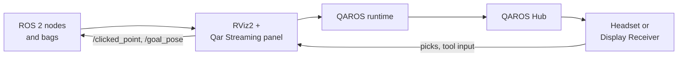
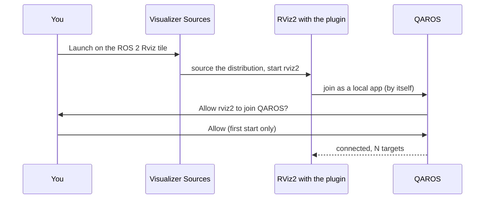

# RViz (ROS 2)

## What you get

Your ROS 2 system in AR: the live RViz2 scene from each viewer's own pose, RViz panels, AR tools from the ROS 2 graph, image topics as video, and headset picks published to ROS 2.

| | Version |
|---|---|
| `qar_rviz_streaming` plugin | 0.3.0 |
| ROS 2 | Humble (prebuilt and checked). Jazzy and Linux do not build yet. |
| QAROS | 0.9.0 or newer. Install from the Visualizer: 0.10.0. |
| OS | Windows 11 x64 |

Full reference (every tab, environment variables, log messages): [Running the RViz2 Plugin on Windows](../../operator-guide/rviz2-plugin.md).

## Install

- **ROS 2 Humble** with a working `rviz2`. QAROS does not repair a broken distribution: see the [repair scripts](https://github.com/Quaternar/qaros-ros-rviz/blob/main/docs/TROUBLESHOOTING.md).
- **Qt 5.15** (msvc2019_64): the Windows distribution ships none. QAROS looks in `QAR_QT_ROOT`, `Qt5_DIR`, a `qt` folder beside the distribution, its pixi environment, `C:\Qt`.
- **The plugin, from the Visualizer (recommended):** open the **ROS 2 Rviz** tile, press **Install** (later **Update**).
  - QAROS downloads the [release](https://github.com/Quaternar/qaros-ros-rviz/releases/latest) for that distribution and checks its SHA-256.
  - It unpacks it for your Windows user, without administrator rights.
- **By hand:** build and register it as in [INSTALL.md](https://github.com/Quaternar/qaros-ros-rviz/blob/main/docs/INSTALL.md). Your registered build shows as **Detected** and wins over a download.

## Connect to QAROS

- **Detection:** one tile per distribution, for example **ROS 2 Rviz (Humble)**.
  - QAROS looks in `AMENT_PREFIX_PATH`, `C:\opt\ros\*`, `C:\dev\ros2_*`, `C:\pixi_ws\ros2-windows`.
  - A folder counts when it has `local_setup.bat` or `setup.bat`, and `rviz2.exe`.
- **Not found:** a greyed-out **ROS 2 Rviz** row with **Locate...**.
  1. Press **Locate...** (or **Add ROS installation...** in the Apps heading).
  2. Pick the distribution folder, with its setup script and rviz2.
  3. Every **Refresh** searches it from then on. See [Locating an app QAROS did not find](../../operator-guide/source-applications.md#locating-an-app-qaros-did-not-find).
- **Start it:** click the tile, press **Launch**. With plugin 0.3.0 the panel joins by itself; an older plugin needs **Connect to QarOS** on the **Connection** tab.
- **Allow it once:** click **Allow** within 120 s ([Approved local apps](../../operator-guide/source-applications.md#approved-local-apps)).
  - Until then the panel reads *waiting for approval in the QAROS Hub*.
  - `rviz2.exe` is not code-signed: QAROS asks again after RViz2 is updated or replaced.
- **Several distributions:** each gets its own tile. For another configuration: **...** > **Duplicate as new preset**, then change **Executable** or arguments (Developer UI mode).

<!-- Screenshot needed: ROS 2 Rviz tile editor with Install / Launch (QAROS running). -->
<!-- Screenshot needed: RViz2 with the Qar Streaming panel, Connection tab connected. -->

## First session

1. **Open a target.** A paired headset, or a Display Receiver (**Add receiver** in the Visualizer). A fresh Visualizer has no receiver: RViz has nothing to stream to until you add one.
2. **Check the panel.** It reads *QarOS: connected (local app) - N target(s)*.
3. **What you see:**

   | In the room | Does |
   |---|---|
   | The RViz2 scene in a 10 m app volume *RViz Scene* | Follows your own pose, not the RViz camera |
   | **QAR control** panel, about 1 m ahead | Pick mode (**Off** / **Point** / **Nav goal**), **Confirm pick**, **Cancel pick**, panel and tool switches |
   | **Displays (AR)** and other RViz docks | Real RViz widgets: clicks in AR reach them. Add more on the **AR panels** tab, **Stream panel to AR**. |
   | Video panels | Image topics, up to 30 fps |

4. **Pick.** Choose a mode, point in the headset, confirm. Points go to `/clicked_point`, goals to `/goal_pose`, initial poses to `/initialpose`.
5. **AR tools.** **AR tools** tab > **Add from ROS graph...**. Publishing stays off until **Allow publishing from AR**; **Publish** and **Send goal** need a second press.
6. **Move and scale** the scene with the usual app volume gestures ([Moving and scaling app volumes](../working-in-a-session.md#moving-and-scaling-app-volumes)).

<!-- Screenshot needed: RViz scene and QAR control panel on a Display Receiver (QAROS running). -->

## Tips and limits

- Several headsets: lower **Resolution** (default 1280x720) and **FPS cap** (default 60) on the **Settings** tab. At most 8 targets.
- AR tool pages are plain HTTP on a random port. If a headset cannot load them, pin it with `QAR_PANEL_WEB_PORT` and allow it in the firewall.
- RViz2 joins the Hub of its own PC only.
- RViz2 may crash when it closes (known issue).

## Troubleshooting

| Problem | Fix |
|---|---|
| The tile says Qt was not found | Install Qt 5.15 or set `QAR_QT_ROOT`, then **Refresh**. |
| Stuck on *waiting for approval* | Click **Allow** in the QAROS prompt or under **Sources** > **Waiting for approval**. |
| RViz2 dies on connect, `SEH FAULT` in `qar_library_init` | C++ runtime next to rviz2 too old: run the repository's `fix_old_vc_runtime.ps1`. |
| Connected, no targets, nothing streams | Open a headset or click **Add receiver** in the Visualizer. |
| Only the grid shows | Nothing is published: start your nodes or play a bag. |
| *This program does not match what was approved* | Revoke it under **Approved apps**, start RViz again. |
