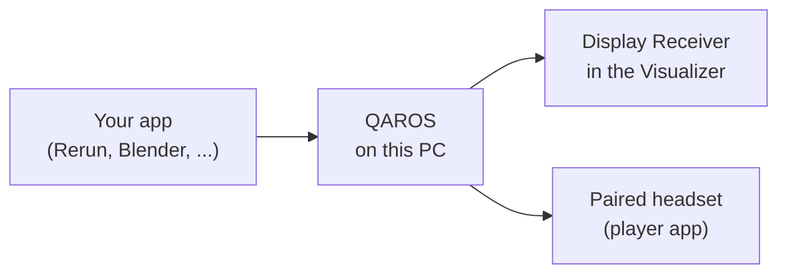

# Before You Start: Start QAROS and Add a Receiver

A streamed app needs somewhere to show. A fresh QAROS has none: no headset has joined and the Visualizer has no receiver, so an app you start streams to nobody, and you see nothing. Do these steps first, before any supported-app tutorial. About 2 minutes.

You need one of the two on the right: a **Display Receiver**, which shows the stream in a tab of the Visualizer on this PC, or a **paired headset** running the QAROS player app. A receiver is the quickest way to check that streaming works.

## 1. Start QAROS

1. Click **Start**, type `QAROS` and open **QAROS**. (It also starts by itself when you sign in to Windows, unless you turned that off.)
2. The QAROS icon appears in the notification area (the tray) at the bottom right of the taskbar. Starting it takes a few seconds.
3. Left-click the tray icon if the Visualizer does not open by itself. The tray menu (right-click) has **Open visualizer** too.

The Visualizer opens only once QAROS runs. If something is wrong, the tray shows a **QAROS Hub** window that says what instead ([Running the Hub](../../operator-guide/running-the-hub.md)).

## 2. The Visualizer

- The **left rail** opens the panels: **Session** (devices, rooms, hubs), **View**, **Sources** (the apps you start: Rerun, Blender, ...), **Controls**, **Content**, **Tools** and **Settings**.
- The main area shows the **Stream Graph**: which app streams to which target.
- At the bottom of the **Stream Graph** is the **Receivers** strip.

A fresh Visualizer says *No target app is receiving a stream yet* and the strip has no receiver:

## 3. Add a receiver

1. In the **Receivers** strip at the bottom of the **Stream Graph**, click **+ Add receiver**.
2. A pill **Display Receiver 1** appears in the strip, and a tab of the same name opens next to **Stream Graph** and **Logs**. QAROS starts the receiver by itself; there is no second click.

   

3. Click the **Display Receiver 1** tab to see what it receives. It stays empty until an app streams.

**View** in the left rail > **Hub Display** > **Add receiver** adds a receiver too. On the pill, the pause button pauses it, the eye reopens its tab, the trash removes it. Closing its tab does not stop the receiver.

## 4. Check that it works

| Where | Working | Not yet |
|---|---|---|
| The receiver's pill | green dot | another colour: hover the pill for its state; the play button retries a receiver that failed |
| The **Stream Graph** | *1 of 1 targets are showing your apps*; under **TARGET**, **Display Receiver 1**, **Showing**, with a delay and a frame rate | *No target app is receiving a stream yet* |
| The **Display Receiver 1** tab, once an app streams | the app's content in its box (its app volume) | empty |

Once your app streams, it shows under **SOURCE APPS** in the **Stream Graph**, and in the receiver's tab.

## Or: use a headset

1. Pair the headset with this QAROS once: **Session** > **Devices** > **Pair headset** ([Pair a Headset](../../operator-guide/visualizer-tutorials/pair-a-headset.md)).

   

2. Start the QAROS player app on the headset. It joins by itself and shows under **TARGET** in the **Stream Graph**, like a receiver.

A headset and a receiver work side by side: each gets its own picture of the same room.

## Next

Pick your app:

- [Rerun](./rerun.md)
- [Blender](./blender.md)
- [RViz (ROS 2)](./rviz.md)
- [3D Slicer](./3d-slicer.md)

More about receivers and 3D displays: [Stream to a 3D Monitor](../../operator-guide/visualizer-tutorials/stream-to-a-3d-monitor.md).
