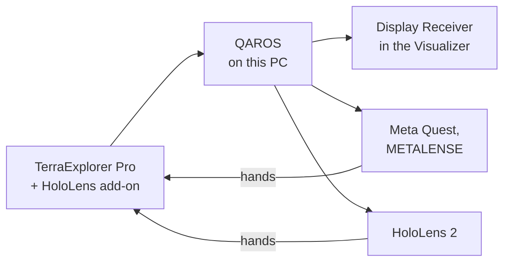

# TerraExplorer

Stream the map of [Skyline TerraExplorer Pro](https://www.skylinesoft.com/) onto a table in the room: the terrain and the city models lie in a box you can walk around, a control panel floats beside it, and you pan and zoom the map with your hands. This tutorial starts with TerraExplorer and its HoloLens add-on already installed, and QAROS not yet installed. About 15 minutes, no code.

You will:

- install QAROS, from the add-on's panel or by hand;
- start QAROS and add a receiver;
- start streaming from TerraExplorer;
- connect a Meta Quest, a METALENSE or a HoloLens 2;
- move and zoom the map with your hands, and use the controls panel.

The screenshots show TerraExplorer Pro **8.1** with the HoloLens add-on that bundles QAROS **0.10.0**.

## Before you start

| | Needed |
|---|---|
| TerraExplorer | **TerraExplorer Pro 8** with a valid licence, on Windows x64 |
| HoloLens add-on | installed in TerraExplorer (the `HoloLens.tez` package). It adds the **XR Headset** button to the **Tools** tab |
| A project | any project open in TerraExplorer. The add-on's button is greyed out until one is loaded |
| Viewer | a Display Receiver in the QAROS Visualizer, or a headset with the QAROS player: Meta Quest, METALENSE or HoloLens 2 |
| Network | the PC and the headsets on the same network; 5 GHz Wi-Fi for Quest and METALENSE |

You start TerraExplorer yourself, as you always do. QAROS does not start it for you, and TerraExplorer has no tile in the Visualizer's **Sources**.

## How it fits together

- The **HoloLens add-on** is the panel you open in TerraExplorer. It connects TerraExplorer to QAROS, picks which device gets the stream, and invites headsets.
- The add-on carries a QAROS installer, so it can install or update QAROS on this PC for you.
- TerraExplorer keeps drawing its own map. The headset you select sends its hands back, and TerraExplorer moves the map with them.

## Step 1: Install QAROS

The add-on package contains the QAROS setup, `QAROS-Setup-<version>.exe`. Install it one of two ways.

| Way | Use it when |
|---|---|
| [1. From the XR Headset panel](#way-1-from-the-xr-headset-panel) | Usually. The panel says whether QAROS is missing or older than the one in the add-on |
| [2. By hand from the add-on package](#way-2-by-hand-from-the-add-on-package) | You install QAROS before anyone opens TerraExplorer, or on a PC where you cannot open it |

Installing QAROS needs administrator rights on the PC: Windows asks for them.

### Way 1: From the XR Headset panel

1. Start TerraExplorer and open a project.
2. Open the **Tools** tab and click **XR Headset**.

   

3. The **XR Headset** panel opens. It compares the QAROS on this PC with the one in the add-on and shows the result at the top:

   | QAROS on this PC | **QAROS Hub** | Message | Button |
   |---|---|---|---|
   | not installed | **Not installed** | *QAROS is not installed on this PC. Install it to connect TerraExplorer.* | **Install QAROS** |
   | older than the add-on's | **Connecting**, then **Connected** | *A QAROS update is available (installed &lt;version&gt;), bundled &lt;version&gt;. The QAROS setup closes TerraExplorer: save your project first, then start TerraExplorer again after the setup.* | **Update QAROS** |
   | the same or newer | **Connecting**, then **Connected** | none | none |

4. Click **Install QAROS** (or **Update QAROS**, or **Reinstall QAROS**). A message says that TerraExplorer must be closed to install or update QAROS. Save your project first, then click **OK** (**Cancel** changes nothing). The QAROS setup starts and TerraExplorer closes. Windows asks for administrator approval: click **Yes**.
5. The QAROS setup opens. Follow it to the end.
6. When the setup has ended, start TerraExplorer again and open the panel: **Tools** › **XR Headset**. QAROS loads from the updated install, and **QAROS Hub** at the top changes to **Connected** (after you allow TerraExplorer in [Step 3](#step-3-open-the-xr-headset-panel-and-allow-terraexplorer)).

- The offer never holds TerraExplorer back. With an older QAROS, TerraExplorer connects and streams with it; the **Update QAROS** button stays until you update.
- **If QAROS cannot be unloaded:** when TerraExplorer still holds a QAROS file, the panel stays open, names the file and starts no setup. Save your project, close TerraExplorer and run the QAROS setup by hand ([way 2](#way-2-by-hand-from-the-add-on-package)).
- The same button is also in the panel's settings: click the gear, then **Install**. It reads **Install QAROS**, **Update QAROS** or **Reinstall QAROS**, with the installed and the bundled version.

The add-on finds the setup inside its own folder and reads the version from the file name, `QAROS-Setup-<version>.exe`. Nothing else is downloaded.

### Way 2: By hand from the add-on package

A `.tez` add-on package is a ZIP file. The QAROS setup is inside it.

1. Copy `HoloLens.tez` and rename the copy to `HoloLens.zip` (or open it with 7-Zip).
2. Unzip it. Inside is the folder `HoloLens\prerequisites\` with exactly one file, `QAROS-Setup-<version>.exe`, for example `QAROS-Setup-0.10.0.exe`.
3. Run `QAROS-Setup-<version>.exe` and follow the setup. To update a QAROS that TerraExplorer uses, close TerraExplorer first, or use the panel, which unloads QAROS for you ([way 1](#way-1-from-the-xr-headset-panel)).

If the add-on is already installed, the same file is in its installed folder: `%APPDATA%\Skyline\TerraExplorer\Add-ons\HoloLens\prerequisites\`. Paste that path into the File Explorer address bar.

## Step 2: Start QAROS and add a receiver

Follow [Before You Start: Start QAROS and Add a Receiver](./start-qaros-and-add-a-receiver.md): start QAROS, open the Visualizer, and add a **Display Receiver** (**+ Add receiver** at the bottom of the **Stream Graph**), or start the player app on your paired headset.

In short:

1. Click **Start**, type `QAROS` and open **QAROS**. Its icon appears in the notification area; left-click it to open the Visualizer.
2. At the bottom of the **Stream Graph**, click **+ Add receiver**. **Display Receiver 1** appears, with a green dot.

A receiver shows the stream on this PC, so you can check everything before you put on a headset. If QAROS is not running when TerraExplorer connects, TerraExplorer starts it, but without a receiver or a headset there is nothing to stream to.

## Step 3: Open the XR Headset panel and allow TerraExplorer

1. In TerraExplorer, **Tools** › **XR Headset** (if the panel is not open yet).
2. The first time, QAROS asks: **Allow Skyline® TerraExplorer® to join QAROS?** It shows the publisher (Skyline Software Systems, Inc), the program and *Valid Windows signature*. Click **Allow** within 2 minutes. QAROS remembers **Allow** for your Windows user, so it asks only once.

   

3. The panel shows **QAROS Hub: Connected**, and under **Target Devices** every receiver and headset that can show TerraExplorer, for example **Display Receiver 1**, *QAROS Hub Display*, *Ready to connect*.

   

Approved apps are listed, and can be revoked, in the Visualizer: [Approved local apps](../../operator-guide/source-applications.md#approved-local-apps).

## Step 4: Start streaming

1. Under **Target Devices**, select the device with its round button. It is the one that gets the controls panel and moves the map with its hands.
2. Click **Connect** on its row. The button turns into **Disconnect**, the square next to it turns green, and the row reads *Streaming from TerraExplorer*.

   

3. In the Visualizer, the **Stream Graph** lists **TerraExplorer** under **SOURCE APPS**, and the target reads **Showing**.

   

4. Open the **Display Receiver 1** tab. The map lies on a table, 2 × 2 m by default, inside a box labelled **TerraExplorer**, with the **TerraExplorer controls** panel next to it.

- **Disconnect** stops only the TerraExplorer stream to that device.
- The **⋮** menu on a row has **Stop target app**: it closes the player on that device and every stream to it, after you confirm.

## Step 5: Connect a headset

Each headset runs the **QAROS player**. Install it once per headset ([Settings: install the player on a device](#settings-install-the-player-on-a-device)), then connect it as below. Once it is connected, it shows under **Target Devices**: select it and click **Connect**, as in Step 4.

### Meta Quest or METALENSE: scan the QR code

1. Put on the headset and start the **QAROS player**. While it has no QAROS to join, it shows the connection prompt: *Scan the connection QR code or enter in QAROS*.
2. In the XR Headset panel, click **Invite other headsets**. The QAROS Visualizer opens its **Pair Headset** dialog with a QR code.

   

3. If the PC has several networks, pick the one the headset is on in **Network**.
4. Look at the QR code with the headset. Each code works once and for 60 seconds; while the dialog is open, a fresh one replaces it before it expires. The dialog closes once the headset has used it.
5. The headset joins QAROS and appears in the panel under **Target Devices**.

If the headset cannot scan the code, type the **Address** and the 6-digit **Pairing code** the headset shows into the same dialog and click **Pair**. More ways, such as pairing over USB: [Pair a Headset](../../operator-guide/visualizer-tutorials/pair-a-headset.md).

A paired headset joins again by itself next time: start the player, and it is listed.

### HoloLens 2: invite by IP address

A HoloLens does not scan a pairing code. You invite it by its address from the panel.

1. On the HoloLens, start **QAROS Player**. Allow the **camera** and **eye tracking** when it asks, and note the IP address it shows (also under **Settings** › **Network & Internet** on the HoloLens).
2. In the XR Headset panel, under **Invite HoloLens by IP address**, type the address, for example `192.168.1.50`. The **Invite** button becomes active once the address is complete.

   

3. Click **Invite**. The button reads **Inviting...** for up to a minute.
4. The HoloLens appears under **Target Devices**. Select it and click **Connect**.

- The **▾** button next to the address lists the addresses you invited before. The **×** clears the field.
- The first connection can take a while. If the HoloLens does not show *Receiving...* within about 60 seconds, restart it and invite it again.

### Anchor the headsets on the table

Every headset needs to know where the table is. Click **Show anchoring QR** in the XR Headset panel: the Visualizer opens **Room Origin** with the room's anchoring code.

1. Print the code (**Print**) and lay it where the table should be, or show it on a monitor (**Calibrate...** makes it the right size).
2. Look at the code with each headset until it has anchored. The map then stands on the code.

Details: [Scene Origin: Anchor Several Devices Together](../../operator-guide/visualizer-tutorials/scene-origin-and-rooms.md).

## Step 6: Use your hands and the controls panel

The device you selected under **Target Devices** controls the map. Other devices watch the same map.

| Do | With |
|---|---|
| Pan the map | pinch with thumb and index finger and drag, one hand |
| Zoom | pinch with both hands, then move the hands apart (zoom in) or together (zoom out) |
| Point | a white ray from your hand: dotted while you aim, solid while you pinch |
| Use the panel | point at the **TerraExplorer controls** panel and pinch to press |

The panel shows the same help: *Move the map by pinching and dragging with your thumb and index finger. Pinch with each hand, then move hands together to zoom out or apart to zoom in.*

The **TerraExplorer controls** panel, 1 × 1 m, has five tabs:

| Tab | What it has |
|---|---|
| **Main** | the map tools: move the map, place a location marker, draw, measure a distance (**New Measure**, **Undo**, a colour) |
| **Navigate** | arrow buttons that turn and move the view |
| **Locations** | the locations of the open project |
| **Presentations** | the presentations of the open project |
| **Layers** | the project's layers, to show or hide |

- Move or resize the panel as any QAROS panel: QAROS keeps where you put it.
- The **Control Panel** switch in the XR Headset panel shows or hides it.
- Only the selected device sees the panel and moves the map. Select another device with its round button to hand over.

### The table settings

Below the devices, the XR Headset panel sets up the table:

| Setting | What it does |
|---|---|
| **Table Width**, **Table Length** | the size of the table in the room, in cm (200 × 200 by default). It is the size of the box in QAROS, both ways |
| **Map Scale** | how many metres of the world one metre of table shows, for example 1 : 1100000 |
| **Table Offset** | raises or lowers the map on the table |
| **Clip Data** | cuts the map at the table's edges |
| **Lock North** | keeps north at the same side of the table |
| **Control Panel** | shows or hides the controls panel in the headset |

## Settings: install the player on a device

The gear at the top of the XR Headset panel opens the add-on's settings. Its buttons:

| Button | What it shows |
|---|---|
| **Install** | **QAROS on this PC**: the installed and the bundled QAROS version and the **Install QAROS** / **Update QAROS** / **Reinstall QAROS** button ([Step 1](#way-1-from-the-xr-headset-panel)); below it, how to install the player on a HoloLens, with a **Set up HoloLens** button |
| **Devices** | the buttons that install the player on a headset, and the connected devices |
| **Done** | back to the main panel |

Each **Set up** button opens the QAROS Visualizer's **Set up a device** dialog for that device. The player comes with QAROS: the Android player (`.apk`) in the `devices\android` folder of the QAROS installation, the HoloLens player (`.msix`) in `devices\hololens`. Nothing is downloaded.

### Set up Meta Quest, METALENSE or Android XR

1. Turn on Developer Mode on the headset once (Meta Quest: in the Meta Horizon app).
2. Plug the headset into the PC with a USB-C data cable and power it on.
3. If QAROS asks for the Android platform tools (`adb`), click **Download platform tools** and accept Google's licence.
4. Put on the headset and allow **USB debugging**. The headset shows under **Connected over USB**.
5. Under **Install QAROS Player**, click **Install** (or **Update to** *version*). Keep **Launch after install** ticked.
6. Continue in the same dialog: **Wi-Fi on the headset** (a 5 GHz network), **Pair the headset**, **Anchor**.

Step by step: [Meta Quest and METALENSE 2: Install and Pair](../../operator-guide/visualizer-tutorials/quest-and-metalense-2.md).

### Set up HoloLens

No cable and no Device Portal: QAROS serves the player on your network.

1. Click **Show install code**. The HoloLens must be on the same network as the PC.
2. Once per HoloLens, trust the QAROS certificate: set **Code opens** to **Certificate**, scan the code with the HoloLens, and install `QAROS-Player-HoloLens.cer` under **Local Machine** › **Trusted People** in the HoloLens settings.
3. Scan the code again: App Installer opens on the HoloLens. Select **Install**.
4. Start **QAROS Player** on the HoloLens and invite it by its address ([Step 5](#hololens-2-invite-by-ip-address)).

A managed HoloLens (company-managed, App Installer turned off) installs the player through the HoloLens Device Portal instead. Both ways step by step: [HoloLens 2: Install, Invite, Start and Stop](../../operator-guide/visualizer-tutorials/hololens-2.md) and [HoloLens 2 installation](../../operator-guide/player-installation-to-device/hololens-2.md).

The **Disconnect device** button under each device in **Devices** stops the player on that device and every stream to it. To stop only the TerraExplorer stream, use **Disconnect** in the main panel.

## Stop

- **Disconnect** on a device's row stops streaming to it.
- Closing the XR Headset panel keeps the stream running; open it again from **Tools** › **XR Headset**.
- Closing TerraExplorer ends its streams. QAROS keeps running for other apps.

## Troubleshooting

| What you see | Why, and what to do |
|---|---|
| The **XR Headset** button is greyed out | No project is open. Open a project first |
| **QAROS Hub: Not installed** | QAROS is not installed on this PC: click **Install QAROS**, or install it by hand ([way 2](#way-2-by-hand-from-the-add-on-package)). The panel connects by itself afterwards |
| **QAROS Hub: Connecting** stays | Check that QAROS is running (its tray icon), and look for the *Allow ... to join QAROS?* window, possibly behind TerraExplorer |
| The panel closed and nothing else happened | The QAROS setup is starting: look for the Windows administrator prompt, possibly behind TerraExplorer. After the setup, open the panel again from **Tools** › **XR Headset** |
| *QAROS installation was cancelled at the Windows permission prompt* | Click **Install QAROS** again and answer **Yes**. Installing needs an administrator |
| You clicked **Deny** on *Allow ... to join QAROS?*, or it expired | QAROS remembers no denial: close TerraExplorer, start it again, open the XR Headset panel and click **Allow** |
| *No connected target devices.* | Nothing can show the stream yet: add a receiver ([Step 2](#step-2-start-qaros-and-add-a-receiver)) or start the player on a paired headset |
| **Connect** is greyed out | The panel is not **Connected** yet, or the device is busy. Wait for **Connected** |
| The square next to **Disconnect** is not green | Blinking red: TerraExplorer is still starting the stream, wait a few seconds. Amber: the stream is paused. Steady red: the stream failed, click **Disconnect** and **Connect** again |
| The receiver or headset shows an empty box | Check that the square next to **Disconnect** is green and that TerraExplorer still has the project open |
| The hands do not move the map | Only the device selected with the round button under **Target Devices** controls the map. Select yours |
| The Quest or METALENSE does not join after the scan | The code expired (60 s): look at the new one the dialog shows. Check that the headset and the PC are on the same network; on Wi-Fi use 5 GHz |
| **Invite** stays greyed out | The address is not a complete IPv4 address (four numbers 0-255), or the panel is not **Connected** |
| The HoloLens does not appear after **Invite** | Check the address on the HoloLens, that **QAROS Player** runs on it and that both are on the same network. On the first run, restart the HoloLens and invite it again |
| The map stands in the wrong place | The headset has not anchored. **Show anchoring QR** and look at the code again |
| Nothing happens on **Invite other headsets**, **Show anchoring QR** or **Set up ...** | These open views of the QAROS Visualizer. The panel must be **Connected**. A very old QAROS opens only the Visualizer: update QAROS |

More help: [Troubleshooting](../troubleshooting.md).
