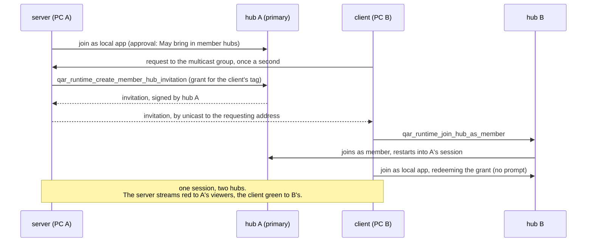

# Member hub cube

Two Vulkan apps on two PCs that show a **primary hub** and a **member hub** in one QAROS session. Each PC runs QAROS; each app streams a cube to the viewers of its own PC. The client finds the server on the network by UDP multicast: neither side types the other's address.

| App | Runs on | Does | Cube |
|---|---|---|---|
| `qar-member-hub-server` | the PC whose hub stays the **primary** | joins its hub as a local app, listens on a multicast group and answers each client that asks with a member-hub invitation | red |
| `qar-member-hub-client` | another PC | asks on the group, makes the hub of its PC a **member** of the server's primary with the invitation, joins that hub with the invitation's grant (no prompt) | green |

It is the end-to-end form of [`remote_app_onboarding.c`](../remote_app_onboarding.c) (Developer Guide, *Tutorials*, *C*, *Remote App on Another PC*), with the cube of [`vulkan_cube`](../vulkan_cube/README.md) as the content: the same renderer and shaders, the cube drawn in one color. Background: Developer Guide, *Onboarding and Sessions*, "Remote app: through a member hub".



## What it shows

- **One session, two hubs.** After the join, the peer list of either app lists the target apps of both hubs. Which targets to render for is the app's choice: `--target <text>` keeps each app to the viewers whose name contains the text, for example its own PC's Visualizer receiver.
- **The primary creates, the member joins.** Only an app on the primary's PC whose approval allows it to bring in member hubs can create an invitation; the hub of the client's PC checks the primary's signature and that it trusts that primary before it joins.
- **A grant admits one app.** The invitation carries a remote-app grant for the client's app tag: the first client executable that redeems it is approved on the primary without a prompt, and only that executable afterwards.
- **One app volume, two renderers.** Both apps ask for the app volume `member-hub-cube` ([`cube_app.hpp`](cube_app.hpp)). The common name is the volume's identity in the session, so the second app gets the volume the first one created, whichever hub it joined. Each app still renders only for its own viewers, in its own color: A's viewer shows the red cube, B's the green one, in the same place.
- **A move on one PC moves both cubes.** Move the volume, or the content in it (its app pose), in either PC's Visualizer or with a headset: the primary stores it once for the whole session, both apps print `The shared app volume is at x=... y=... z=...` (or `The cube's app pose in the shared volume is at ...`), and the cube moves on both PCs.
- **Your channel carries the invitation.** QAROS does not send it to the other PC. Here UDP multicast with [standalone asio](https://think-async.com/Asio/) carries it ([`invite_channel.hpp`](invite_channel.hpp)).

## The invitation channel is a demo

The invitation is a **bearer secret**: whoever holds it can make a hub a member of the primary until it is used or expires. This example sends it unencrypted to whoever asks on the multicast group, from an address in `--allow` when given (any address without it), and keeps it short-lived (one hub, 10 minutes). Run it only on a network you trust. A real application sends the invitation over an encrypted, authenticated channel of its own, never logs it and never puts it on a command line.

## Requirements

- Two Windows 10/11 x64 PCs with QAROS installed, on one network that passes IPv4 multicast. The member-hub calls are Windows only today; the channel is portable.
- On each PC, what [`vulkan_cube`](../vulkan_cube/README.md#requirements) requires.
- The server's PC lets the client's requests in, UDP on the group's port (default 47123):

  ```powershell
  New-NetFirewallRule -DisplayName "Member hub cube" -Direction Inbound -Protocol UDP -LocalPort 47123 -RemoteAddress <client IPv4> -Action Allow
  ```

  The client needs no rule: Windows Firewall lets a unicast answer to a multicast request in for 3 seconds, and the client asks again every second.

## Build

From the `qaros` repository root, in a **Developer PowerShell for VS 2022**:

```powershell
cmake --preset x64-windows -DBUILD_VULKAN_EXAMPLE=ON -DVCPKG_MANIFEST_FEATURES=examples-vulkan
cmake --build --preset x64-windows-release --target qar-member-hub-server qar-member-hub-client
```

- The configure downloads standalone asio (no Boost), the `asio-1-30-2` release pinned by its SHA-256, with `FetchContent`; it needs no asio installed.
- Output: `build/x64-windows/qar-streaming-c/examples/member_hub_cube/Release/`. Copy `qar-member-hub-client.exe` to the other PC.

## Run

1. **PC A**, the primary:

   ```powershell
   .\qar-member-hub-server.exe --allow <IPv4 of PC B> --target <name of A's viewer>
   ```

   On the first run QAROS asks **"Allow qar-member-hub-server to join QAROS?"**: tick **May bring in member hubs**, then click **Allow**. The app cannot preset that box; the operator decides. The console shows `Joined QAROS as peer <id>` and `Waiting for clients on 239.255.43.21:47123`.
2. **PC B**:

   ```powershell
   .\qar-member-hub-client.exe --join --target <name of B's viewer>
   ```

   The console shows `Received a member-hub invitation.`, `The hub of this PC is a member of the primary hub.` and `Joined QAROS as peer <id>`. The hub of PC B and its Visualizer restart into A's session meanwhile; nobody is asked to approve the client.
3. Open a viewer on each PC (a Visualizer receiver, a headset). A's viewer shows the red cube, B's the green one, each from the app on its own PC, in the one **Member Hub Cube** volume. In either Visualizer the hub list shows two hubs: A primary, B member.
4. Move the **Member Hub Cube** volume on one PC (Visualizer, App Volumes; or grab it with a headset): the cube moves on the other PC too, and both consoles print the new position.
5. Later starts on PC B need no server: `.\qar-member-hub-client.exe --target <name>` joins as the app approved by the first start.

- Without `--target` an app renders for every viewer in the session, on both PCs.
- On a PC with several networks, `--interface <IPv4>` picks the one to use (both apps).
- Ctrl+C stops either app; so does closing its stdin when it is a pipe (how QAROS stops an app it started).

| Option | App | Meaning |
|---|---|---|
| `--allow <IPv4>` | server | answer only this client PC; repeat for more (default: any PC that asks) |
| `--group <address:port>` | both | the multicast group (default `239.255.43.21:47123`) |
| `--interface <IPv4>` | both | the address of the network interface to use (default: the system's choice) |
| `--join` | client | first start: ask for an invitation and join the server's primary |
| `--wait <seconds>` | client | how long to keep asking (default 600) |
| `--target <text>` | both | render only for viewers whose name contains `<text>` |

| Console message | App | Exit code | What to do |
|---|---|---|---|
| `This app may not bring in member hubs...` | server | (keeps running) | revoke the server in A's Visualizer (Source Applications, Approved apps), start it again and tick **May bring in member hubs** |
| `Refused a client at <ip>: not in --allow.` | server | (keeps running) | add the client's address with `--allow` |
| `Could not join <group>...` | server | 8 | pick another `--group` or `--interface` |
| `No server answered on <group>...` | client | 8 | start the server; check `--allow` and the firewall of PC A; check that the network passes multicast |
| `The invitation can no longer be used...` | client | 9 | start the client again for a new invitation |
| `This PC does not trust the server's primary hub...` | client | 9 | the hub of PC B joined another primary before, or an administrator's allow-list leaves this one out |
| `The hub of this PC cannot reach the primary hub...` | client | 9 | check the network between the PCs |

Exit codes 2 to 7 are those of [`vulkan_cube`](../vulkan_cube/README.md#run) (QAROS missing, unreachable, the approval denied, timed out, ...); 0 follows a stop, 1 is a bad argument or any other failure.

## Files

| File | What it holds |
|---|---|
| [`server.cpp`](server.cpp) | the server: invitation with a remote-app grant, the channel thread |
| [`client.cpp`](client.cpp) | the client: ask, `qar_runtime_join_hub_as_member`, redeem the grant |
| [`cube_app.cpp`](cube_app.cpp) | shared: joining as a local app, the GPU, following the targets, one request-driven sender per target |
| [`invite_channel.cpp`](invite_channel.cpp) | the demo multicast channel (asio) |
| `../vulkan_cube/renderer.cpp`, `cube.vert`, `cube.frag` | the cube's Vulkan renderer and shaders, shared with `vulkan_cube` |
